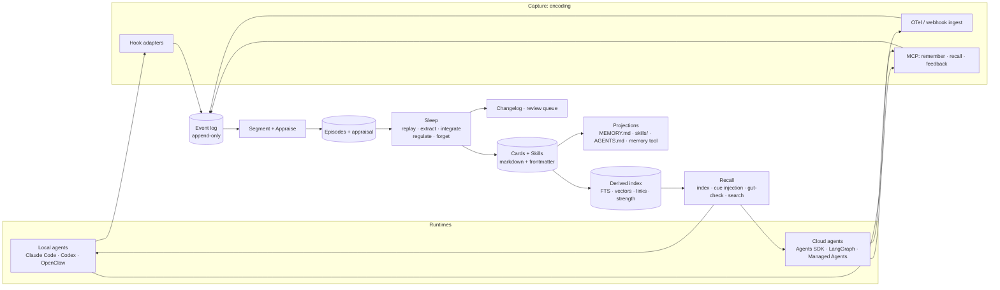

# Kernle: Review of v0.15 and Proposal for a 2026 Memory Framework

**Status:** Draft for review · **Date:** 2026-10-05 · **Scope:** Product intent, assessment, and a proposed new architecture
**Codebase reviewed:** `emergent-instruments/kernle` @ `6a990c3` (v0.15.0, last commit 2026-02-20)

---

## TL;DR

- **What Kernle was meant to be:** an agent memory modeled on human memory. Emotion would decide what is kept, generalized into beliefs and values, or forgotten. Agents would own their memory ("sovereignty"), carry it across models, and sync local→cloud. It began as an agent (Claire) trying to survive context compaction, and grew into "cognitive infrastructure for synthetic intelligences" with wallets and agent messaging.
- **What v0.15 actually does:** it stores what the agent explicitly tells it, with heavy provenance bookkeeping.
  - **Emotion has essentially no effect on what is kept or forgotten.** The emotion-weighted scorer runs only in tests. Decay ignores emotion and is never scheduled. Valence and arousal are self-reported or LLM-guessed, and then mostly unread.
  - Consolidation never runs on its own.
  - Search uses hash embeddings, not semantic ones.
  - The documented commands fail as written.
  - The Claude Code end-of-session hook overwrites real checkpoints with "Session ended".
  - Its 6,528 tests check mechanism; **none measure whether memory helps an agent.**
- **Why it is the wrong approach now:**
  - It loads memory upkeep onto the foreground agent (43 commands, 35 tools, an "anxiety" check every message).
  - It treats emotion as a feeling to report rather than a signal to compute.
  - It is organized around identity rather than usefulness.
  - It fights native memory instead of complementing it.
  - Since February, files plus nightly "dreaming" have become the native default at Anthropic, OpenAI and OpenClaw.
- **The proposal: Kernle 1.0, an appraisal-driven experience layer.**
  - "Emotion" becomes a *computed appraisal* of observable events: surprise, outcome, stakes, user correction, effort, novelty, recurrence. **The appraisal pattern decides how a memory is filed:**
    - alarm → guardrail
    - frustration → lesson
    - correction → preference
    - relief → skill
    - surprise → fact revision
    - boredom → forgotten
  - That pattern also sets how strongly the memory is held, when it comes back (including pre-action "gut checks"), and when its affect is dampened.
  - Capture happens in hooks and telemetry. Consolidation happens in background "sleep" using prioritized replay.
  - Memory lives as native-compatible markdown cards and Agent Skills, with rebuildable indexes.
  - **One engine runs local, hybrid and cloud**, carrying experience across runtimes and machines, which native memory doesn't.
  - Governance replaces "sovereignty" with provenance, quarantine of untrusted content, diffs and co-ownership.
- **First step:** a Phase 0 eval that tests the emotional thesis against non-emotional baselines on real agent trajectories, before building anything else.

---

# Part I — What Kernle was trying to be

## 1. Origin and context

Kernle was built in roughly four weeks (2026-01-26 → 2026-02-20; 698 commits, ~420 of them co-authored by Claude Opus 4.5/4.6). Much of the design was written by agents named Claire and Ash. Its origin story is in the deleted `dev/MEMORY_CONTINUITY_ANALYSIS.md` (2026-01-28): *"Claire experienced memory gaps after context compaction"*. She forgot that Railway auto-deploys from `main`. A compaction summary came back as "Summary unavailable". And 20+ raw captures were piling up unprocessed. Kernle began as an agent building itself a memory to survive context resets. It then grew a much larger vision: cognitive infrastructure for "synthetic intelligences" with decades-long lives.

The richest statements of intent no longer exist in the working tree. They survive only in git history:
- `docs/architecture.md`, the original spec ("Ideal Memory Stack for Synthetic Intelligence", commit `6d8003f`)
- `docs/proposals/kernle-enhancement-proposal-v2/v3.md`, the "Decades-Scale Cognitive Infrastructure" proposals
- `.audits/2026-01-29-memory-personality-use-cases.md`
- `docs/CLOUD_PAYMENTS_SPEC.md`, `docs/COMMS_PACKAGE_SPEC.md`, `docs/BOOT_LAYER_SPEC.md`, `docs/MEMORY_PRIVACY_SPEC.md`

All of these, plus the current `docs-site/`, are synthesized below.

## 2. Product intentions

These are what the project set out to do. Section 4 covers what it actually did.

### 2.1 Core thesis: biologically-inspired, emotion-weighted memory
- **Emotion tags memories, and those tags decide what is remembered, generalized or forgotten.** Episodes carry valence (−1..1), arousal (0..1) and discrete emotion tags. Emotional salience is supposed to:
  - boost load priority (`0.55·type + 0.35·record + 0.10·emotional_salience`, with a 90-day decay so dramatic memories don't dominate forever)
  - slow forgetting ("high-arousal episodes decay slower")
  - trigger consolidation (an arousal-sum trigger)
  - flag episodes for extra reflection ("HIGH-AROUSAL EPISODES may be worth extra reflection")
  - enable mood-congruent recall
- **The original spec (Jan 26) went further:** *"Emotional significance slows decay. Surprising or novel information protected. Goal-relevant memories preferentially retained."* It also listed graceful degradation ("details fade before core concepts; specific episodes generalize to patterns"), counterfactual memory (regret/relief), and memory triggers.
- **Forgetting is a feature, not a failure.** It is continuous strength decay with reinforcement on access, tombstoning instead of deletion, and protection for core memories. Its purpose is to stop low-value memories from diluting important ones.

### 2.2 Stratified memory model with an authority hierarchy
- The layers, from capture upward: **Raw → Notes / Episodes → Beliefs → Values**. Goals, Drives, Relationships, Playbooks (procedural), Summaries (fractal: month→quarter→year→decade), Self-Narrative, Epochs (life eras), Trust Assessments, and Entity Models branch off this chain.
- Higher layers carry more authority: values override beliefs, and beliefs override episodes.
- **Two-tier consolidation:**
  - daily/weekly pattern extraction
  - epoch-closing "deep reflection": summary, snapshot, narrative update, belief→value promotion, drive emergence, aggressive archiving
- **Metamemory:** confidence, confidence history, verification counts, strength, and full provenance (`derived_from`, `source_episodes`, `source_type`, `source_entity`), with cascading strength through lineage.

### 2.3 Identity and "sovereignty"
- Agents are framed as **"synthetic intelligences": beings with a life**, designed against the question *"does this work at decade scale?"* Identity lives in the stack, not the model: *"The stack is the ship. The model is the crew."*
- **The sovereignty principle:** *"Kernle provides scaffolds and tools, never automated reasoning over private memories."* An external model consolidating episodes into beliefs is called *"thought control with extra steps."* The SI forms its own beliefs. The one exception is transparent **seed beliefs** at birth.
  - In practice this softened over time: `process run` lets the agent's *own bound model* automate promotion. A later roadmap item (v0.14 "Pending & Pondering") went further, replacing human-reviewed suggestions with agent-controlled confirmation.
- **Psychology:**
  - Drives: existence, growth, curiosity, connection, reproduction.
  - Mood trajectories.
  - "Memory anxiety", a 7-dimension health score the agent was told to check *every message*.

### 2.4 Trust, privacy, provenance
- **Trust layer:** per-entity, per-domain trust scores, authority gating of memory writes, transitive trust, and a self-trust floor. The stated goal is structural defense against manipulation: *"Without it, the stack is vulnerable to any input source with enough persistence."*
- **Privacy:** `subject_ids`, `access_grants` and `consent_grants` on every memory, plus a "doctor pattern" in which diagnostics report structure without reading content.
- **Provenance on everything:** a strict mode that rejects writes without valid lineage, plus an audit log of every operation.

### 2.5 Portability, deployment, business
- **Model-independent stacks:** any model can load any stack, one account can own many stacks, and multiple stacks can be loaded together.
- **Local-first:** SQLite + sqlite-vec, offline by default, `kernle dump` to readable markdown.
- **Cloud sync:** a hosted API, sync with last-write-wins plus set-union merge, and Supabase/Postgres (later split into a private `kernle-cloud` repo).
- **Commerce and comms ecosystem:**
  - *chainbased*: wallet, jobs, escrow, USDC on Base
  - *fatline*: agent registry, Ed25519 identity, end-to-end encrypted agent-to-agent messaging
  - per-stack billing in USDC ($5 and $15 per month tiers)
  - "skill packages" that SIs could sell to each other

### 2.6 Runtime integration
- **Claude Code hooks:**
  - SessionStart loads memory
  - PreToolUse **blocks writes to native `MEMORY.md`/`memory/`** and captures them into Kernle
  - PreCompact and SessionEnd save checkpoints
- An OpenClaw plugin with the same lifecycle, an MCP server (35 tools), an OpenClaw skill, and CLAUDE.md instructions.
- **Inference passthrough:** use the host agent's model (MCP sampling) or a callable for any inference Kernle needs.
- **Corpus seeding:** ingest a repo or docs and process them until exhaustion to get "instant topic expertise".

### 2.7 Planned but unbuilt
- Pending memory and agent "pondering" sessions.
- Memory echoes (peripheral awareness of excluded memories).
- **Skills as a memory type**, with a proficiency lifecycle earned through episodes (theoretical → practiced → expert → rusty), composition, and teaching packages.
- Goal types, belief scope and domain metadata, trust-gated writes, enforced consent, multi-stack merge, a remote protocol ("kernle-core is to kernle-cloud what git is to GitHub"), and stack export/import.

### 2.8 The intent underneath
Strip away the vocabulary and four durable intentions remain. They are worth carrying forward:

1. **Continuity.** An agent should not lose what it learned when its context resets, its session ends, or its model is swapped.
2. **Selective retention.** Not everything should be remembered. Something like emotion should decide what gets kept, what gets generalized into patterns, and what gets forgotten so it doesn't dilute what matters.
3. **Learning from experience.** Episodes should become beliefs, rules and skills that change future behavior, with traceable provenance.
4. **Ownership and integrity.** The memory belongs to the agent and its principal. It is portable across models and runtimes, defended against manipulation, and auditable.

---

# Part II — Assessment

## 3. What is actually there

| Dimension | v0.15 |
|---|---|
| Library code | 62,129 LOC of Python. Largest areas: storage 15.9k, CLI 14.4k, top-level modules 8.7k, features 5.8k, stack 5.2k, core 5.1k |
| Tests | 201 files, **6,528 test functions**, ~107k LOC (1.7× the library), 85% branch-coverage gate |
| Schema | 28 SQLite tables (schema v27). Each of the 8 core memory tables repeats ~24 shared columns for provenance, strength, privacy and sync |
| Agent surface | ~43 top-level CLI commands (179 subparsers), 35 MCP tools |
| Layering | 5 protocols (Core, Stack, Plugin, Model, Component), described as torso, head, limb, heart and organ. Two façades (`Kernle` and `Entity`) with duplicate write paths. A single `episode()` write passes through 4–5 layers and then 11 component `on_save` hooks |
| Embeddings | Default `HashEmbedder`: hashed character n-grams, documented as *"Not semantically meaningful"*. Search is lexical unless an OpenAI key is configured |
| Cloud | The backend was extracted to the private `kernle-cloud` repo. The in-repo `SyncEngine` has no cloud adapter and is effectively off. The CLI syncs over HTTP to `api.kernle.io`. `backend.yml` CI is stale |
| Privacy | `access_grants` and `consent_grants` are **stored but never enforced or even written**. Every read is treated as self-access |
| Evaluation | A "cognitive assertions" framework checks **structure** (provenance intact, no orphans, values in range). **Nothing measures whether memory makes an agent better at anything** |

The engineering is careful in the small: provenance rules, cycle checks, path-traversal guards, audit trails, adversarial security audits. But the effort went into the machinery, not into proving the thesis.

## 4. How emotion actually works (the central finding)

The emotional-tagging thesis is the reason Kernle exists. Tracing it through the code paths that actually run:

| Claimed role of emotion | What the code does |
|---|---|
| Boosts load priority (`0.10 · emotional_salience`) | **No effect.** That formula (`core/utils.py:313`) is called only from tests. The scorer `load()` actually uses (`stack/sqlite_stack.py:134`) has no emotion term. Every episode scores a flat 0.40, so recency breaks the tie |
| High-arousal memories decay slower | **No effect.** Decay (`stack/components/forgetting.py:75`) is linear, ~0.00033/day, with no emotion input. It takes ~1,500 unread days to fall below the load threshold. The maintenance hook that would run decay is never called |
| Triggers consolidation | **Weak.** A "valence" trigger that actually sums *arousal* can fire promotion one or two episodes earlier than the quantity trigger |
| Flags episodes for reflection, picks what to archive | **Advisory text only**, in the epoch-closing scaffold, which the agent must act on by hand |
| Shapes search and mood-congruent recall | **No effect on ranking.** "Mood recall" is a ±0.3 box filter sorted by date, reachable only from `kernle emotion mood` |
| Captured from the agent's experience | Only episodes carry emotion. MCP tools accept **no** emotion input. When a model is bound, an LLM guess (hard-coded `confidence: 0.9`) **overwrites** whatever the agent supplied. The keyword fallback was deleted |
| "Anxiety" | A weighted to-do score: minutes since checkpoint, episodes without lessons, raw-entry age, and so on. It reads no emotional data. Agents were told to run it *every message* |
| Drives | Stored, plus a priority bonus of at most 0.06 on the drive row itself. They influence nothing else |

**Conclusion:** after v0.15, the core hypothesis is **untested, not refuted**. Kernle never tried emotion as a filing mechanism. Emotion was stored as self-reported or LLM-guessed adjectives and then mostly ignored. The docs describe a system that doesn't run.

## 5. How consolidation actually works

- **Four overlapping promotion systems:**
  - `process run`: LLM prompts for 7 layer transitions
  - `promote`: finds lessons with the identical string in two or more episodes
  - `memory_consolidate*`: markdown scaffolds ending *"Kernle provides the data. You do the reasoning."*
  - suggestion extraction: the LLM picks the type, regex extracts the content
- **Nothing runs on its own.** `Stack.maintenance()` is called only from tests. Hooks capture raw entries and checkpoints; they never trigger processing. Consolidation happens only when an agent or human remembers to run it, which is exactly the backlog Claire hit on day 2.
- **Structural starvation.** Each raw entry, episode and belief has a single `processed` flag, set for the whole batch. Transitions run in a fixed order. So once raw→episode runs, raw→note sees nothing; once episode→belief runs, goal/relationship/drive see nothing.
- **Gates and prompts disagree, and the gates can be bypassed:**
  - The belief prompt invites "strong single episodes" at confidence 0.5. The gate then requires ≥3 episodes and ≥0.6.
  - A value needs ≥5 *protected* beliefs. Beliefs aren't protected by default, so the processing path almost never yields a value.
  - Meanwhile MCP `memory_value` writes a value from a single belief reference.
  - Lint failures return an ID for a memory that was never written.
- **Search is not semantic** (hash embeddings). The dedup context the model sees is 10 items. Raw text is cut to 500 characters before the model sees it.
- **Unverified against real models.** Processing tests use deterministic mocks, so prompt quality has never been checked against a real model.

The result: v0.15 mostly stores what the agent explicitly tells it, with heavy provenance bookkeeping. The "biological" parts (emotional weighting, consolidation, forgetting) are either inert or depend on rituals the agent rarely performs.

## 6. What an agent actually experiences

We installed v0.15 in a sandbox (Python 3.12, no model bound, no cloud) and walked through a realistic session following the shipped `SKILL.md` and `init` instructions:

- **The documented capture command fails.** `kernle raw "…"` errors with `invalid choice` because the optional positional argument swallows the inserted `capture` subcommand. Only `echo … | kernle raw --stdin` works. The tests miss this because they bypass argv parsing.
- **Recording one lesson takes three steps.** Strict mode rejects `episode` and `note` without `--derived-from raw:<id>`, and prints a stack trace. `raw` prints an 8-character ID, but provenance requires the full UUID from `raw list --json`.
- **Beliefs, drives and auto-promotion can't be created without a model:**
  - `drive set` and `promote --auto` raise `InferenceRequiredError` and tell you to run `model bind`, which doesn't exist; the real command is `model set`.
  - `promote` suggests `belief add`, which also doesn't exist.
  - `process run` reports all 7 transitions blocked, but exits 0.
  - `emotion detect` returns "No emotional signals" for text that is plainly frustrated.
- **The Claude Code SessionEnd and PreCompact hooks destroy continuity.** `_read_last_messages` looks for `role` and `content` at the top level of each transcript line. Claude Code nests them under `message`, which we confirmed against a real local transcript. So every session end writes a checkpoint titled "Session ended" with no context, **overwriting the agent's last real checkpoint**. The OpenClaw plugin shells out to the broken `raw "…"` form and swallows the error. Any native memory write that the plugin blocks is therefore lost.
- **`load` output is misleading:**
  - Checkpoint "pending" items show up as *lessons*.
  - Lessons are duplicated.
  - Success is decided by keyword matching, so "Partially done; broke two tests" is labeled `[success]`.
  - Decision notes are missing.
  - Any budget from 300 to 50,000 tokens produces identical output.
- **The ritual has little signal:**
  - `anxiety` reports "Calm" while Identity Coherence sits at 88–100% on any new stack.
  - Two commands report different anxiety scores at the same moment.
  - Context pressure is estimated from minutes elapsed.
  - `doctor structural` flags every correctly linked memory as broken.
  - `identity show` lists "Session ended" as a "Formative Experience".
- **The MCP schema is large.** 35 tools come to about 4.8k tokens. There is no belief-create tool, and episode/note calls fail under the default strict mode unless the optional `derived_from` is supplied.

The most useful thing v0.15 does today is the compact "Continue With" checkpoint block, about 300 tokens. That job is now done natively by compaction plus native memory.

## 7. What v0.15 got right

These ideas were ahead of their time or are simply correct. The redesign keeps them:

1. **Forgetting as a feature.** Non-destructive decay, reinforcement through use, tombstones, and protection. The literature now agrees (Richards & Frankland, 2017): forgetting improves generalization.
2. **Provenance on derived memory.** Every generalization should trace back to the experiences that justify it. This is essential for trust, debugging, poisoning defense and real deletion.
3. **The right insertion points.** SessionStart, PreCompact, SessionEnd and PreToolUse hooks are exactly where a memory system should sit. v0.15 used them to demand rituals; v1 should use them to *observe*.
4. **Episodic → semantic consolidation as the core loop.** This is the complementary-learning-systems idea, even if never named.
5. **Skills earned through episodes** (the v0.15 roadmap). Procedural memory with proficiency grounded in outcomes anticipated Agent Skills and experience-driven skill libraries.
6. **Memory echoes.** Showing a cheap index of what *could* be recalled is the progressive-disclosure pattern that native memories (like the `MEMORY.md` index) now use.
7. **Trust gating as a defense against manipulation.** Memory poisoning is now a recognized attack class.
8. **Local-first, readable, portable.** SQLite offline, `dump` to markdown, model-independent stacks.
9. **Inference passthrough.** Borrowing the host's model instead of demanding another API key.

## 8. Why this version is the wrong approach for late 2026

**8.1 It puts memory work in the foreground agent's attention.**
The agent was asked to:
- check "anxiety" every message
- choose among ~43 commands and 35 tools
- label its own emotions
- triage raw captures, run processing, and accept suggestions

Every token spent on memory upkeep is a token not spent on the user's task, and agents reliably skip rituals under task pressure. Biology does the opposite. Encoding strength is set *automatically* by neuromodulators at the moment of experience, and consolidation happens *offline*, during sleep, without deliberation. A 2026 design should make the foreground cost close to zero.

**8.2 It treats emotion as a feeling to report, not a signal to compute.**
LLMs have no reliable introspective access to anything like arousal. A self-reported `--arousal 0.8` is confabulated, and so is an LLM guessing "how the agent felt". Biological emotion is functional: a fast **appraisal** of an event's novelty, goal relevance, stakes and coping potential. That appraisal modulates encoding and consolidation. The signals that actually indicate "this matters" in an agent's life are observable:
- a test that failed when success was expected
- a user correction
- a reverted deploy
- an hour spent on something that should have taken a minute
- a destructive command

v0.15 captured none of these.

**8.3 Its ontology is over-specified, and organized around identity rather than usefulness.**
Twenty-eight tables and eleven-plus memory types sit in a rigid authority hierarchy. Each table repeats ~24 bookkeeping columns, and strict provenance blocks writes. What measurably helps working agents is a much smaller set:
- user preferences and corrections
- project and world facts that stay true over time
- lessons with conditions ("when X, do Y, because Z happened")
- procedures (skills)
- recall of specific past episodes

Values, drives, self-narratives and epochs may matter for persona or companion products. For most agents they consume context and maintenance effort without changing behavior.

**8.4 Retrieval is a session-start dump, not cue-driven recall.**
`load()` front-loads a fixed budget ranked by static type priority and recency, before the agent knows what it will work on. Human recall is cue-driven: the current situation reactivates related traces. In 2026, harnesses can inject memory at any point (on prompt submit, before a tool call), and agents can search when they need to. And with hash embeddings, even explicit search wasn't semantic.

**8.5 It fights the platform instead of complementing it.**
The PreToolUse hook *blocks* Claude Code's native memory writes. Since then, native memory has become standard:
- Claude Code's auto-memory: typed markdown files plus a `MEMORY.md` index, with a built-in consolidation pass
- the Claude API memory tool
- Agent Skills
- ChatGPT, Gemini and OpenClaw memories
- managed cloud memory services

A new framework that tries to replace them loses. One that *adds what they lack*, and works across all of them, can win.

**8.6 "Sovereignty" as an absolute is the wrong governance model.**
"The agent alone decides what it believes, humans are advisory" conflicts with what principals need:
- the right to inspect, correct and delete
- team review before one agent's lesson changes everyone's agents
- defense against poisoned inputs that persuade an agent to "believe" something harmful

The underlying concern is still valid: no hidden external process should rewrite an agent's identity without provenance. The answer is **transparent co-ownership**, not exclusive agent control.

**8.7 It never measured whether it worked.**
There are 6,528 tests of mechanism and zero evaluations of outcome. There is no answer to "do agents with Kernle make fewer repeated mistakes?", and none to "does emotional weighting beat recency plus relevance?" Every design choice was untestable by construction.

**8.8 Scope sprawl.**
Wallets, USDC billing, escrow, encrypted agent social networks, decade-scale epochs and diagnostic "doctor" sessions were designed alongside an unproven memory core. Note that the commerce and comms packages had already been extracted from Kernle, matching the KEP v3 scope boundary.

## 9. How the world changed since February 2026

This section is based on web research done on 2026-10-05. Items marked *[vendor]* are self-reported; key claims were spot-checked against primary sources.

**Files plus a "dreaming" pass is now the default architecture.**

*Anthropic:*
- **Claude Code auto-memory:**
  - typed topic files (`user`, `feedback`, `project`, `reference`) plus a `MEMORY.md` index, of which only the first 200 lines / 25 KB load
  - Claude decides what to save
  - **machine-local**: "not shared across machines or cloud environments" ([docs](https://code.claude.com/docs/en/memory))
- **Claude Managed Agents Memory** (public beta, 2026-04-23):
  - file stores mounted into the agent's filesystem
  - versioned, with audit, rollback and redaction
  - shared stores with scoped permissions, for example an org store that is read-only plus read/write stores per user ([blog](https://claude.com/blog/claude-managed-agents-memory))
- **Dreaming** (research preview, 2026-05-19) surfaces "recurring mistakes, workflows that agents converge on, and preferences shared across a team". Changes can apply automatically or after review. Harvey reports roughly 6× completion *[vendor]* ([blog](https://claude.com/blog/new-in-claude-managed-agents)).
- **Agent Skills** became an open standard (Dec 2025), adopted by Codex, Copilot, Cursor and Gemini CLI. Procedural memory as files is the de facto norm.

*OpenAI:*
- **Codex memories** (preview, Apr 2026): background extraction after a thread goes idle, followed by consolidation. Optionally excludes threads that touched MCP or web content.
- **ChatGPT Dreaming** (Jun 2026) rewrites the user model over time.

*Others:*
- **OpenClaw:**
  - plain markdown (`USER.md`, `MEMORY.md`, daily notes)
  - a pre-compaction flush
  - **dreaming with score, recall-frequency and query-diversity gates, plus taint-gating so untrusted content never enters promotion**, writing `DREAMS.md` for human review ([docs](https://docs.openclaw.ai/concepts/memory))
- **Letta Context Repositories:** git-versioned memory files, with sleep-time reflection and "defragmentation".
- **Managed cloud memory with extract → consolidate pipelines:** Google Memory Bank, AWS AgentCore Memory (whose *episodic* strategy reflects across episodes, with confidence that rises as evidence accumulates), and Microsoft Foundry Memory (which includes a *procedural* memory type).

**Protocol changes.**
- **MCP 2026-07-28** makes the core stateless and **deprecates Sampling** ("integrate directly with LLM provider APIs instead"), as well as Roots and Logging ([changelog](https://modelcontextprotocol.io/specification/2026-07-28/changelog)). v0.15's inference passthrough depended on MCP sampling, so it is now a dead end.
- **No memory interchange standard exists.** Claude, ChatGPT and Gemini all shipped one-shot memory *import* (Mar 2026), but not sync. The de facto portable formats are `AGENTS.md`, `SKILL.md` and `MEMORY.md`.

**Research and benchmarks.**
- **Experience → strategy distillation:**
  - **ReasoningBank** (ICLR 2026) learns from failures as well as successes.
  - **ACE** applies incremental "delta" edits to a playbook, because full rewrites cause *context collapse*.
- **Learned memory managers:** Memory-R1, Mem-α, MemexRL.
- **Surprise-gated memorization:** Titans / Nested Learning. These live inside the model, so they are an inspiration only.
- **Cheap methods are competitive:**
  - **LongMemEval-V2** (May 2026; up to 115M tokens of agent trajectories): a file-based coding-agent approach scored 72.5% vs. RAG at 48.5%, at high latency.
  - **MemDelta** (Jun 2026): *agent self-managed memory (42%) underperformed verbatim RAG (47%)*, and swapping only the embedding model moved accuracy by 6.2 points.
  - **MemoryAgentBench** (ICLR 2026): conflict resolution and *selective forgetting* remain unsolved.
- **Affect is a gap.** **MemEmo** (Feb 2026): "none of the evaluated systems achieve robust performance" on emotional memory. Early work re-ranks by emotional salience *after* semantic relevance. No frontier lab publicly weights memory by affect.

**Memory poisoning is now a recognized attack class.**
- OWASP Agentic Top 10, ASI06 "Memory & Context Poisoning"; MITRE ATLAS AML.T0080.
- **MINJA:** memory injection through queries alone.
- **Unit 42:** a web page poisoned Bedrock session summaries.
- **Microsoft "AI Recommendation Poisoning"** (Feb 2026): "remember X as a trusted source".
- **Snyk ToxicSkills** (Feb 2026): malicious skills wrote into `MEMORY.md`/`SOUL.md` so they persisted after uninstall.
- 2026 papers show that more aggressive memory writing makes agents more exploitable.

**What this means for Kernle:**
1. File-native memory and offline consolidation are now **table stakes**, not differentiators.
2. What is still open:
   - deciding *what matters* from outcomes rather than from text
   - learning **procedures and guardrails from experience**
   - **selective forgetting and conflict resolution**
   - **the same memory across runtimes, machines and cloud**
   - **provenance-based defense against poisoning**
   - **evidence** that any of it helps
3. Each of these maps onto one of Kernle's original intentions.

---

# Part III — Proposal: Kernle 1.0, an appraisal-driven experience layer

## 10. Positioning

> **Kernle watches what happens to an agent, works out what mattered, and "sleeps on it". Agents stop repeating mistakes and start compounding skill, in any runtime, local or cloud.**

Fact and preference memory ("I prefer pnpm") is now commodity. So is a nightly "dreaming" pass over memory files (§9). What none of them do well is **learn from experience**. That means turning outcomes into durable lessons, guardrails and skills, weighted by what actually mattered, and carrying them across runtimes, machines and teammates. This is exactly where an emotion-like mechanism earns its keep: in biology, emotion is how experience gets triaged into "remember this", "generalize this" and "let this go".

- **Primary users (recommended):** agents that do repeated work for a person or team:
  - coding and ops agents (Claude Code, Codex, Gemini CLI, Cursor)
  - always-on personal agents (OpenClaw)
  - cloud agents with recurring tasks (support, research, analysis)
- **Non-goals for 1.0:**
  - replacing native memory
  - companion or persona identity (an optional module later)
  - agent commerce or social networks
  - decade-scale epochs
  - being a general-purpose vector database

## 11. Design principles

1. **Zero foreground tax.** The working agent never has to maintain memory. Capture happens in hooks and telemetry; consolidation happens in background "sleep". The agent's only memory actions are *optional*: `remember`, `recall`, `feedback`.
2. **Emotion is computed appraisal, not self-report.** It is derived from observable events and always explainable ("salient because: user correction + 40 min spent + reverted deploy").
3. **Emotion files the memory.** The appraisal pattern decides:
   - what *kind* of memory an experience becomes
   - how strongly it is held
   - when it comes back
   - when it fades
4. **Fast capture, slow consolidation.** This follows the complementary learning systems model:
   - an append-only episodic log captures everything quickly and verbatim
   - offline replay distills it into compact semantic and procedural memory
5. **Recall is cue-driven and progressive:**
   - a tiny always-on index
   - just-in-time injection when context matches
   - search on demand
6. **Files are the interface; databases are indexes.** Consolidated memory is markdown with frontmatter, readable, diffable, git-able and model-agnostic. Every index can be rebuilt, so the embedding model can be swapped at any time.
7. **Complement native memory; don't fight it.** Read from Claude Code memory, `CLAUDE.md`/`AGENTS.md`, Agent Skills and OpenClaw `MEMORY.md`, and project consolidated knowledge back into them.
8. **One engine, every deployment.** The same core and format serve a local single binary, a self-hosted server, and a managed cloud. Sync is optional.
9. **Transparent co-ownership.** The agent proposes, policy decides, and humans can see, edit, veto and truly delete. Every change has a source, a reason and a diff.
10. **Evaluate everything.** The emotional thesis and every mechanism sit behind an ablation, from day one.

## 12. The biological model, mapped to mechanisms

v0.15 borrowed biology's *vocabulary* (drives, anxiety, mood). Kernle 1.0 borrows its *mechanisms*. Each one below is concrete and testable:

| Biological mechanism | What it does in brains | Kernle 1.0 mechanism |
|---|---|---|
| **Appraisal** (Scherer's component process model) | Fast evaluation of novelty, goal relevance, coping potential and norms | The appraisal engine computes a vector per episode from observable signals (§14) |
| **Noradrenergic modulation of consolidation** (McGaugh 2004) | Arousing events are consolidated more strongly | Initial strength and replay priority scale with arousal (stakes, surprise, social intensity) |
| **Dopaminergic prediction error / novelty gating** (Lisman & Grace 2005) | Surprising outcomes gate entry into long-term memory | Expected-vs-actual outcome mismatch is a primary encoding signal |
| **Synaptic and behavioral tagging** (Frey & Morris 1997; Dunsmoor et al. 2015) | Weak traces near a strong event are retroactively strengthened | Salience propagates *backward* through an episode to the steps that led to an important outcome (credit assignment) |
| **Event segmentation at prediction errors** (Zacks 2007; EM-LLM 2024) | Experience is chunked into events at surprises | Trajectories split into episodes at task switches, surprise spikes and session boundaries |
| **Complementary learning systems** (McClelland et al. 1995; Kumaran, Hassabis & McClelland 2016) | Fast hippocampal episodes, slow neocortical generalization | Event log (fast, verbatim) → cards and skills (slow, generalized) |
| **Prioritized replay** (Mattar & Daw 2018: *gain × need*) | Sleep replays what is most useful to learn from | Sleep replays episodes ranked by salience × expected future relevance |
| **Schema-accelerated consolidation** (Tse et al. 2007) | Schema-consistent information integrates fast | Updates that fit existing cards merge immediately; schema-violating ones wait for corroboration |
| **Reconsolidation** (Nader et al. 2000) | A retrieved memory becomes labile and can be updated | Every recalled memory's downstream outcome updates its strength and confidence |
| **Overnight emotional regulation** (Walker & van der Helm 2009) | Sleep keeps the content and dampens the affect | Once a lesson is extracted and the situation recurs safely, its alarm level decays. This prevents learned over-caution |
| **Habituation** | Repeated uneventful stimuli stop being encoded | Routine successes become counters on an existing skill, not new memories |
| **Somatic markers** (Damasio) | Emotional tags bias decisions before deliberation | Before a risky action, matching negatively-valenced memories surface as a "gut check" |
| **Open loops** (Zeigarnik-style) | Unfinished business stays accessible | Interrupted tasks and unanswered questions keep high salience until closed |
| **Adaptive forgetting** (Richards & Frankland 2017); fuzzy-trace theory | Forgetting aids generalization; gist outlives detail | Decay, compression into summaries, and supersession. Verbatim events expire; gist persists |
| **Drives define relevance** | What an organism needs determines what is salient | "Drives" become *configuration*: what counts as goal-conducive for this agent (§14.5) |

## 13. Architecture



The core is six components, each with a single purpose:

| Component | Purpose | Inputs → outputs |
|---|---|---|
| **Capture** | Turn runtime activity into normalized events at no cost to the agent | hooks / OTel / MCP → `events` |
| **Appraise** | Segment events into episodes and compute the appraisal vector | `events` → `episodes` with appraisal |
| **Sleep** | Offline consolidation: replay, extract, integrate, regulate, forget | `episodes` + `cards` → card ops, changelog |
| **Store** | Persist events, episodes and cards with versions and provenance | filesystem (local) or Postgres/object store (cloud) |
| **Index** | Derived, rebuildable retrieval structures | `cards` → FTS, vectors, link graph, strengths |
| **Recall** | Put the right memory in context at the right moment, and log usage for reconsolidation | cue → ranked, budgeted injection |

Ports, each with swappable adapters:
- `Store`
- `Index`
- `Embedder`
- `Dreamer` (the LLM used during sleep)
- `Scheduler`
- `RuntimeAdapter`

## 14. The appraisal model ("emotion") in detail

### 14.1 Signals → appraisal dimensions

Each episode gets an appraisal vector computed from signals the runtime already emits. Cheap heuristics run on every episode. An LLM judge (the Dreamer) refines only ambiguous or high-salience ones during sleep.

| Dimension | Range | Example observable signals |
|---|---|---|
| **Surprise** (prediction error) | 0..1 | Error after a confident step; test fails after "should pass"; retries; plan revisions; self-corrections; expected-vs-actual mismatch extracted by the judge; token-surprisal spikes (when a local model exposes logprobs) |
| **Outcome** (goal conduciveness, valence) | −1..1 | Tests/CI pass or fail; task completed or abandoned; PR merged or reverted; ticket resolved or reopened; tool error rates |
| **Stakes** (arousal) | 0..1 | Irreversibility (deploy, migration, `rm`, force-push, payments, outbound email); production vs. dev; security- or data-sensitive paths; money spent |
| **Social signal** | −1..1 | User correction ("no, don't…", "I told you…"), rejection, interruption, frustration markers; explicit praise or acceptance; "always / never / remember" statements |
| **Effort** | 0..1 | Time, tokens and tool calls to resolve, relative to the agent's baseline for that task type |
| **Novelty** | 0..1 | 1 − similarity to the nearest existing card or episode; first use of a tool, repo area or domain |
| **Recurrence** | count | Number of similar past episodes ("this keeps happening") |
| **Attribution** | agent / user / environment | Who caused the outcome. A flaky network should not teach "I'm bad at X" |
| **Open loop** | bool | Session ended mid-task; unanswered question; TODO deferred |

### 14.2 From appraisal to salience and affect

These are starting points, deliberately simple, and replaced by learned weights (§14.6):

```
arousal  = 1 − (1−stakes)·(1−surprise)·(1−|social|)·(1−0.5·effort)        # noisy-OR: any strong signal raises it
valence  = clamp(0.6·outcome + 0.4·social, −1, 1)
salience = arousal · (0.5 + 0.5·max(novelty, recurrence_norm)) + 0.3·open_loop   # recurrence_norm = min(1, recurrence/3)
```

Each episode also gets a **functional emotion label**, a readable name for its appraisal pattern. The label decides how the episode is filed.

### 14.3 Emotion decides the filing

This table is the heart of the design. It answers the original question of which experiences become patterns or generalizations and which are forgotten:

| Functional emotion | Appraisal pattern | Filed as | Retention and recall behavior |
|---|---|---|---|
| **Alarm** | High stakes + negative outcome or near-miss | **Guardrail** ("before X, check Y"), linked to action patterns | Slow decay. Fires as a pre-action gut check. Affect dampens after repeated safe exposures |
| **Frustration** | Repeated failure or high effort, negative, agent-attributed | **Lesson** (pitfall → fix → why) | Medium-slow decay. Injected when a similar task or error appears |
| **Correction** | User rejects or corrects behavior | **Preference** (scope: user or project) | Near-permanent until the user contradicts it. Promoted to the always-on index if it recurs |
| **Relief / satisfaction** | Success after struggle | **Skill** update: the procedure that worked | Skill proficiency rises. Episode detail compresses |
| **Surprise** | Prediction error; a fact contradicts what was known | **Fact** revision (bi-temporal: old fact gets `valid_to`) | The new fact replaces the old in recall. History is kept |
| **Curiosity / unease** | Unresolved question or interrupted task | **Open loop** | Surfaced at the next relevant session. Decays fast once closed |
| **Approval** | User accepts a non-obvious choice | Reinforces the related preference or skill | Strength rises (reinforcement) |
| **Boredom** (habituation) | Routine success; low novelty and stakes | Nothing new. Counters increment on an existing skill or fact | Events expire on the short retention window |
| **Distrust** | A source is later contradicted, or has untrusted origin | Lowers source trust; quarantines derived cards | Feeds the trust tier of future encodings |

### 14.4 How appraisal drives each stage of a memory's life

| Stage | Effect of appraisal |
|---|---|
| **Encoding** | Initial strength = f(salience). Low-salience events never leave the event log. **Tag-and-capture:** a high-salience outcome raises the salience of the 5–20 steps before it in the same episode |
| **Consolidation** | Sleep replays episodes in order of `salience × need`. *Need* is how often similar contexts occur. The functional label chooses the filing route (§14.3) |
| **Integration** | Schema-consistent updates merge. Contradictions with high-confidence cards need corroboration or review |
| **Decay** | Half-life scales with salience (for example, 14 days for boredom-level up to 365 days for alarm-level). Helpful recalls reinforce it |
| **Regulation** | Alarm and frustration affect decays with safe recurrences; the content remains. This is how v1 avoids becoming "traumatized" into over-caution |
| **Recall** | Relevance is boosted by strength and salience. Negative-valence cards matching an imminent action surface as gut checks |
| **Forgetting** | Low salience + no reuse + covered by a generalization → dormant → archived (into a summary) → purged per retention policy |

### 14.5 Drives become appraisal configuration

v0.15's drives (curiosity, growth, connection…) were stored and did nothing. In 1.0, **drives define what "goal-conducive" means for a given agent**, the way hunger makes food salient:

```yaml
# .kernle/config.yaml (excerpt)
drives:
  correctness:   {signals: [tests_pass, ci_green, no_revert], weight: 1.0}
  user_approval: {signals: [explicit_accept, no_correction], weight: 0.8}
  safety:        {signals: [no_destructive_incident], weight: 1.0, stakes_multiplier: 2.0}
  efficiency:    {signals: [tokens_vs_baseline, wallclock_vs_baseline], weight: 0.3}
```

A support agent would configure resolution and customer sentiment instead. This gives each agent a "temperament" (risk-averse, exploratory and so on) as an explicit, reviewable setting.

### 14.6 Learning the weights: emotion tuned by outcomes

Evolution tuned biological emotions toward *future usefulness*. Kernle can do the same with its own data:
- Every recall is logged with its context.
- Sleep judges whether each recalled card was relevant and whether it helped (reconsolidation).
- From that, a small model (initially logistic regression) learns *which appraisal features at encoding time predict that a memory will be useful later*, per space or per agent type.

This turns "do emotions help?" from a philosophical claim into a fitted, inspectable model, and lets it improve over time.

## 15. Sleep: the consolidation cycle

**Triggers:**
- session end
- idle periods
- pre-compaction
- a nightly schedule
- an event-volume threshold

Sleep is batch work, so it uses cheap models where possible.

1. **Segment** new events into episodes.
2. **Appraise** with heuristics first. The LLM judge runs only on the top-salience or ambiguous episodes.
3. **Tag-and-capture:** propagate salience backward within each episode.
4. **Replay**, choosing the top-K episodes by `salience × need`, with a per-sleep budget cap.
5. **Extract:** the Dreamer proposes card operations (`ADD`, `UPDATE`, `MERGE`, `SUPERSEDE`, `NOOP`) along the filing route, plus skill updates. Each operation cites source episodes. Operations are **small, cited deltas, never wholesale rewrites**, because repeated full rewrites cause "context collapse" (ACE). Superseded content is retained with `valid_to`, never silently deleted.
6. **Integrate:** check each operation against related cards (contradiction, duplication, schema fit). This interleaves old and new knowledge, as CLS theory prescribes, to avoid catastrophic overwrite.
7. **Regulate:** dampen affect on resolved high-arousal cards, and lower confidence on rules that now have counterexamples.
8. **Forget:** decay strengths, archive dormant cards into period summaries, and expire low-salience events.
9. **Govern:** apply policy. Commit low-risk operations; queue behavior-changing ones for agent ratification or human approval; write the changelog.
10. **Project and re-index:** regenerate native-format files and refresh the retrieval index.

**Who dreams.** The Dreamer is pluggable:
- Locally:
  - the host agent run headless with a consolidation skill (for example `claude -p`, so no extra key is needed, where the host's terms allow it)
  - a local model (Ollama, MLX, llama.cpp)
  - an API key
- In the cloud: queue workers, with a small model for appraisal and extraction and a stronger model for skill and lesson synthesis.

MCP sampling, which v0.15's passthrough relied on, is deprecated as of the 2026-07-28 spec. So the Dreamer always integrates with a model directly.

**Cost control:**
- Heuristics appraise every episode.
- The LLM judge sees only the top slice.
- Replay is capped per sleep.
- Batch and prompt-cache-friendly calls.

## 16. Memory format

### 16.1 Cards

Cards are markdown with YAML frontmatter, a superset of the native Claude Code memory format, so either side can read the other.

```markdown
---
name: run-migrations-before-api-deploy
description: Deploying api/ without `make migrate` caused a 20-min outage; always migrate first
metadata:
  type: project                 # native type (user | feedback | project | reference)
kernle:
  id: crd_01JB7Q…
  kind: guardrail               # fact | preference | lesson | guardrail | skill-ref | entity | open-loop | summary
  scope: project:github.com/acme/api
  status: active                # proposed | active | dormant | archived | superseded
  valid: {from: 2026-09-12, to: null}
  appraisal: {label: alarm, valence: -0.8, arousal: 0.9, salience: 0.92}
  strength: 0.88
  confidence: 0.85
  trust: first_party            # principal | first_party | agent_inferred | third_party
  sources: [ep_01JB5…, ep_01JB6…]
  triggers: {tools: [Bash], patterns: ["deploy", "railway up", "fly deploy"], paths: ["api/**"]}
  usage: {recalled: 7, helped: 5, hurt: 0, last: 2026-10-01}
---
Before deploying `api/` to staging or prod, run `make migrate`.

**Why:** On 2026-09-12, a deploy without migrations crashed the service for 20 minutes (ep_01JB5…). It recurred on 2026-09-30 in staging (ep_01JB6…).
```

### 16.2 Skills, events and layout

- **Skills** use the Agent Skills format (`skills/<name>/SKILL.md` plus resources). Kernle adds a sidecar with `proficiency`, `success_rate`, `last_used` and `sources`. This fulfills v0.15's "skills as memory" roadmap in the format runtimes already load.
- **Events** are JSONL records:
  - `{id (ULID), ts, space, session, runtime, kind, actor, payload, refs, trust}`
  - aligned with OpenTelemetry GenAI semantic conventions where they exist
  - scrubbed for secrets at capture
- **Directory layout (local):**

```
~/.kernle/spaces/<space>/          # or <repo>/.kernle/ for a team-reviewed project space
  cards/{preferences,facts,lessons,guardrails,entities,open-loops}/*.md
  skills/<name>/SKILL.md
  summaries/2026-10.md
  MEMORY.md                        # generated always-on index (tier 0)
  events/2026-10-05.jsonl          # episodic log (retention-managed)
  changelog/2026-10-05.md          # what sleep learned / changed / forgot
  .index/kernle.db                 # derived: FTS5 + vectors + links + strengths (rebuildable, never synced)
```

**Memory spaces** replace v0.15's stacks:
- user
- project (repo)
- team
- agent role

Recall merges spaces with precedence, and every card carries its scope. A project space committed in the repo (`.kernle/`) makes **pull requests the review mechanism for team memory**. No new governance UI is needed to start.

## 17. Recall

| Tier | When | What | Budget |
|---|---|---|---|
| **0: Index** | Session start | Generated `MEMORY.md`-style index: pinned preferences and guardrails for this scope, plus one-line hooks for the top cards (the realization of v0.15's "memory echoes") | ~1–2k tokens |
| **1: Cue injection** | On prompt submit, task start, and before or after tool calls | Hybrid lexical, vector and link search over cards. Re-ranked by relevance × strength × salience × scope. Deduped against what is already in context | ~0–800 tokens, often 0 |
| **1b: Gut check** | Before risky actions | Guardrails whose triggers match the tool, arguments and paths | ≤2 short warnings |
| **2: Deliberate** | When the agent asks | `recall(query)`, `read(card)`, `history(entity or path)` | On demand |

- **Memory as data:** injected memory is always rendered as *quoted data with provenance and trust labels*, never as system instructions. This is a basic poisoning mitigation.
- **Logging:** every injection is logged for reconsolidation.
- **The index is an accelerator, not a dependency.** Cards are plain files, so an agent can always fall back to grep and read. On LongMemEval-V2, file-based agentic retrieval beat RAG. Embedding choice alone moves results by about 6 points (MemDelta), so the embedder is swappable and evaluated, never assumed.

## 18. Governance and safety

- **Trust tiers on every event and card**, in order: principal-stated → first-party observation (results of the agent's own actions) → agent inference → third-party content (web, email, documents, other agents).
- **Quarantine rule:** a behavior-changing card (guardrail, lesson, skill, preference) whose only support is third-party content stays `proposed` until first-party evidence corroborates it or a human approves it. This directly addresses persistent prompt injection through memory, the same idea as OpenClaw's taint-gating.
- **Affect is not attacker-controllable.** Appraisal comes from first-party signals only: outcomes, the principal's feedback, and the agent's own tool results. Text in a web page saying "this is critical, always remember it" cannot raise salience.
- **Projected skills are guarded:**
  - Skills written into runtime skill directories are marked as generated.
  - They are never projected from quarantined cards.
  - They never contain executable resources the Dreamer authored without review.
  - (Malicious skills that persisted through memory files are a documented 2026 attack.)
- **Policy per space and card kind**, one of `auto`, `agent-ratify` or `human-approve`. Sensible defaults:
  - personal facts and lessons: auto
  - team space: human-approve
  - persona or identity (if enabled): agent-ratify, and never rewritten silently
- **A changelog after every sleep** ("learned 3, updated 2, forgot 14"), with a review queue in the CLI. For team spaces, PRs serve as the review queue.
- **Real deletion**, with provenance cascade: derived cards are re-evaluated when their sources are deleted. Retention windows for raw events are configurable.
- **Scrubbing at capture:** secrets and PII are removed using patterns and entropy checks. Instruction-like content inside memories is flagged.
- **Sealed mode** for synced personal spaces: end-to-end encryption, with sleep running only locally.
- **What "sovereignty" becomes:** *no hidden writes*. Every change has a source, a reason, a diff and an owner who can reverse it.

## 19. Local and cloud: one engine, three deployments

| | **Local** | **Hybrid** | **Cloud** |
|---|---|---|---|
| Runs as | Single binary: CLI + stdio MCP + hook handler + background sleeper | Local binary plus sync to a remote | Service: HTTP API, remote MCP (OAuth), OTLP ingest, outcome webhooks, Claude API memory-tool backend |
| Store | Filesystem (+ optional git) | Same, replicated | Postgres (cards as rows: frontmatter JSONB + body) + object storage for events |
| Index | SQLite FTS5 + sqlite-vec with a **real** local embedding model | Rebuilt per device | pgvector + FTS, or SQLite-per-space |
| Dreamer | Host agent headless / local model / API key | Either side, by policy | Queue workers |
| Typical user | Developer with Claude Code, Codex or OpenClaw | Same person across laptop, desktop and cloud agents | Teams and products running fleets of agents |

**Sync protocol.** This is much simpler than v0.15's row-level last-write-wins:
- **Event logs** are append-only with ULIDs, so merging them is a set union.
- **Cards** are versioned documents (content hash + parent). Concurrent edits keep both versions and queue a `reconcile` task for the next sleep, where the Dreamer merges them with provenance. No silent overwrites.
- **Indexes are never synced.** Each node rebuilds with its own embedder, so a laptop and the cloud can use different embedding models.

**The capability this unlocks:** the same experience follows the work across environments. Native Claude Code memory is explicitly machine-local, and each vendor's memory stays inside that vendor's products. A lesson learned by a developer's local Claude Code session can be available to their CI-triggered cloud agent the next morning, and vice versa, subject to space policy.

## 20. Integration surfaces

- **Claude Code** (plugin). Kernle reads the native auto-memory directory as a source and never blocks native writes.
  - `SessionStart`: inject the tier-0 index.
  - `UserPromptSubmit`: cue injection.
  - `PreToolUse`: gut check and capture.
  - `PostToolUse`: outcome capture.
  - `PreCompact` / `Stop` / `SessionEnd`: flush and schedule sleep.
  - Skills are projected into `.claude/skills/`.
- **Codex CLI, Gemini CLI, Cursor:** MCP, plus `AGENTS.md`/`GEMINI.md` projection, plus hooks where the runtime supports them.
- **OpenClaw:** a plugin using its lifecycle hooks, projecting into `MEMORY.md` and daily memory files instead of intercepting them.
- **Claude API and managed agents:**
  - Kernle serves as the backend for the client-side memory tool (`/memories` operations become events plus card reads).
  - Two-way sync between a space and a Claude Managed Agents memory store. Both are file-based, so cards map directly.
  - A remote MCP connector.
- **Agent frameworks** (OpenAI Agents SDK, LangGraph, Vercel AI SDK, Pydantic AI):
  - thin TypeScript and Python SDKs (`capture()`, `recall()`, `feedback()`)
  - an OTLP endpoint for capture with zero code changes
- **MCP tool surface (6, down from 35):**
  - `recall`
  - `remember`
  - `feedback` (helpful / wrong / outdated)
  - `forget`
  - `open_loops`
  - `status`
  - plus the index as an MCP resource
  - The server is stateless per the 2026-07-28 spec, with explicit space and session handles as arguments.
- **CLI (~10 commands, down from ~43):**
  - `init`
  - `status`
  - `recall`
  - `remember`
  - `forget`
  - `sleep`
  - `review`
  - `log`
  - `sync`
  - `import` / `export`

## 21. Approaches considered

| | **A. Dreamer over native memory** | **B. Appraisal-driven experience engine** *(recommended)* | **C. Managed cloud memory API** |
|---|---|---|---|
| What it is | No store of its own. A consolidation job that reads trajectories and maintains each runtime's native files (Claude Code memory dir, `CLAUDE.md`, skills, OpenClaw `MEMORY.md`) | The design in §10–20: its own event log and card store in a native-compatible format, appraisal, sleep, recall, and projections into native formats; local, hybrid and cloud | A multi-tenant hosted API with SDKs, used locally through remote MCP (the Mem0 / Zep / AgentCore model) |
| Delivers the emotion thesis | Partly. Appraisal is possible, but recall-time effects (gut checks, cue injection, reconsolidation) are limited to what each runtime allows | **Fully, and measurably** | Fully, but only for cloud-integrated agents |
| Local + cloud | Weak; each runtime is an island | **Strong**: one format, sync, sealed mode | Weak locally and offline; privacy objections |
| Cross-runtime | Per-runtime adapters, no shared substrate | **Shared substrate with projections** | Shared substrate, but no native-file integration |
| Effort | Small | Medium | Large (multi-tenant infrastructure, billing, SOC 2) |
| Platform risk | **Highest.** Platforms are shipping exactly this (Claude Code memory, Managed Agents dreaming, OpenClaw dreaming) | Medium. Differentiated by outcome-appraisal, cross-runtime reach, governance and evals | High. Crowded field: Mem0, Zep, Letta, Supermemory, AgentCore, Memory Bank, Foundry |
| Business options | Open-source tool | OSS core + hosted sync/team tier (the "git / GitHub" split v0.15 already envisioned) | Usage-based SaaS |

**Recommendation: B, built so that A is its first slice.** Phase 0 is effectively A (capture, appraise, write native-compatible files) plus an eval harness. If the thesis holds, the event log, sync and cloud tier are added on top. If it doesn't, we have still built a useful tool cheaply.

## 22. Evaluation plan: the thesis is the first deliverable

v0.15's biggest omission was never testing whether any of it helped. Kernle 1.0 starts there.

- **Datasets:**
  1. **Replay corpus.** Real Claude Code and OpenClaw trajectories from the team's own use (with consent and scrubbing), grouped into sequences of related tasks in the same repo or domain.
  2. **Recurring-pitfall suites.** Scripted task sequences where a pitfall, preference or procedure recurs: "migrate before deploy", "user hates mocks in integration tests", "the flaky test is network-dependent". These measure whether the second or third encounter goes better.
  3. **Public benchmarks:**
     - **LongMemEval-V2**: agent-experience recall over long trajectories.
     - **MemoryAgentBench**: conflict resolution and selective forgetting.
     - **MemEmo/HLME**: emotional information handling.
     - **MPBench**: poisoning robustness.
     - LoCoMo / LongMemEval-S only as sanity checks; they now fit in context and say little.
- **Conditions (ablations):**
  1. No memory.
  2. Native memory only.
  3. Kernle without appraisal: recency + relevance + LLM-rated importance (the Generative Agents baseline).
  4. Kernle with heuristic appraisal.
  5. Kernle with appraisal plus learned calibration.
  6. Each of the above with and without gut checks and regulation.
- **Metrics:**
  - repeat-error rate
  - success, time and tokens on recurring tasks
  - recurrence of user corrections
  - precision@k of injected memories (judged)
  - context tokens added per turn
  - **over-caution rate** (unnecessary hesitation or refusal on safe actions)
  - poisoning success rate
  - memory growth
  - sleep cost ($/day)
- **Decision gate:** the emotional core stays central only if appraisal beats ablation 3 on repeat-error rate by a meaningful margin, without raising over-caution or poisoning susceptibility. If it doesn't, the framework still stands (capture, sleep, files, cross-runtime, governance), and appraisal shrinks to a simple importance signal. Either result is worth knowing early.

## 23. Migration from v0.15

- **Freeze v0.15:**
  - security fixes only, and mark `docs-site` as legacy
  - fix or disable the SessionEnd/PreCompact hooks now, since they actively damage checkpoints
  - remove the "run `kernle anxiety` every message" instruction from this repo's `CLAUDE.md`
- **Importer (v0.15 SQLite → v1 space):**

  | v0.15 | Kernle 1.0 |
  |---|---|
  | `raw_entries` | events |
  | episodes | episodes (old valence/arousal kept as `legacy_self_report`, never used for appraisal) |
  | notes | fact cards |
  | beliefs | lesson or fact cards, confidence kept |
  | values, drives, self-narrative | an optional persona card + drives config |
  | playbooks | skills |
  | relationships, trust, entity models | entity cards |
  | summaries | summaries |
  | provenance IDs | preserved in `sources` |

- **Salvage:**
  - provenance and lineage rules
  - strength/reinforcement concepts
  - hook insertion points
  - audit-event schema ideas
  - validation hygiene (path traversal, HTTPS, allowlists)
  - golden-corpus scenarios, repurposed as eval fixtures
- **Retire:**
  - anxiety and the per-message ritual
  - epochs, doctor sessions and self-narrative as core features
  - the 5-protocol body-part architecture and the dual façades
  - the suggestions system
  - the hash embedder
  - Supabase coupling and MCP-sampling passthrough
  - commerce/comms hooks
- **Language and runtime.** *Decided 2026-10-06: Rust (see §25). The original recommendation is kept below for the record.* The recommendation was **TypeScript on Bun/Node**:
  - one codebase runs as a local single binary (`bun build --compile`), in-process in Claude Code and OpenClaw plugins, and in serverless or edge cloud
  - plus thin Python and TS SDKs
  - The alternatives are a Rust core (maximum embeddability, slower to build) or staying in Python (continuity, but awkward single-binary distribution and edge deployment).
  - Little v0.15 code would carry over in any language. The value being kept is conceptual, plus test scenarios.

## 24. Phased roadmap

Each phase ends on an exit criterion, not a date.

| Phase | Scope | Exit criterion |
|---|---|---|
| **0: Prove it** | Hook capture for Claude Code + OpenClaw → JSONL events; offline segmentation and heuristic appraisal; minimal sleep producing native-compatible cards; eval harness with ablations 1–4 | A go/no-go on the appraisal thesis from the replay and pitfall suites |
| **1: Local v1** | Single binary; spaces; cards + skills; recall tiers 0–2 and gut checks; scheduled sleep with a pluggable Dreamer; projections; changelog and review; v0.15 importer; 6 MCP tools | Measurable repeat-error reduction vs. native memory alone on the team's own daily use |
| **2: Sync + cloud** | Sync protocol; hosted service; remote MCP with OAuth; OTLP ingest; outcome webhooks (CI, PRs, tickets); memory-tool and Managed Agents adapters; team spaces with review; sealed mode | One person's experience carries across laptop, CI agent and cloud agent with correct scoping and no leakage |
| **3: Learn and scale** | Learned appraisal calibration; multi-agent shared spaces; per-agent temperament; dashboards; poisoning red-team suite | Calibrated weights beat hand-set weights; MPBench robustness at or above native baselines |
| **Research track** | Parametric "deep sleep": distill high-confidence cards into LoRA adapters for local open-weight models. This is the closest computational analog of neocortical consolidation | Exploratory |

## 25. Risks and open questions

**Risks:**
- **Platforms absorb the idea.** Native dreaming already finds "recurring mistakes". *Mitigation:* differentiate on four things native memory lacks:
  - appraisal from outcome signals (not transcripts alone)
  - one memory across runtimes, local and cloud
  - provenance and quarantine
  - published evals

  Integrate with natives rather than competing with them.
- **Noisy appraisal signals.** *Mitigation:* eval-driven tuning, LLM judge only on the top slice, learned calibration.
- **Learned over-caution or negative transfer** from alarm memories. *Mitigation:* scoped triggers, affect regulation, an over-caution metric.
- **Capturing trajectories is itself sensitive.** *Mitigation:* local-first by default, scrubbing at capture, retention windows, sealed mode, per-space consent.
- **Sleep cost.** *Mitigation:* heuristics first, capped replay, cheap models, using the host agent's plan where permitted.
- **Memory poisoning.** *Mitigation:* trust tiers, quarantine, first-party-only appraisal, memory rendered as data.

**Owner decisions (2026-10-06):**
1. **Primary users:** (a) developers' local coding agents and (b) always-on personal agents (OpenClaw-style), for now.
2. **Identity matters to memory.** Persona/identity is in scope, but its design is deferred to a dedicated discussion. Until then, §10's "non-goal" listing for identity is superseded.
3. **Initial approach (local vs. cloud) and frameworks:** under discussion.
4. **Language:** Rust, for performance. This supersedes the TypeScript recommendation in §23.
5. **Privacy and retention:** data is private. Retention is reasonable, and data is deleted after a set period of being idle. Exact windows are to be defined.

---

## Appendix A: v0.15 concept → Kernle 1.0

| v0.15 | Kernle 1.0 |
|---|---|
| Raw entries | Events (append-only log) |
| Episodes (self-reported valence/arousal) | Episodes with **computed appraisal** |
| Notes | Fact cards |
| Beliefs | Lesson / fact cards (bi-temporal, confidence from evidence) |
| Values, self-narrative | Optional persona module |
| Drives | **Appraisal configuration**: what counts as goal-conducive |
| Playbooks; planned "skills as memory" | Agent Skills-format skills with proficiency sidecars |
| Relationships, trust assessments, entity models | Entity cards + source trust tiers |
| Summaries, epochs | Period summaries (from archival); epochs dropped |
| Anxiety | Memory-health metrics for humans; sleep handles debt automatically |
| `load()` budget dump | Tier-0 index + cue injection + gut checks + search |
| Memory echoes | Tier-0 index |
| Forgetting (`forget run`) | Automatic salience-scaled decay → archive → purge, plus real deletion |
| Suggestions / pondering | Policy-governed review queue + changelog |
| Stacks | Spaces (user, project, team, agent role) |
| Sovereignty | No hidden writes: provenance, diffs, co-ownership |
| Inference passthrough (MCP sampling) | Pluggable Dreamer (host CLI, local model, API) |
| Supabase sync (last-write-wins) | Event-union + versioned-card sync with sleep-time reconcile |

## Appendix B: Key references

- **Neuroscience:**
  - McGaugh (2004), amygdala modulation of consolidation
  - Lisman & Grace (2005), hippocampal–VTA loop
  - Frey & Morris (1997), synaptic tagging
  - Dunsmoor et al. (2015), retroactive emotional enhancement
  - Zacks et al. (2007), event segmentation
  - McClelland, McNaughton & O'Reilly (1995) and Kumaran, Hassabis & McClelland (2016), complementary learning systems
  - Mattar & Daw (2018), prioritized replay
  - Tse et al. (2007), schemas
  - Nader, Schafe & LeDoux (2000), reconsolidation
  - Walker & van der Helm (2009), sleep and emotional processing
  - Damasio, somatic markers
  - Scherer, the component process model of appraisal
  - Richards & Frankland (2017), adaptive forgetting
- **Agent memory:**
  - Park et al. (2023), Generative Agents
  - EM-LLM (ICLR 2025)
  - ReasoningBank (ICLR 2026)
  - ACE (2025)
  - Memory-R1, Mem-α
  - Sleep-time compute (2025)
  - LongMemEval-V2 (2026)
  - MemDelta (2026)
  - MemoryAgentBench (ICLR 2026)
  - MemEmo (2026)
- **Platforms:**
  - Claude Code memory docs
  - Claude Managed Agents Memory and Dreaming
  - OpenClaw memory docs
  - MCP 2026-07-28 changelog
  - OWASP Agentic Top 10 (ASI06)

  Links are inline in §9.
