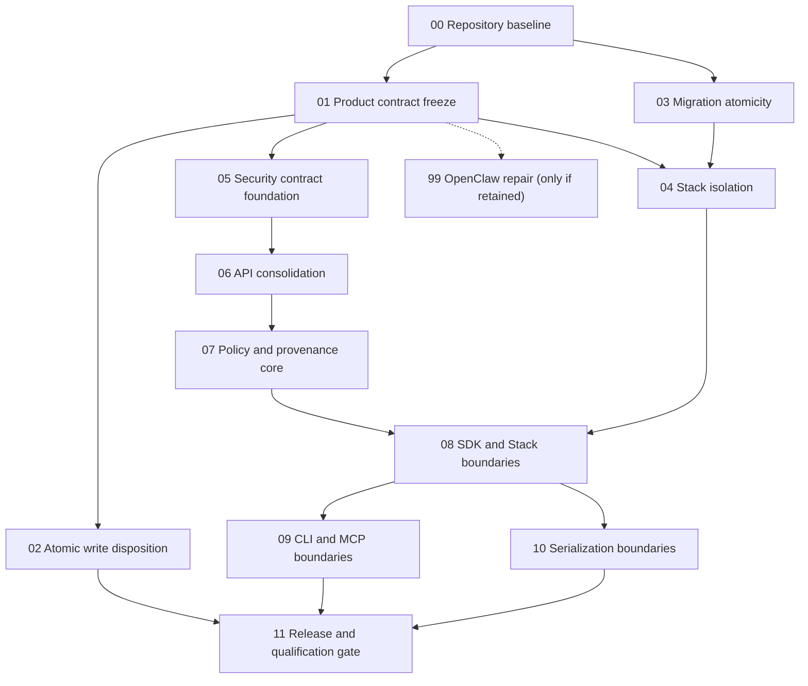

# Implementation Plan

This is a compatibility pointer, not a duplicate plan.

- Product cut and dependency order: [README](README.md) and [alpha-simplification.md](alpha-simplification.md)
- Review evidence and test sufficiency: [readiness-audit.md](readiness-audit.md)
- Required owner decisions/data: [source-docs/inputs-required.md](source-docs/inputs-required.md)
- Work units: [bundles/](bundles/)
- Local and live services: [services/](services/)
- Fixture contract: [samples/README.md](samples/README.md)
- Cross-bundle contract ownership: [schemas/README.md](schemas/README.md)
- Implementation rules: [standards/codebase-guidelines.md](standards/codebase-guidelines.md)
- Independent review loop: [audits/bundle-audit-protocol.md](audits/bundle-audit-protocol.md)
- Operator state guidance: [ui-guidance.md](ui-guidance.md)
- Visual authority: [mockups/README.md](mockups/README.md)

The coordinator should maintain a dependency DAG, not a flat issue queue:

