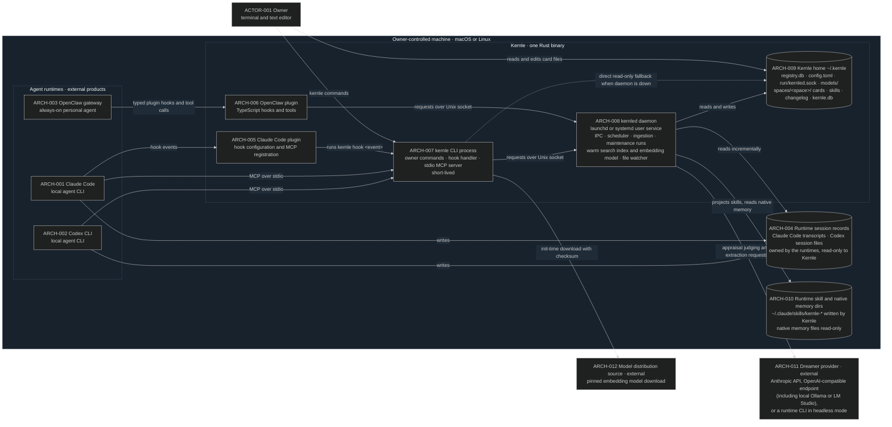
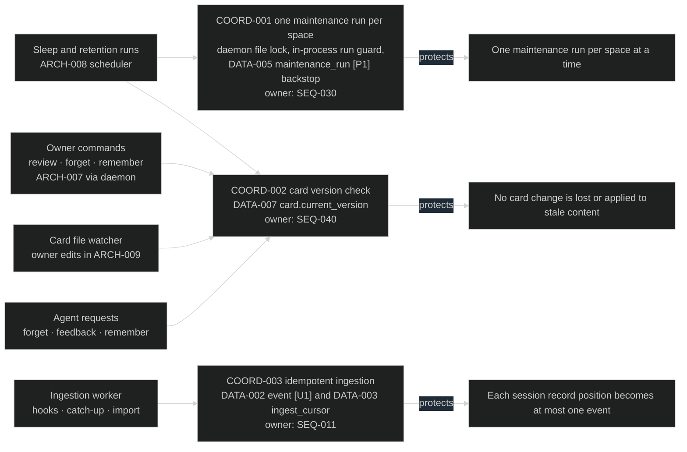

# Stack context

Kernle runs entirely on a machine the owner controls. That machine may be a
laptop, a workstation, or an always-on home server or VPS running OpenClaw.
Each machine that runs connected agents has its own Kernle installation and its
own memory. The only network destinations are the owner-configured Dreamer
provider (`ARCH-011`) and a one-time model download (`ARCH-012`).

## Whole-product map

| ID | Responsibility | Owned state |
| --- | --- | --- |
| `ARCH-001` Claude Code | Runs the owner's coding agent and invokes Kernle hooks and MCP tools | Its own transcripts (`ARCH-004`) and native memory (`ARCH-010`) |
| `ARCH-002` Codex CLI | Runs the owner's coding agent and invokes Kernle MCP tools | Its own session files (`ARCH-004`) |
| `ARCH-003` OpenClaw gateway | Runs the owner's always-on personal agent and loads the Kernle plugin | Its own sessions and native memory |
| `ARCH-004` Runtime session records | The runtimes' complete records of each session | Owned by the runtimes. Kernle only reads them |
| `ARCH-005` Claude Code plugin | Declares Kernle hooks (`async` for turn-end ingestion) and registers the MCP server | No state |
| `ARCH-006` OpenClaw plugin | Maps OpenClaw hooks to Kernle requests, forwards completed turns, and registers recall tools | No durable state |
| `ARCH-007` kernle CLI process | Owner commands, hook handling inside the runtime's deadline, and the stdio MCP server | No durable state of its own |
| `ARCH-008` kernled daemon | The only writer of space databases during runtime operation. Runs ingestion, maintenance scheduling, sleep and retention runs, index upkeep, and the card file watcher | In-memory index and model cache |
| `ARCH-009` Kernle home | All Kernle data. One directory and one SQLite database per memory space | `DATA-001` in `registry.db`. `DATA-002`–`DATA-010`, `DATA-012`, and `DATA-013` in each space's `kernle.db`. `DATA-011` card files |
| `ARCH-010` Runtime skill and native memory dirs | Where runtimes load skills and keep their own memory | Kernle writes only `kernle-*` skill folders. It never writes native memory files |
| `ARCH-011` Dreamer provider | Language-model calls during sleep only | External. Receives episode content only as allowed by [SEQ-031](../modules/consolidation/sequences/sequences.md#seq-031-sleep-run) |
| `ARCH-012` Model distribution source | Supplies the pinned embedding model | External. Receives no memory content |

## Module: spaces

Owns the Kernle home, the space registry, owner-only access, configuration, and
the daemon service. Physical participants: `ARCH-007`, `ARCH-008`, `ARCH-009`
(`registry.db`, `config.toml`, socket), and `ARCH-012` (at init).
Public boundary: [SEQ-003 Resolve space and authorize](../modules/spaces/sequences/sequences.md#seq-003-resolve-space-and-authorize-a-request).
Flows: [spaces user flows](../modules/spaces/experience/user-flows.md).

## Module: capture

Owns runtime adapters and turns session activity into scrubbed events.
Physical participants: `ARCH-001`–`ARCH-007`, the ingestion worker in `ARCH-008`,
and `event` / `ingest_cursor` in each space's `kernle.db`.
Public boundary: [capture sequences](../modules/capture/sequences/sequences.md#public-boundary).

## Module: appraisal

Segments events into episodes and computes each episode's appraisal and
functional emotion label. It runs inside sleep runs on `ARCH-008`, calls
`ARCH-011` only for judging, and owns `episode` in `kernle.db`.
Public boundary: [appraisal sequences](../modules/appraisal/sequences/sequences.md#public-boundary).

## Module: consolidation

Schedules maintenance runs and orchestrates sleep: replay, extraction,
integration, policy, review, and changelog. It runs on `ARCH-008`, calls
`ARCH-011`, and owns `maintenance_run` and `card_op` in `kernle.db`. Review
commands arrive through `ARCH-007`.
Public boundary: [consolidation sequences](../modules/consolidation/sequences/sequences.md#public-boundary).

## Module: memory

Owns memory cards and skills: the card files in `ARCH-009`, their registry,
history, provenance and change ledger in `kernle.db`, and skill projection into
`ARCH-010`. It runs on `ARCH-008`, which includes the card file watcher.
Public boundary: [memory sequences](../modules/memory/sequences/sequences.md#public-boundary).

## Module: recall

Brings memory back into agent context: session index, cue injection, gut
checks, deliberate recall, feedback, and the derived search index. It runs in
`ARCH-007` hook and MCP handling against the warm index in `ARCH-008`, and in
`ARCH-006` for OpenClaw.
Public boundary: [recall sequences](../modules/recall/sequences/sequences.md#public-boundary).

## Module: retention

Owns forgetting and deletion: expiry of events and episodes, idle card
deletion, owner and agent forget requests, idle space deletion, and
irrecoverable removal. It runs on `ARCH-008` and through `ARCH-007` for owner
commands.
Public boundary: [retention sequences](../modules/retention/sequences/sequences.md#public-boundary).

## Coordination overlay

Several writers can touch the same space. Each mechanism below is defined by its
owning module; this view only maps contenders to what each one protects.

## Current rationale

- All memory stays on the owner's machine because agent transcripts are among
  the most sensitive data a developer has. Sending them to a third-party store
  would add exposure the owner never chose. The Dreamer provider is the single
  configured exception, and it can be a local model.
- Each machine keeps its own memory because cross-machine sync is outside this
  release. Placing Kernle on the same host as the agent keeps hook latency low
  and avoids network dependencies in the agent's critical path.
- The daemon is the only runtime writer of space databases. Otherwise hook
  processes, MCP servers, and owner commands would contend for SQLite writes
  and repeat model loading on every call. The CLI can still read directly, so
  recall degrades instead of failing when the daemon is down.
- Hooks run a short-lived CLI process because that is how Claude Code invokes
  hooks. A Rust binary keeps this per-call cost within the
  [recall latency bound](../modules/recall/quality/constraints.yaml).
- Capture reads the runtimes' own session records instead of streaming every
  tool call through hooks. Those records are complete and survive a missed
  hook, so per-turn hooks only need to say "new activity" (Claude Code's
  `SessionEnd` allows 1.5 seconds for all hooks).
- One directory and database per space makes deleting a space a single
  directory removal and keeps one project's memory physically separate from
  another's.
- Kernle writes only its own namespaced skill folders and never native memory
  files, because native memory belongs to each runtime's own consolidation.
  Rewriting it would make the two memories fight.
- The OpenClaw plugin is an ordinary plugin, not OpenClaw's exclusive memory
  slot. That keeps OpenClaw's native memory working beside Kernle.
