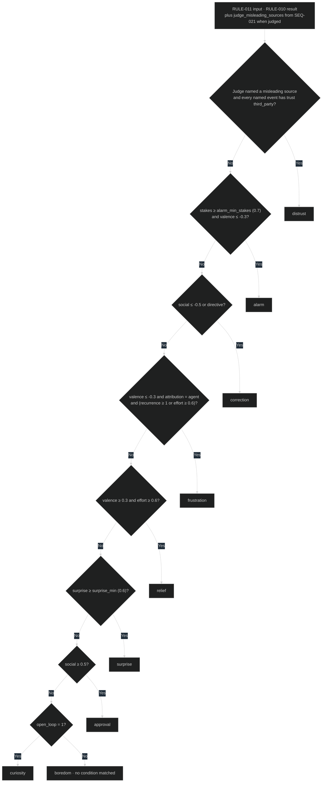

# Appraisal rules

Kernle's "emotion" is a computed **appraisal**: an evaluation of an episode's
surprise, outcome, stakes, social feedback, effort, novelty, and recurrence.
It is built from observable session events and never from the agent's
description of its own feelings. These rules are applied by
[SEQ-020](../sequences/sequences.md#seq-020-segment-and-appraise-new-events) and
re-applied with judged signals by
[SEQ-021](../sequences/sequences.md#seq-021-judge-episodes). Their result
decides how consolidation files each episode
([consolidation RULE-021](../../consolidation/behavior/rules.md#rule-021-filing-route)).
Every named parameter is in [settings.yaml](../contracts/settings.yaml).

## RULE-010 Appraisal signals and scores

Inputs: the episode's events (`DATA-002`, `seq` from `first_seq` to
`last_seq`), the next episode in the same session when one exists, the
space's closed episodes from the last 30 and 90 days (`DATA-004`), active cards
from recall `NearestCards`
([recall SEQ-055](../../recall/sequences/sequences.md#seq-055-maintain-the-search-index)),
the drive profile, and the marker lists.

```mermaid
---
config:
  theme: dark
  flowchart:
    wrappingWidth: 420
  themeVariables:
    edgeLabelBackground: '#1f2c38'
---
flowchart TD
  EV["Episode events and related records<br/>tool_call, tool_status, user_message (task and feedback),<br/>assistant_message, interrupt, explicit_remember, session_end"]

  STAKES["stakes = min(1, max over tool_calls of stakes_classes score<br/>× drives.safety.stakes_multiplier)<br/>no tool calls: 0"]
  SURPRISE["surprise = min(1, 0.3 × retried_failures + 0.2 × self_corrections)<br/>retried_failures: error tool_status followed within 3 events by a call of the same tool<br/>self_corrections: assistant messages matching self_correction_markers"]
  SOCIAL["social, from feedback user_messages in the episode:<br/>any frustration marker: -1.0 · else any correction marker: -0.8<br/>· else any praise marker: +0.6 · else 0<br/>directive = any directive marker or an explicit_remember event"]
  EFFORT["ratio = episode tool_calls / baseline<br/>baseline = median tool_calls of the space's closed episodes in 30 days,<br/>or effort_baseline_default when fewer than 10 exist, never below 5<br/>effort = clamp((ratio - 1) / 3, 0, 1)"]
  DRIVES["Drive signals (each -1..1 or absent):<br/>correctness: last test, build, or lint tool_status ok +1, error -1<br/>· -1 when the next episode reverts files this episode edited<br/>user_approval: social ≥ 0.5 → +1 · social ≤ -0.5 → -1 · neutral feedback → 0<br/>safety: a stakes ≥ 0.9 call that errored or drew social ≤ -0.5 → -1<br/>efficiency: ratio ≤ 1 → +0.5 · ratio ≥ 3 → -0.5 · else 0"]
  OUTCOME["outcome = Σ(weight × signal) / Σ(weight) over drives with a signal<br/>no drive signal: 0"]
  NOVELTY["novelty = 1 - max cosine(summary_vec, active cards in readable spaces<br/>and the space's episodes from 90 days)<br/>nothing to compare: 1"]
  RECUR["recurrence = count of the space's earlier episodes in 90 days<br/>with cosine ≥ recurrence_similarity<br/>recurrence_norm = min(1, recurrence / 3)"]
  ATTR["attribution = environment when at least half of error tool_status events<br/>match environment_error_markers · else agent<br/>(user is assigned only by the judge, SEQ-021)"]
  LOOP["open_loop = 1 when this is the session's last episode and<br/>the last event is an interrupt, or task items remain incomplete,<br/>or the last assistant message asks a question or offers next steps · else 0"]

  AROUSAL["arousal = 1 - (1 - stakes)(1 - surprise)(1 - max(|social|, 0.8 × directive))(1 - 0.5 × effort)"]
  VALENCE["valence = clamp(0.6 × outcome + 0.4 × social, -1, 1)"]
  SALIENCE["salience = clamp(arousal × (0.5 + 0.5 × max(novelty, recurrence_norm)) + 0.3 × open_loop, 0, 1)"]
  PEAK["peak_seq = seq of the first of: highest-stakes tool_call when stakes ≥ 0.7,<br/>first error tool_status, first negative feedback message, else last_seq<br/>evidence_first_seq = max(first_seq, peak_seq - tag_window_events)"]
  OUT["RESULT · appraisal vector, arousal, valence, salience,<br/>peak_seq and evidence_first_seq → RULE-011"]

  EV --> STAKES & SURPRISE & SOCIAL & EFFORT & NOVELTY & RECUR & ATTR & LOOP
  SOCIAL --> DRIVES
  STAKES --> DRIVES
  EFFORT --> DRIVES
  DRIVES --> OUTCOME
  STAKES & SURPRISE & SOCIAL & EFFORT --> AROUSAL
  OUTCOME & SOCIAL --> VALENCE
  AROUSAL & NOVELTY & RECUR & LOOP --> SALIENCE
  STAKES & SOCIAL --> PEAK
  AROUSAL & VALENCE & SALIENCE & PEAK & ATTR --> OUT
```

### Current rationale

- Every signal comes from events the runtime recorded: tool outcomes,
  feedback messages, and commands. Models have no reliable access to an inner
  state, so a self-reported "arousal" would be confabulated. A computed
  signal can always be explained.
- Arousal is a noisy-OR: one strong reason to care (a destructive command, a
  correction, a surprise) is enough to make an episode matter, as one alarming
  event is enough for a person.
- Salience multiplies arousal by novelty or recurrence. A familiar,
  already-learned event matters less, while something that keeps happening
  matters more each time.
- Drives define what counts as a good outcome, so different agents can care
  about different things through configuration rather than code.
- The peak and the window before it implement tag-and-capture: the steps that
  led to an important moment are kept as evidence, even though each looked
  routine when it happened.

## RULE-011 Functional emotion label

The label is a readable name for the appraisal pattern. Consolidation uses it
to choose what kind of memory an episode becomes. The first matching condition
wins.

### Current rationale

- Alarm comes before correction. A high-stakes failure the user also
  corrected should become a pre-action guardrail, which is the stronger
  protection.
- Frustration requires agent attribution. Otherwise a flaky network or an
  outage would teach the agent false lessons about its own approach.
- Distrust requires every misleading event to be third-party. Kernle must not
  learn to distrust the owner's own statements or the agent's own
  observations.
- Boredom is the explicit no-match outcome. Routine work is the largest share
  of experience, and labeling it lets consolidation skip it
  (habituation) instead of treating "no label" as an error.
