# Appraisal data model

`episode` lives in each space's `kernle.db` (`ARCH-009`). Appraisal owns its
content. Consolidation writes only `replay_state` and `replay_attempts`
([SEQ-031](../../consolidation/sequences/sequences.md#seq-031-sleep-run)).
Retention deletes expired rows that no active card cites
([retention SEQ-060](../../retention/sequences/sequences.md#seq-060-retention-sweep)).

```mermaid
---
config:
  theme: dark
  flowchart:
    htmlLabels: true
    wrappingWidth: 860
  themeVariables:
    edgeLabelBackground: '#1f2c38'
  themeCSS: |
    .pip-entity { border-collapse: collapse; background: #111827; color: #e5edf5; text-align: left; }
    .pip-entity th, .pip-entity td { border: 1px solid #344556; padding: 8px 12px; text-align: left; }
    .pip-entity th { background: #263544; color: #e5edf5; }
    .pip-entity code { color: #e5edf5; font-family: monospace; }
    .badge { display: inline-block; white-space: nowrap; border: 1px solid; border-radius: 4px; padding: 2px 5px; margin: 2px; }
    .badge.index { background: #162c48; border-color: #6ea8ff; color: #c6ddff; }
    .badge.unique { background: #163c2a; border-color: #6fd38a; color: #b8f5cb; }
    .badge.partial { background: #302047; border-color: #c58aff; color: #e4caff; }
---
flowchart TB
  EP["<table class='pip-entity'><tr><th colspan='4'>DATA-004 · episode · space kernle.db</th></tr><tr><th>ATTRIBUTE</th><th>TYPE</th><th>KEY / RULE</th><th>INDEX BADGE</th></tr><tr><td><code>id</code></td><td><code>TEXT</code></td><td>PK · ULID</td><td></td></tr><tr><td><code>session_id</code></td><td><code>TEXT</code></td><td>Not null</td><td><span class='badge unique'>[U1·1]</span></td></tr><tr><td><code>first_seq</code></td><td><code>INTEGER</code></td><td>Not null · first event seq</td><td><span class='badge unique'>[U1·2]</span></td></tr><tr><td><code>last_seq</code></td><td><code>INTEGER</code></td><td>Not null · ≥ first_seq</td><td></td></tr><tr><td><code>runtime</code></td><td><code>TEXT</code></td><td>Not null · selects the dreamer_allowed check</td><td></td></tr><tr><td><code>summary</code></td><td><code>TEXT</code></td><td>Not null · heuristic, replaced by the judge</td><td></td></tr><tr><td><code>summary_vec</code></td><td><code>BLOB</code></td><td>Nullable · embedding of summary · novelty, recurrence, need</td><td></td></tr><tr><td><code>stakes</code></td><td><code>REAL</code></td><td>0..1 · RULE-010</td><td></td></tr><tr><td><code>surprise</code></td><td><code>REAL</code></td><td>0..1 · RULE-010</td><td></td></tr><tr><td><code>outcome</code></td><td><code>REAL</code></td><td>-1..1 · RULE-010</td><td></td></tr><tr><td><code>social</code></td><td><code>REAL</code></td><td>-1..1 · RULE-010</td><td></td></tr><tr><td><code>directive</code></td><td><code>INTEGER</code></td><td>0 or 1 · RULE-010</td><td></td></tr><tr><td><code>effort</code></td><td><code>REAL</code></td><td>0..1 · RULE-010</td><td></td></tr><tr><td><code>novelty</code></td><td><code>REAL</code></td><td>0..1 · RULE-010</td><td></td></tr><tr><td><code>recurrence</code></td><td><code>INTEGER</code></td><td>≥ 0 · RULE-010</td><td></td></tr><tr><td><code>attribution</code></td><td><code>TEXT</code></td><td>agent, user, or environment</td><td></td></tr><tr><td><code>open_loop</code></td><td><code>INTEGER</code></td><td>0 or 1</td><td></td></tr><tr><td><code>arousal</code></td><td><code>REAL</code></td><td>0..1 · RULE-010</td><td></td></tr><tr><td><code>valence</code></td><td><code>REAL</code></td><td>-1..1 · RULE-010</td><td></td></tr><tr><td><code>salience</code></td><td><code>REAL</code></td><td>0..1 · RULE-010 · orders judging and replay</td><td><span class='badge partial'>[P1·1]</span></td></tr><tr><td><code>label</code></td><td><code>TEXT</code></td><td>Not null · RULE-011 label · selects the filing route</td><td></td></tr><tr><td><code>peak_seq</code></td><td><code>INTEGER</code></td><td>Not null · tag-and-capture peak</td><td></td></tr><tr><td><code>evidence_first_seq</code></td><td><code>INTEGER</code></td><td>Not null · start of the evidence window</td><td></td></tr><tr><td><code>state</code></td><td><code>TEXT</code></td><td>Not null · 'appraised' or 'judged'</td><td><span class='badge partial'>[P1·where]</span></td></tr><tr><td><code>judge_attempts</code></td><td><code>INTEGER</code></td><td>Not null · default 0 · at most one attempt is made</td><td></td></tr><tr><td><code>replay_state</code></td><td><code>TEXT</code></td><td>Not null · 'pending', 'replayed', 'reinforced', or 'skipped' · written by consolidation</td><td><span class='badge partial'>[P1·where]</span></td></tr><tr><td><code>replay_attempts</code></td><td><code>INTEGER</code></td><td>Not null · default 0 · failed extraction attempts · written by consolidation · skipped at extraction_max_attempts</td><td></td></tr><tr><td><code>created_at</code></td><td><code>TEXT</code></td><td>Not null · ISO-8601 UTC</td><td></td></tr><tr><td><code>expires_at</code></td><td><code>TEXT</code></td><td>Not null · created_at + episode_retention_days · not applied while an active card cites the episode</td><td><span class='badge index'>[I1·1]</span></td></tr><tr><th colspan='4'>INDEXES</th></tr><tr><td><span class='badge unique'>[U1]</span></td><td colspan='3'><code>episode_session_first_seq_key</code><br/>UNIQUE (session_id ASC, first_seq ASC)<br/>Supports SEQ-020: rerunning segmentation creates no duplicate episodes</td></tr><tr><td><span class='badge partial'>[P1]</span></td><td colspan='3'><code>episode_replay_queue_idx</code><br/>(salience DESC) WHERE replay_state = 'pending' AND state IN ('appraised', 'judged')<br/>Supports consolidation SEQ-031 and RULE-020: replay candidates in salience order</td></tr><tr><td><span class='badge index'>[I1]</span></td><td colspan='3'><code>episode_expires_idx</code><br/>(expires_at ASC)<br/>Supports retention SEQ-060: find expired episodes</td></tr></table>"]
  EVENT["REFERENCE · DATA-002 · event<br/>owned by capture"]
  SOURCE["REFERENCE · DATA-009 · card_source<br/>owned by memory"]
  EVENT -->|"event.episode_id = episode.id · 1 episode : 1..many events while events are retained · 0 after they expire"| EP
  SOURCE -->|"card_source.source_id = episode.id where source_type = 'episode' · 1 episode : 0..many citing cards · a cited episode is kept"| EP
  classDef entity fill:#111827,stroke:#8ea0b3,color:#e5edf5
  classDef ref fill:#111827,stroke:#8ea0b3,color:#b8c4d0,stroke-dasharray: 5 5
  class EP entity
  class EVENT,SOURCE ref
```

Legend: blue `I` = ordinary index, green `U` = unique index, purple `P` =
partial index. Numeric suffixes are ordered key positions. `·where` = column
used only in the predicate.

## Current rationale

- Every signal is stored, not only the label. The owner, the changelog, and
  the policy can then show why an episode mattered ("salient because: user
  correction, 40 minutes of effort").
- Episodes outlive their events (90 days against 30). The episode's summary
  and appraisal are the gist that justifies cards, while raw transcript
  excerpts are the most sensitive data and expire first.
- A cited episode is kept while its card is active, so every memory can still
  be traced to the experience that justifies it.
