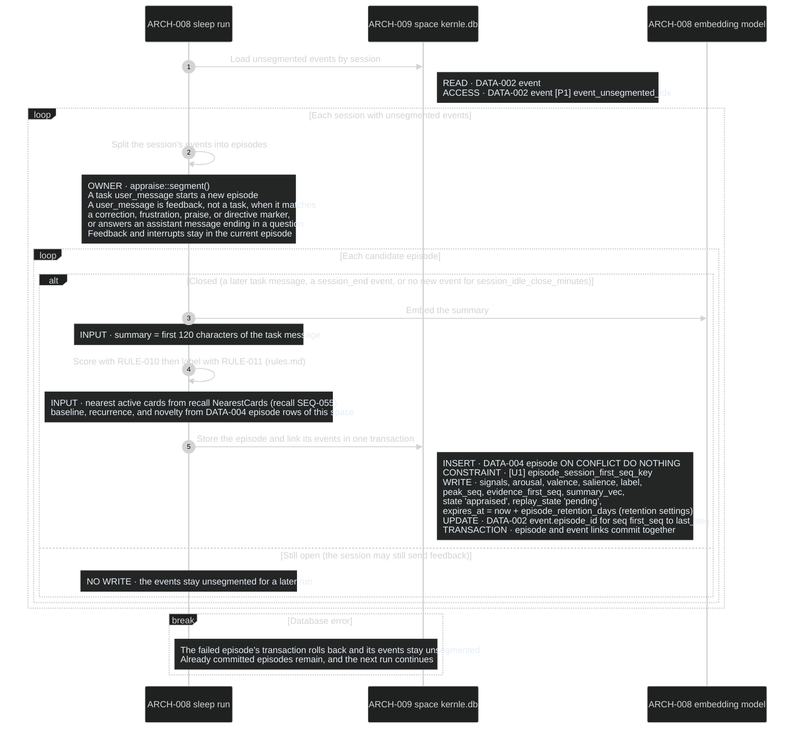
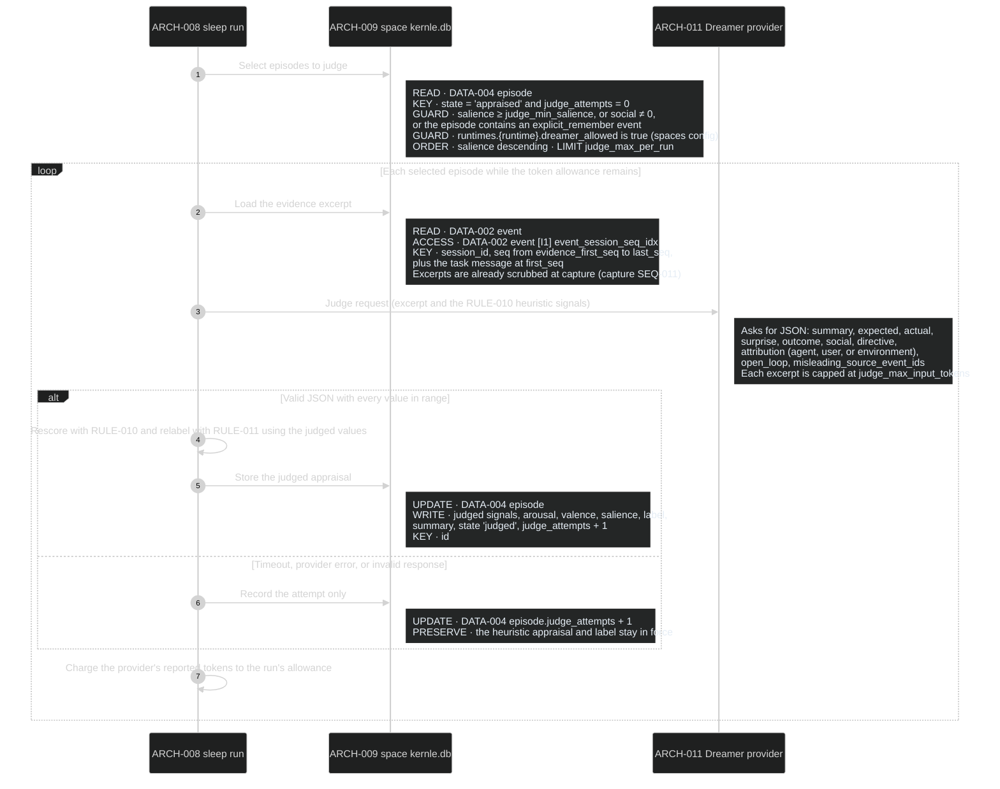

# Appraisal sequences

Appraisal turns events into episodes with an explainable appraisal and label
([DATA-004](../data/data-model.md)). Both processes run inside a sleep run
([consolidation SEQ-031](../../consolidation/sequences/sequences.md#seq-031-sleep-run))
while that run holds the space's maintenance lease. Rust module `appraise` owns
them.

## Public boundary

| Operation | Caller | Result and guarantees |
| --- | --- | --- |
| [AppraisePending](#seq-020-segment-and-appraise-new-events) | consolidation SEQ-031 | Every closed run of unsegmented events becomes exactly one episode with heuristic appraisal and label. Open episodes wait. Rerunning after a failure creates no duplicates. No network use |
| [JudgeEpisodes](#seq-021-judge-episodes) | consolidation SEQ-031 | Refines at most `judge_max_per_run` eligible episodes through the Dreamer, within the run's token allowance. A failed judgment keeps the heuristic appraisal. Never sends episodes of a runtime whose `dreamer_allowed` is false |

## SEQ-020 Segment and appraise new events

**DCL:** 3 (product default)

### Current rationale

- An episode stays open until the session moves on. The person's reaction to
  a piece of work usually arrives in their next message, and appraising before
  it arrives would miss the strongest signal.
- Feedback messages belong to the episode they react to, not a new one. A
  correction is information about the work just done.
- Episode creation and event linking commit together, and `[U1]` makes a
  repeated run a no-op. A crash mid-run must not leave events in two episodes
  or none.

## SEQ-021 Judge episodes

Called by SEQ-031 after SEQ-020, with the run's remaining Dreamer token
allowance. Rust function `appraise::judge()` owns it.

**DCL:** 3 (product default)

### Current rationale

- Only the top slice is judged, in salience order. Judging every episode
  would spend the owner's Dreamer budget on routine work, while the episodes
  that decide what is remembered get the best evidence.
- Each episode is judged at most once. A provider outage must not spend the
  budget retrying the same episode every night, and the heuristic appraisal is
  already a complete answer.
- The judge sees the evidence window, not the whole session. That bounds both
  cost and how much private content leaves the machine.
