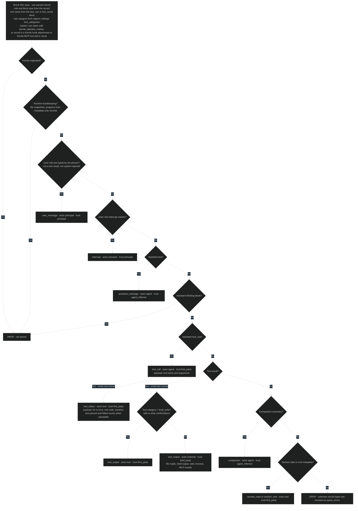

# Capture rules

## RULE-001 Classify a session record

[SEQ-011](../sequences/sequences.md#seq-011-ingest-session-records) applies this
rule to every complete record. The result decides whether the record is stored,
as which event kind, and with which actor and trust tier. Trust tiers later
decide which memories may apply automatically
([consolidation RULE-022](../../consolidation/behavior/rules.md#rule-022-change-policy)).

Inputs come from the parsed record: its role and content block type, its tool
name and the tool's category in [settings.yaml](../contracts/settings.yaml), and
Kernle's injection marker.

### Current rationale

- A tool result is split into a first-party status and a separately trusted
  output. Whether a command succeeded is something the agent observed itself.
  What a file, web page, or command printed may have been written by anyone.
  Lessons grounded in success or failure can then apply automatically, while
  claims that rest only on outside text cannot.
- Shell output is third-party because commands like `cat` print content of
  unknown authorship. Instructions planted in a repository file must not be
  able to pass as first-party evidence.
- Thinking blocks are dropped. They are often redacted or encrypted, and
  storing an agent's raw reasoning adds privacy exposure without helping
  appraisal, which uses outcomes and visible messages.
- Kernle-originated content is dropped first, so Kernle never treats its own
  recall as new experience.
