# Capture data model

Both tables live in each space's `kernle.db` (`ARCH-009`). Capture owns them.
Appraisal writes only `event.episode_id`
([appraisal SEQ-020](../../appraisal/sequences/sequences.md#seq-020-segment-and-appraise-new-events)).
Retention deletes expired rows
([retention SEQ-060](../../retention/sequences/sequences.md#seq-060-retention-sweep)).

```mermaid
---
config:
  theme: dark
  flowchart:
    htmlLabels: true
    wrappingWidth: 820
  themeVariables:
    edgeLabelBackground: '#1f2c38'
  themeCSS: |
    .pip-entity { border-collapse: collapse; background: #111827; color: #e5edf5; text-align: left; }
    .pip-entity th, .pip-entity td { border: 1px solid #344556; padding: 8px 12px; text-align: left; }
    .pip-entity th { background: #263544; color: #e5edf5; }
    .pip-entity code { color: #e5edf5; font-family: monospace; }
    .badge { display: inline-block; white-space: nowrap; border: 1px solid; border-radius: 4px; padding: 2px 5px; margin: 2px; }
    .badge.index { background: #162c48; border-color: #6ea8ff; color: #c6ddff; }
    .badge.unique { background: #163c2a; border-color: #6fd38a; color: #b8f5cb; }
    .badge.partial { background: #302047; border-color: #c58aff; color: #e4caff; }
---
flowchart TB
  EVENT["<table class='pip-entity'><tr><th colspan='4'>DATA-002 · event · space kernle.db</th></tr><tr><th>ATTRIBUTE</th><th>TYPE</th><th>KEY / RULE</th><th>INDEX BADGE</th></tr><tr><td><code>id</code></td><td><code>TEXT</code></td><td>PK · ULID</td><td></td></tr><tr><td><code>session_id</code></td><td><code>TEXT</code></td><td>Not null · runtime session identity</td><td><span class='badge index'>[I1·1]</span> <span class='badge partial'>[P1·1]</span></td></tr><tr><td><code>seq</code></td><td><code>INTEGER</code></td><td>Not null · order within the session</td><td><span class='badge index'>[I1·2]</span> <span class='badge partial'>[P1·2]</span></td></tr><tr><td><code>runtime</code></td><td><code>TEXT</code></td><td>Not null · claude-code, codex, openclaw, or kernle-cli</td><td></td></tr><tr><td><code>source_key</code></td><td><code>TEXT</code></td><td>Not null · runtime + source path or session, or 'remember:' + request id</td><td><span class='badge unique'>[U1·1]</span></td></tr><tr><td><code>source_pos</code></td><td><code>INTEGER</code></td><td>Not null · record position within the source, with a suffix for split tool results</td><td><span class='badge unique'>[U1·2]</span></td></tr><tr><td><code>ts</code></td><td><code>TEXT</code></td><td>Not null · ISO-8601 UTC from the record</td><td></td></tr><tr><td><code>kind</code></td><td><code>TEXT</code></td><td>Not null · RULE-001 kinds plus explicit_remember</td><td></td></tr><tr><td><code>actor</code></td><td><code>TEXT</code></td><td>Not null · principal, agent, tool, or external</td><td></td></tr><tr><td><code>trust</code></td><td><code>TEXT</code></td><td>Not null · principal, first_party, agent_inferred, or third_party · feeds consolidation RULE-022</td><td></td></tr><tr><td><code>payload</code></td><td><code>TEXT</code></td><td>Not null · scrubbed JSON · at most max_event_chars of text</td><td></td></tr><tr><td><code>episode_id</code></td><td><code>TEXT</code></td><td>Nullable · FK to episode.id · NULL until segmented · written only by appraisal SEQ-020</td><td><span class='badge partial'>[P1·where]</span></td></tr><tr><td><code>ingested_at</code></td><td><code>TEXT</code></td><td>Not null · ISO-8601 UTC</td><td></td></tr><tr><td><code>expires_at</code></td><td><code>TEXT</code></td><td>Not null · ingested_at + event_retention_days</td><td><span class='badge index'>[I2·1]</span></td></tr><tr><th colspan='4'>INDEXES</th></tr><tr><td><span class='badge unique'>[U1]</span></td><td colspan='3'><code>event_source_position_key</code><br/>UNIQUE (source_key ASC, source_pos ASC)<br/>Supports SEQ-011 and SEQ-013: each source position becomes at most one event</td></tr><tr><td><span class='badge index'>[I1]</span></td><td colspan='3'><code>event_session_seq_idx</code><br/>(session_id ASC, seq ASC)<br/>Supports appraisal SEQ-020 evidence windows and consolidation SEQ-031 excerpts</td></tr><tr><td><span class='badge partial'>[P1]</span></td><td colspan='3'><code>event_unsegmented_idx</code><br/>(session_id ASC, seq ASC) WHERE episode_id IS NULL<br/>Supports appraisal SEQ-020: find events not yet in an episode</td></tr><tr><td><span class='badge index'>[I2]</span></td><td colspan='3'><code>event_expires_idx</code><br/>(expires_at ASC)<br/>Supports retention SEQ-060: delete expired events</td></tr></table>"]
  CURSOR["<table class='pip-entity'><tr><th colspan='4'>DATA-003 · ingest_cursor · space kernle.db</th></tr><tr><th>ATTRIBUTE</th><th>TYPE</th><th>KEY / RULE</th><th>INDEX BADGE</th></tr><tr><td><code>source_key</code></td><td><code>TEXT</code></td><td>PK · same identity as event.source_key</td><td></td></tr><tr><td><code>byte_offset</code></td><td><code>INTEGER</code></td><td>Not null · byte offset after the last complete record ingested</td><td></td></tr><tr><td><code>next_pos</code></td><td><code>INTEGER</code></td><td>Not null · next source_pos to assign</td><td></td></tr><tr><td><code>file_dev</code></td><td><code>INTEGER</code></td><td>Nullable · device of the file read</td><td></td></tr><tr><td><code>file_ino</code></td><td><code>INTEGER</code></td><td>Nullable · inode of the file read · a change restarts at offset 0</td><td></td></tr><tr><td><code>updated_at</code></td><td><code>TEXT</code></td><td>Not null · ISO-8601 UTC</td><td></td></tr></table>"]
  EPISODE["REFERENCE · DATA-004 · episode<br/>owned by appraisal"]
  CURSOR -->|"ingest_cursor.source_key = event.source_key · 1 cursor : 0..many events · same transaction (SEQ-011)"| EVENT
  EVENT -->|"event.episode_id = episode.id · 0..many events : 0..1 episode · events expire before or with their episode"| EPISODE
  classDef entity fill:#111827,stroke:#8ea0b3,color:#e5edf5
  classDef ref fill:#111827,stroke:#8ea0b3,color:#b8c4d0,stroke-dasharray: 5 5
  class EVENT,CURSOR entity
  class EPISODE ref
```

Legend: blue `I` = ordinary index, green `U` = unique index, purple `P` =
partial index. Numeric suffixes are ordered key positions. `·where` = column
used only in the predicate.

## Current rationale

- `trust` is stored per event, not per session. One session mixes the
  person's words, the agent's own actions, and outside content, and
  consolidation's policy needs to know which kind supports each memory.
- `expires_at` is fixed at ingestion. Event retention counts from capture
  ("raw events are deleted 30 days after capture"), so later processing never
  extends how long a raw transcript excerpt is kept.
- `episode_id` is the only appraisal-written field. It lets appraisal find
  unsegmented events through `[P1]` without a separate progress table, while
  capture remains the owner of event content.
