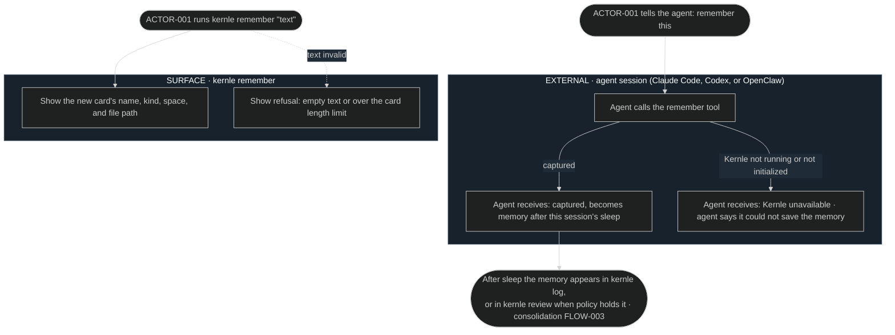

# Capture user flows

Capture is invisible during ordinary agent work. Its only actor-visible flow is
asking Kernle to remember something explicitly.

## FLOW-008 Remember something explicitly

Both paths run [SEQ-013](../sequences/sequences.md#seq-013-remember-explicitly).

## Current rationale

- The agent is told that memory forms after sleep, not that it is saved now.
  Agent requests pass through policy first, so the agent should not claim
  something is remembered before that happens.
- The owner's command shows the created file. Owners trust memory they can
  open and edit, and the card exists immediately for them.
