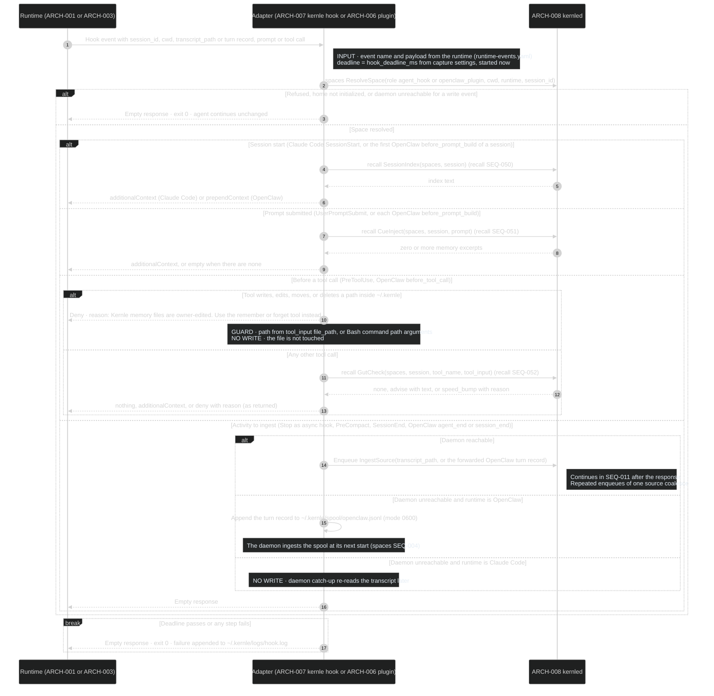
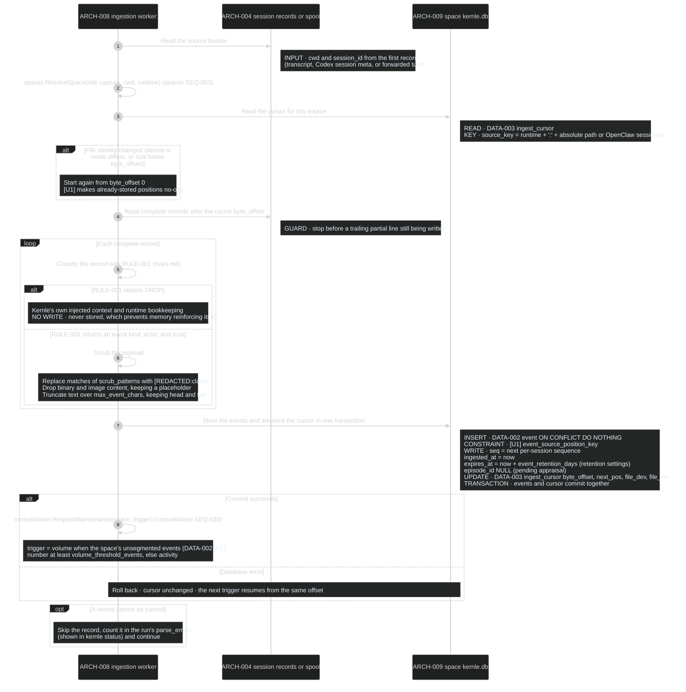
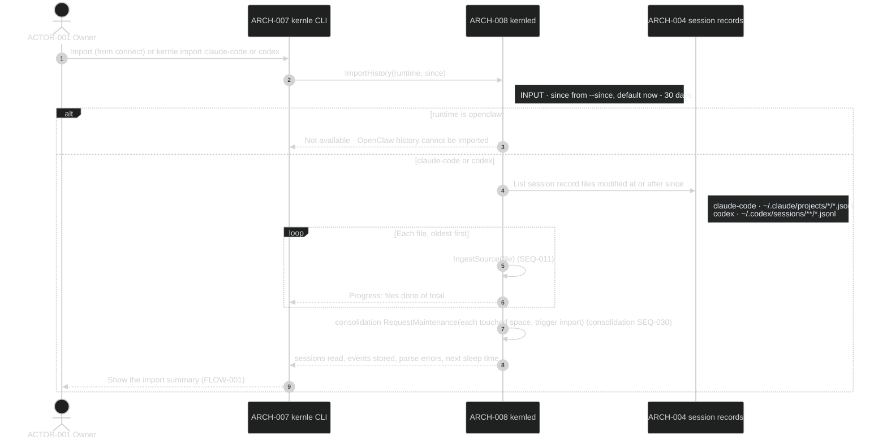
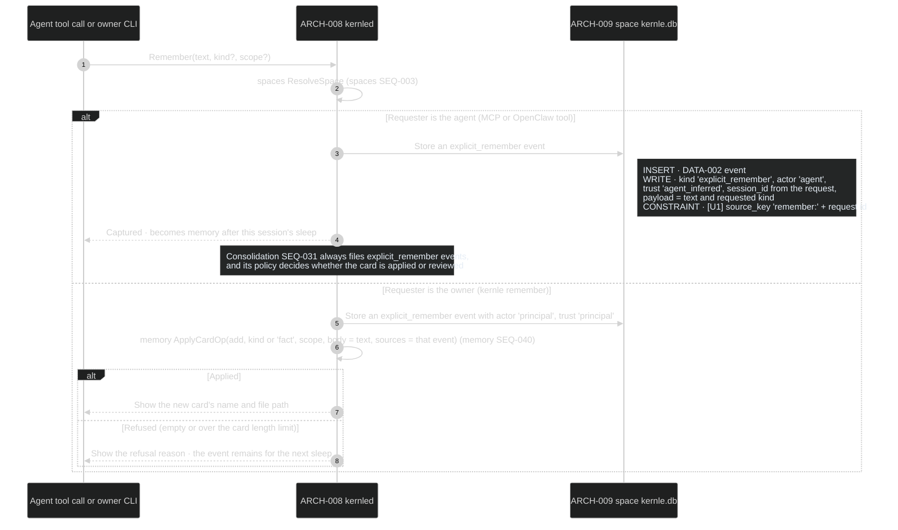

# Capture sequences

Capture turns agent sessions into private, scrubbed events
([DATA-002, DATA-003](../data/data-model.md)) without agent effort. It owns the
runtime adapters' entry point, ingestion of session records, history import,
and explicit remember. Rust module `capture` owns these processes. Runtime
mappings are in [runtime-events.yaml](../contracts/runtime-events.yaml) and
parameters in [settings.yaml](../contracts/settings.yaml).

## Public boundary

| Operation | Callers | Result and guarantees |
| --- | --- | --- |
| [HandleHookEvent](#seq-010-handle-a-runtime-hook-event) | Claude Code via `ARCH-005`, OpenClaw via `ARCH-006` | Returns within `hook_deadline_ms`. Never blocks or alters an agent action except the Kernle-home write guard and a recall speed bump. Every failure yields an empty, non-blocking response |
| [IngestSource](#seq-011-ingest-session-records) | SEQ-010, daemon catch-up (spaces SEQ-004), the Codex watcher, SEQ-012 | Idempotent. Each source position becomes at most one event. A failure leaves the cursor unchanged so a later trigger resumes. Scrubbed before storage |
| [ImportHistory](#seq-012-import-history) | spaces SEQ-002, `kernle import` | Same guarantees as IngestSource across many files. Returns counts and the next sleep time |
| [Remember](#seq-013-remember-explicitly) | MCP `remember`, OpenClaw `remember` tool, `kernle remember` | Agent requests are captured as events for the next sleep. Owner requests create a card immediately |

## SEQ-010 Handle a runtime hook event

Entry for every Claude Code hook and OpenClaw typed hook. Rust function
`capture::hook::handle()` owns dispatch. The shared deadline belongs to this
handler.

**DCL override:** 4 — runs inside the agent's critical path on every prompt and
tool call, so it must answer within the deadline and fail open without
supervision.

### Current rationale

- Every failure path returns an empty, non-blocking response. A memory system
  that can stall or break the agent's own work costs more than the memory is
  worth.
- Turn-end ingestion only enqueues work. Claude Code gives all `SessionEnd`
  hooks 1.5 seconds, and reading a transcript inside the agent's turn would add
  visible latency.
- Writes into `~/.kernle` are denied from agent tools. Otherwise an agent, or
  instructions injected into it, could rewrite memory files directly. That
  would bypass provenance, policy, and the watcher's assumption that file
  edits come from the owner.
- OpenClaw turns are spooled when the daemon is down. Kernle cannot re-read
  OpenClaw session storage later the way it re-reads Claude Code transcripts.

## SEQ-011 Ingest session records

Triggered by SEQ-010 enqueues, the daemon's catch-up and spool scan
(spaces SEQ-004), the Codex watcher (a Codex session file unchanged for
`codex_idle_ingest_minutes`), and SEQ-012. Rust function
`capture::ingest::ingest_source()` owns it.

**DCL:** 3 (product default)

### Current rationale

- Ingestion reads the runtime's own records rather than hook payloads, because
  the records hold every message, tool call, and result in order. A missed
  hook then only delays memory.
- Events and cursor commit together, and `[U1]` makes every position
  idempotent. Hooks, catch-up, and import can all trigger the same file, and
  each record must still become exactly one event.
- Scrubbing happens before anything is stored. A secret that once reaches the
  database also reaches episodes, Dreamer requests, and cards.
- Kernle's own injected context is dropped. Otherwise each recall would be
  re-captured as experience and strengthen itself in a loop.

## SEQ-012 Import history

Runs from `kernle connect` (spaces SEQ-002) or `kernle import <runtime> [--since]`.
Import is available for Claude Code and Codex, which keep session records on
disk. OpenClaw history is not importable. Rust function
`capture::import::import_history()` owns it.

**DCL:** 3 (product default)

### Current rationale

- Import reuses ingestion. Re-importing, or importing a session that hooks
  already captured, then creates nothing twice.
- The default window is 30 days, the same as event retention. Imported events
  older than that would expire on arrival.

## SEQ-013 Remember explicitly

The agent calls `remember` (MCP or OpenClaw tool) during a session. The owner
runs `kernle remember "<text>" [--kind <kind>] [--personal]`. Rust function
`capture::remember()` owns it.

**DCL:** 3 (product default)

### Current rationale

- An agent's remember request waits for sleep instead of becoming a card at
  once. Instructions injected into an agent, for example from a web page,
  could otherwise plant a guardrail or preference that shapes the very next
  session. Sleep's policy checks what supports the request first.
- The owner's request becomes a card immediately because the owner is the
  principal. There is nothing to verify, and the owner expects to see the
  result.
