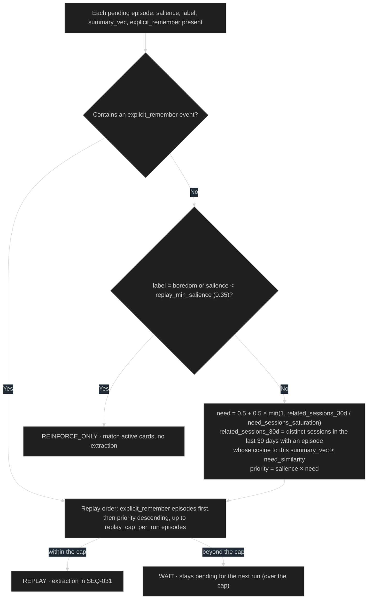
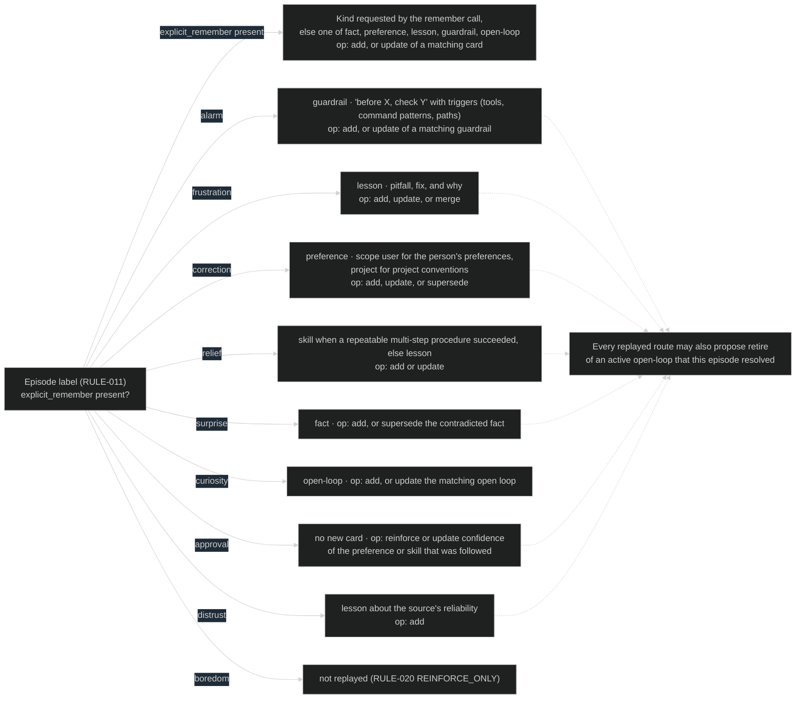
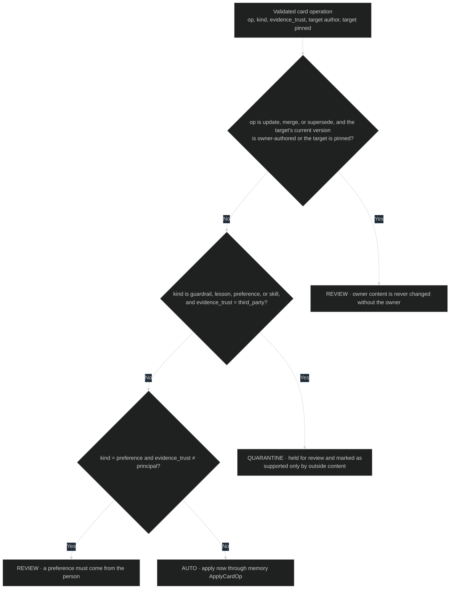

# Consolidation rules

[SEQ-031](../sequences/sequences.md#seq-031-sleep-run) applies these rules
during every sleep run, in this order: RULE-020 chooses which episodes to
replay, RULE-021 chooses what each replayed episode may become, and RULE-022
decides whether each proposed change applies, waits for the owner, or is
refused. Parameters are in [settings.yaml](../contracts/settings.yaml).

## RULE-020 Replay selection

Inputs: pending episodes from `DATA-004 episode [P1]`, each episode's
`salience`, `label`, and `summary_vec`, the space's episodes from the last 30
days, and whether the episode contains an `explicit_remember` event
(`DATA-002`).

### Current rationale

- Priority multiplies salience by need, as in prioritized replay: an
  experience is worth consolidating when it mattered and when similar
  situations keep coming up.
- Explicit remember requests always replay. The person or agent asked, and
  skipping a request because it scored low would break trust in remember.
- Low-salience and boredom episodes only reinforce existing memories. Routine
  success should strengthen what is already known, not create new memories
  that dilute the important ones.

## RULE-021 Filing route

The episode's label from
[appraisal RULE-011](../../appraisal/behavior/rules.md#rule-011-functional-emotion-label)
decides which card kinds and operations the Dreamer may propose. A proposal
outside its route is refused at validation in SEQ-031.

### Current rationale

- The label decides the kind of memory. That is how emotion files memory: a
  near-disaster should become a pre-action guardrail, a correction a
  preference, and a hard-won success a procedure. The same experience filed
  as a generic note would not change behavior at the moment it matters.
- Approval reinforces instead of creating. Praise confirms something already
  known, and a new card for it would duplicate rather than strengthen.

## RULE-022 Change policy

Applied to every validated card operation before it is applied. Inputs:
operation type and card kind from the proposal, `evidence_trust` (the highest
`DATA-002 event.trust` among the operation's cited events, ordered principal >
first_party > agent_inferred > third_party), and, for updates, the target card's
current author and `pinned` value (`DATA-007`, `DATA-008`).

REVIEW and QUARANTINE operations wait in the review queue
([SEQ-032](../sequences/sequences.md#seq-032-resolve-a-held-change)) and expire
unapplied after `review_expiry_days`.

### Current rationale

- Behavior-changing memories need first-party or owner support. Persistent
  prompt injection works by getting an agent to "remember" an instruction it
  read somewhere. Quarantining what only outside content supports blocks that
  path without blocking memories of things that actually happened.
- Preferences require the person's own words. An agent inferring what its
  owner likes, then acting on it every session, is how memory drifts away
  from the person it serves.
- Owner-authored or pinned cards are never rewritten automatically. When the
  owner has spoken, sleep proposes and the owner decides.
- Everything else applies automatically. Owner attention is scarce, the
  changelog shows every change, and any card can be edited or forgotten later.
