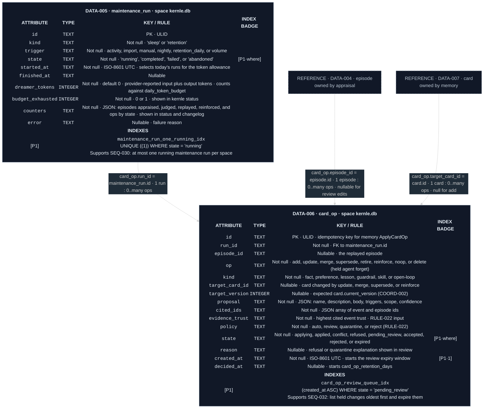

# Consolidation data model

Both tables live in each space's `kernle.db` (`ARCH-009`). Consolidation owns
them. Retention deletes decided `card_op` rows after `card_op_retention_days`
([retention SEQ-060](../../retention/sequences/sequences.md#seq-060-retention-sweep)).

Legend: purple `P` = partial or expression index. `·1` = first key column.
`·where` = column used only in the predicate.

## Current rationale

- Daily token usage is the sum of run rows. The budget then needs no separate
  counter that could drift from the runs that actually spent the tokens.
- `card_op` keeps every proposal, including refusals and expirations, until
  its retention window ends. The changelog and review can explain what sleep
  decided, and a version conflict can be retried from the recorded proposal.
- The one-running index has a constant key with a predicate. The invariant is
  "one running row per space database", not per any column value.
