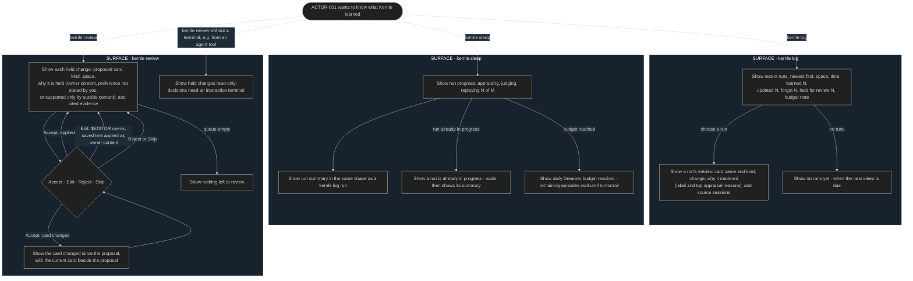

# Consolidation user flows

## FLOW-003 Review memory changes

`kernle log` reads the changelog projection that memory writes after each run
([memory SEQ-042](../../memory/sequences/sequences.md#seq-042-write-the-changelog)).
`kernle review` resolves held changes
([SEQ-032](../sequences/sequences.md#seq-032-resolve-a-held-change)).
`kernle sleep` starts a manual run
([SEQ-030](../sequences/sequences.md#seq-030-schedule-maintenance-runs)).

## Current rationale

- The log leads with counts, then reasons. Owners skim for "did anything
  surprising happen", and the reason ("held because supported only by outside
  content") is what lets them judge a change quickly.
- Review shows why each change is held. Different holds call for different
  owner judgments: protecting their own text, confirming a preference, or
  spotting a manipulation attempt.
- A conflict shows the current card beside the proposal rather than failing.
  The owner can then decide with full context.
