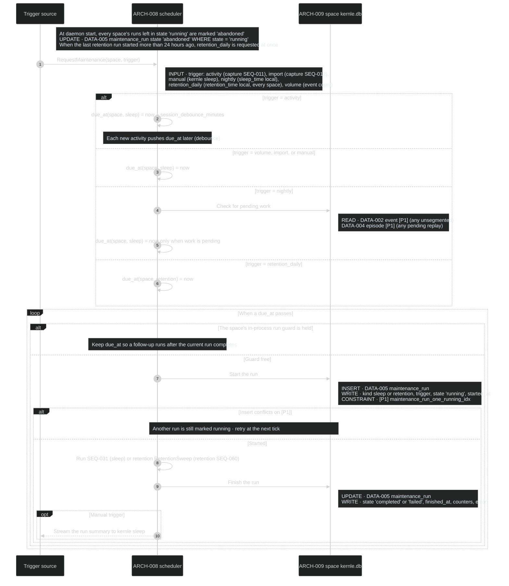
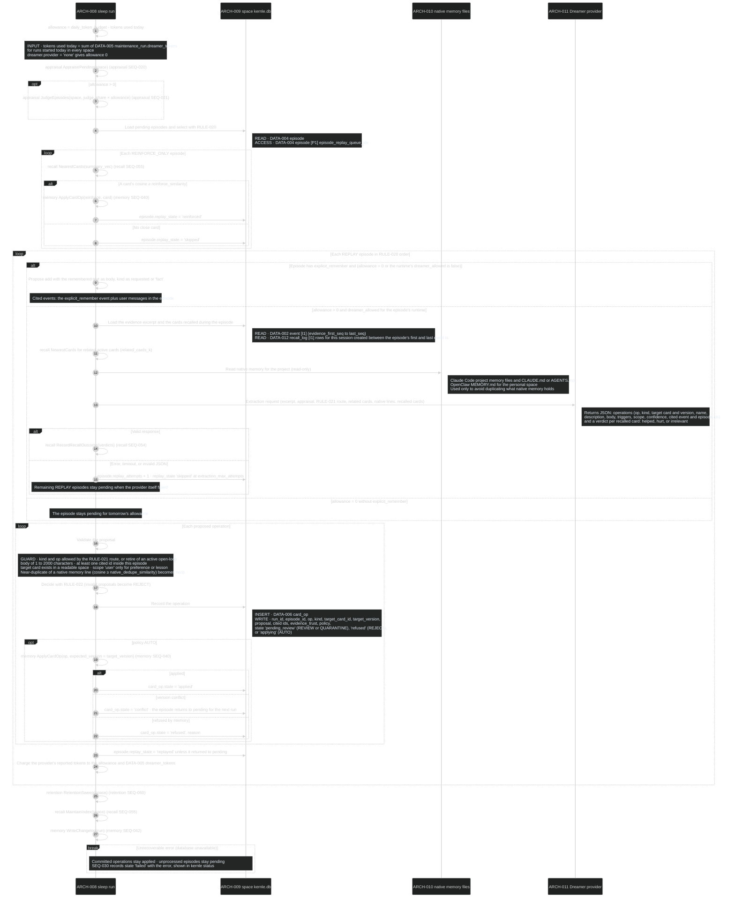
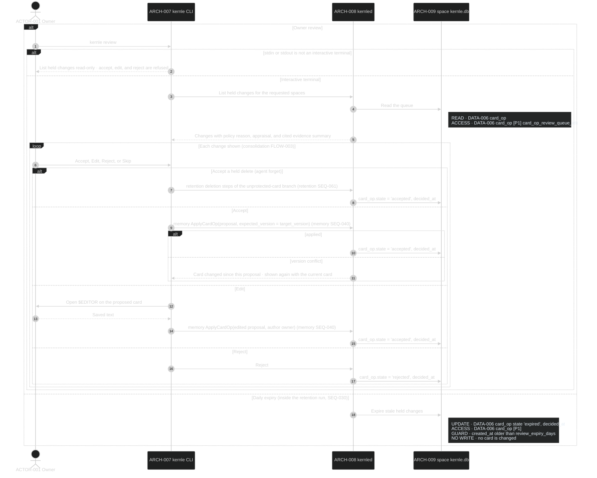

# Consolidation sequences

Consolidation schedules maintenance runs and orchestrates sleep. It owns
[DATA-005 and DATA-006](../data/data-model.md), the
[rules](../behavior/rules.md), and the review queue. Rust module `sleep` owns
these processes. Parameters are in [settings.yaml](../contracts/settings.yaml).

## Public boundary

| Operation | Callers | Result and guarantees |
| --- | --- | --- |
| [RequestMaintenance](#seq-030-schedule-maintenance-runs) | capture SEQ-011 and SEQ-012, `kernle sleep`, the scheduler | Schedules or starts a run. At most one maintenance run per space at a time. Requests during a run schedule a follow-up |
| [Sleep run](#seq-031-sleep-run) | SEQ-030 | Appraises, judges, replays, applies or holds card changes, sweeps retention, refreshes the index, and writes the changelog. Partial progress is kept. A failure leaves unprocessed work pending |
| [Resolve a held change](#seq-032-resolve-a-held-change) | `kernle review`, the daily expiry pass | Accept applies the change through memory ApplyCardOp. Reject and expiry never apply it |

## SEQ-030 Schedule maintenance runs

Rust function `sleep::scheduler` owns scheduling. It runs inside `kernled`
(`ARCH-008`), started by spaces SEQ-004.

**DCL:** 3 (product default)

### Current rationale

- Activity is debounced. Sleeping after every turn would spend the Dreamer
  budget on half-finished work, and episodes cannot close until the session
  moves on anyway.
- The nightly trigger runs only when work is pending, so idle spaces cost
  nothing. Retention runs daily for every space, including idle ones, because
  deletion must happen on schedule whether or not anyone uses the space.
- One run per space is enforced by the daemon's in-process guard, backed by
  `[P1]`. Only one daemon can run per home (spaces SEQ-004 file lock), and the
  index catches any second writer. A persisted lease would add expiry and
  fencing logic that a single process does not need.

## SEQ-031 Sleep run

Started by SEQ-030 for a space. Rust function `sleep::run()` owns the order.

**DCL:** 3 (product default)

### Current rationale

- Appraisal and judging happen before replay selection, so replay ranks
  episodes by their best available appraisal.
- The run pauses when the daily allowance is spent instead of degrading to
  cheaper extraction. Pending episodes keep their priority and resume the next
  day, while explicit remember requests still become cards without the Dreamer.
- Native memory is read only to avoid duplication. Kernle adds what native
  memory lacks rather than restating what the runtime already loads every
  session.
- A version conflict sends the episode back to pending rather than retrying
  at once. The card changed during the run, often through an owner edit, and
  the next run should consider the new content.
- Every proposed change is recorded in `card_op`, including refusals, so the
  changelog and review queue can explain everything sleep did or chose not to
  do.

## SEQ-032 Resolve a held change

The owner runs `kernle review` in an interactive terminal, or the daily
expiry pass runs inside the scheduler's retention run. Rust function
`sleep::review()` owns it.

**DCL:** 3 (product default)

### Current rationale

- Accepting or rejecting requires an interactive terminal. Agents run under
  the owner's account and can execute `kernle`, but their tool shells are not
  interactive. A quarantined change therefore cannot be approved by the same
  agent whose input produced it.
- Held changes expire rather than accumulate. A queue the owner never reads
  must not become a backlog that later applies stale memories in bulk.
- An edited acceptance is owner-authored. The owner's words become the card,
  and RULE-022 then protects it from automatic rewrites.
