# Memory data model

Each memory space keeps its cards as files (`DATA-011`) plus a registry,
history, provenance, and ledger in its `kernle.db` (`ARCH-009`). The current
file is what the owner reads and edits. The registry holds what Kernle needs to
rank, govern, and expire the card, and can be rebuilt from the files with usage
history reset.

```mermaid
---
config:
  theme: dark
  flowchart:
    htmlLabels: true
    wrappingWidth: 900
  themeVariables:
    edgeLabelBackground: '#1f2c38'
  themeCSS: |
    .pip-entity { border-collapse: collapse; background: #111827; color: #e5edf5; text-align: left; }
    .pip-entity th, .pip-entity td { border: 1px solid #344556; padding: 8px 12px; text-align: left; }
    .pip-entity th { background: #263544; color: #e5edf5; }
    .pip-entity code { color: #e5edf5; font-family: monospace; }
    .badge { display: inline-block; white-space: nowrap; border: 1px solid; border-radius: 4px; padding: 2px 5px; margin: 2px; }
    .badge.index { background: #162c48; border-color: #6ea8ff; color: #c6ddff; }
    .badge.unique { background: #163c2a; border-color: #6fd38a; color: #b8f5cb; }
    .badge.partial { background: #302047; border-color: #c58aff; color: #e4caff; }
---
flowchart TB
  CARD["<table class='pip-entity'><tr><th colspan='4'>DATA-007 · card · space kernle.db</th></tr><tr><th>ATTRIBUTE</th><th>TYPE</th><th>KEY / RULE</th><th>INDEX BADGE</th></tr><tr><td><code>id</code></td><td><code>TEXT</code></td><td>PK · ULID · equals frontmatter kernle.id</td><td></td></tr><tr><td><code>kind</code></td><td><code>TEXT</code></td><td>Not null · fact, preference, lesson, guardrail, skill, or open-loop</td><td></td></tr><tr><td><code>name</code></td><td><code>TEXT</code></td><td>Not null · slug · names the file</td><td><span class='badge unique'>[U1·1]</span></td></tr><tr><td><code>status</code></td><td><code>TEXT</code></td><td>Not null · active, dormant, or superseded · dormant cards are searchable but never injected</td><td></td></tr><tr><td><code>current_version</code></td><td><code>INTEGER</code></td><td>Not null · ≥ 1 · optimistic version check (COORD-002)</td><td></td></tr><tr><td><code>file_path</code></td><td><code>TEXT</code></td><td>Not null · relative to the space directory</td><td></td></tr><tr><td><code>trust</code></td><td><code>TEXT</code></td><td>Not null · principal, first_party, agent_inferred, or third_party · shown with every injection</td><td></td></tr><tr><td><code>confidence</code></td><td><code>REAL</code></td><td>Not null · 0..1</td><td></td></tr><tr><td><code>salience</code></td><td><code>REAL</code></td><td>Not null · 0..1 · from the strongest cited episode · recall ranking</td><td></td></tr><tr><td><code>valence</code></td><td><code>REAL</code></td><td>Not null · -1..1 · from the strongest cited episode</td><td></td></tr><tr><td><code>arousal</code></td><td><code>REAL</code></td><td>Not null · 0..1 · gut-check speed bump threshold</td><td></td></tr><tr><td><code>label</code></td><td><code>TEXT</code></td><td>Not null · functional emotion of the strongest cited episode, or 'owner'</td><td></td></tr><tr><td><code>pinned</code></td><td><code>INTEGER</code></td><td>Not null · 0 or 1 · owner-set · never expires · always in the session index</td><td></td></tr><tr><td><code>triggers</code></td><td><code>TEXT</code></td><td>Nullable · JSON: tools, command patterns, path globs · guardrails only</td><td></td></tr><tr><td><code>valid_from</code></td><td><code>TEXT</code></td><td>Not null · ISO-8601 UTC</td><td></td></tr><tr><td><code>valid_to</code></td><td><code>TEXT</code></td><td>Nullable · set when superseded · starts superseded_retention_days</td><td></td></tr><tr><td><code>superseded_by</code></td><td><code>TEXT</code></td><td>Nullable · FK to card.id</td><td></td></tr><tr><td><code>projected_path</code></td><td><code>TEXT</code></td><td>Nullable · Claude Code skill folder written by SEQ-040</td><td></td></tr><tr><td><code>created_at</code></td><td><code>TEXT</code></td><td>Not null · ISO-8601 UTC</td><td></td></tr><tr><td><code>last_used_at</code></td><td><code>TEXT</code></td><td>Not null · starts at created_at · idle-time origin for retention RULE-040</td><td></td></tr><tr><td><code>recalled_count</code></td><td><code>INTEGER</code></td><td>Not null · injections and search returns</td><td></td></tr><tr><td><code>helped_count</code></td><td><code>INTEGER</code></td><td>Not null · helped verdicts and feedback</td><td></td></tr><tr><td><code>hurt_count</code></td><td><code>INTEGER</code></td><td>Not null · hurt or wrong verdicts and feedback</td><td></td></tr><tr><td><code>strength</code></td><td><code>REAL</code></td><td>Not null · 0..1 · retention RULE-040 · recall ranking</td><td></td></tr><tr><th colspan='4'>INDEXES</th></tr><tr><td><span class='badge unique'>[U1]</span></td><td colspan='3'><code>card_name_key</code><br/>UNIQUE (name ASC)<br/>Supports SEQ-040 and recall SEQ-053: one card per name in a space, so a name identifies one file</td></tr></table>"]
  VER["<table class='pip-entity'><tr><th colspan='4'>DATA-008 · card_version · space kernle.db</th></tr><tr><th>ATTRIBUTE</th><th>TYPE</th><th>KEY / RULE</th><th>INDEX BADGE</th></tr><tr><td><code>card_id</code></td><td><code>TEXT</code></td><td>PK part 1 · FK to card.id</td><td></td></tr><tr><td><code>version</code></td><td><code>INTEGER</code></td><td>PK part 2 · ≥ 1</td><td></td></tr><tr><td><code>author</code></td><td><code>TEXT</code></td><td>Not null · 'sleep' or 'owner' · consolidation RULE-022 protects owner versions</td><td></td></tr><tr><td><code>op_id</code></td><td><code>TEXT</code></td><td>Nullable · DATA-006 card_op.id or the caller's operation id</td><td><span class='badge partial'>[P1·1]</span></td></tr><tr><td><code>content</code></td><td><code>TEXT</code></td><td>Not null · full file content of this version</td><td></td></tr><tr><td><code>content_hash</code></td><td><code>TEXT</code></td><td>Not null · SHA-256 of content · SEQ-041 compares files with it</td><td></td></tr><tr><td><code>created_at</code></td><td><code>TEXT</code></td><td>Not null · ISO-8601 UTC</td><td></td></tr><tr><th colspan='4'>INDEXES</th></tr><tr><td><span class='badge partial'>[P1]</span></td><td colspan='3'><code>card_version_op_key</code><br/>UNIQUE (op_id ASC) WHERE op_id IS NOT NULL<br/>Supports SEQ-040: an operation applies at most once</td></tr></table>"]
  SRC["<table class='pip-entity'><tr><th colspan='4'>DATA-009 · card_source · space kernle.db</th></tr><tr><th>ATTRIBUTE</th><th>TYPE</th><th>KEY / RULE</th><th>INDEX BADGE</th></tr><tr><td><code>card_id</code></td><td><code>TEXT</code></td><td>PK part 1 · FK to card.id</td><td></td></tr><tr><td><code>source_type</code></td><td><code>TEXT</code></td><td>PK part 2 · 'event', 'episode', or 'card'</td><td><span class='badge index'>[I1·1]</span></td></tr><tr><td><code>source_id</code></td><td><code>TEXT</code></td><td>PK part 3 · id in the source's own table</td><td><span class='badge index'>[I1·2]</span></td></tr><tr><td><code>source_space_id</code></td><td><code>TEXT</code></td><td>Not null · space holding the source · personal cards cite project episodes</td><td></td></tr><tr><td><code>relation</code></td><td><code>TEXT</code></td><td>Not null · evidence, merged_from, or supersedes</td><td></td></tr><tr><th colspan='4'>INDEXES</th></tr><tr><td><span class='badge index'>[I1]</span></td><td colspan='3'><code>card_source_source_idx</code><br/>(source_type ASC, source_id ASC)<br/>Supports retention SEQ-060 (is an expiring episode still cited?) and SEQ-061 (forget cascade)</td></tr></table>"]
  LED["<table class='pip-entity'><tr><th colspan='4'>DATA-010 · card_ledger · space kernle.db</th></tr><tr><th>ATTRIBUTE</th><th>TYPE</th><th>KEY / RULE</th><th>INDEX BADGE</th></tr><tr><td><code>id</code></td><td><code>INTEGER</code></td><td>PK · ascending · recall SEQ-055 indexing cursor</td><td></td></tr><tr><td><code>card_id</code></td><td><code>TEXT</code></td><td>Not null · no FK, the card may be deleted</td><td><span class='badge index'>[I2·1]</span></td></tr><tr><td><code>run_id</code></td><td><code>TEXT</code></td><td>Nullable · maintenance run that made the change</td><td></td></tr><tr><td><code>change</code></td><td><code>TEXT</code></td><td>Not null · added, updated, merged, superseded, reinforced, owner_edited, owner_edit_invalid, pinned, unpinned, dormant, reactivated, or deleted</td><td></td></tr><tr><td><code>version</code></td><td><code>INTEGER</code></td><td>Nullable</td><td></td></tr><tr><td><code>reason</code></td><td><code>TEXT</code></td><td>Not null · label and appraisal reasons, or retention reason · contains no card content</td><td></td></tr><tr><td><code>card_name</code></td><td><code>TEXT</code></td><td>Nullable · set to NULL on every row when the card is deleted</td><td></td></tr><tr><td><code>created_at</code></td><td><code>TEXT</code></td><td>Not null · ISO-8601 UTC</td><td><span class='badge index'>[I1·1]</span></td></tr><tr><th colspan='4'>INDEXES</th></tr><tr><td><span class='badge index'>[I1]</span></td><td colspan='3'><code>card_ledger_created_idx</code><br/>(created_at ASC)<br/>Supports SEQ-042: regenerate a date's changelog</td></tr><tr><td><span class='badge index'>[I2]</span></td><td colspan='3'><code>card_ledger_card_idx</code><br/>(card_id ASC)<br/>Supports SEQ-040 delete: null the card's name on every ledger row</td></tr></table>"]
  FILE["<table class='pip-entity'><tr><th colspan='4'>DATA-011 · card file · spaces/&lt;space&gt;/cards/&lt;kind&gt;/&lt;name&gt;.md or skills/&lt;name&gt;/SKILL.md</th></tr><tr><th>FIELD</th><th>TYPE</th><th>KEY / RULE</th><th>INDEX BADGE</th></tr><tr><td><code>name</code></td><td><code>string</code></td><td>Owner-editable · equals card.name</td><td></td></tr><tr><td><code>description</code></td><td><code>string</code></td><td>Owner-editable · one line · used in the session index</td><td></td></tr><tr><td><code>metadata.type</code></td><td><code>string</code></td><td>Kernle-managed · native memory type mapping (card-format.yaml)</td><td></td></tr><tr><td><code>kernle.id</code></td><td><code>string</code></td><td>Kernle-managed · equals card.id</td><td></td></tr><tr><td><code>kernle.pinned</code></td><td><code>boolean</code></td><td>Owner-editable</td><td></td></tr><tr><td><code>kernle.triggers</code></td><td><code>map</code></td><td>Owner-editable · guardrails</td><td></td></tr><tr><td><code>kernle.sources</code></td><td><code>list</code></td><td>Kernle-managed · mirrors card_source</td><td></td></tr><tr><td><code>body</code></td><td><code>markdown</code></td><td>Owner-editable · 1 to 2000 characters</td><td></td></tr></table>"]
  VER -->|"card_version.card_id = card.id · 1 card : 1..many versions · deleted with the card"| CARD
  SRC -->|"card_source.card_id = card.id · 1 card : 0..many sources · owner-authored cards may have none"| CARD
  LED -->|"card_ledger.card_id = card.id when the card exists · 1 card : 1..many ledger rows · rows outlive the card without its name"| CARD
  FILE -->|"frontmatter kernle.id = card.id · 1 card : exactly 1 file · file content equals card_version at current_version"| CARD
  classDef entity fill:#111827,stroke:#8ea0b3,color:#e5edf5
  class CARD,VER,SRC,LED,FILE entity
```

Legend: blue `I` = ordinary index, green `U` = unique index, purple `P` =
partial unique index. Numeric suffixes are ordered key positions.

## Field ownership on card

| Fields | Writer |
| --- | --- |
| `kind`, `name`, `status` (every value, including dormant and active as decided by retention RULE-040), `current_version`, `file_path`, `trust`, `confidence`, `salience`, `valence`, `arousal`, `label`, `pinned`, `triggers`, `valid_from`, `valid_to`, `superseded_by`, `projected_path`, and `last_used_at` on add or reinforce | memory [SEQ-040](../sequences/sequences.md#seq-040-apply-a-card-operation) |
| `last_used_at`, `recalled_count`, `helped_count`, `hurt_count` | recall [SEQ-053 and SEQ-054](../../recall/sequences/sequences.md#public-boundary) |
| `strength` | retention [SEQ-060](../../retention/sequences/sequences.md#seq-060-retention-sweep) |

## Current rationale

- Files are the owner's interface and a portable format. The database is
  where Kernle keeps what files are bad at: version history, a provenance
  graph, counters, and ranking fields.
- `card_source` records the source's space. A personal preference learned in
  one repository's session cites an episode stored in that project's space,
  and deleting that space must still be able to find and remove the citation.
- The ledger outlives deleted cards without their names, so the owner can see
  that something was forgotten and why, without the forgotten content
  persisting.
