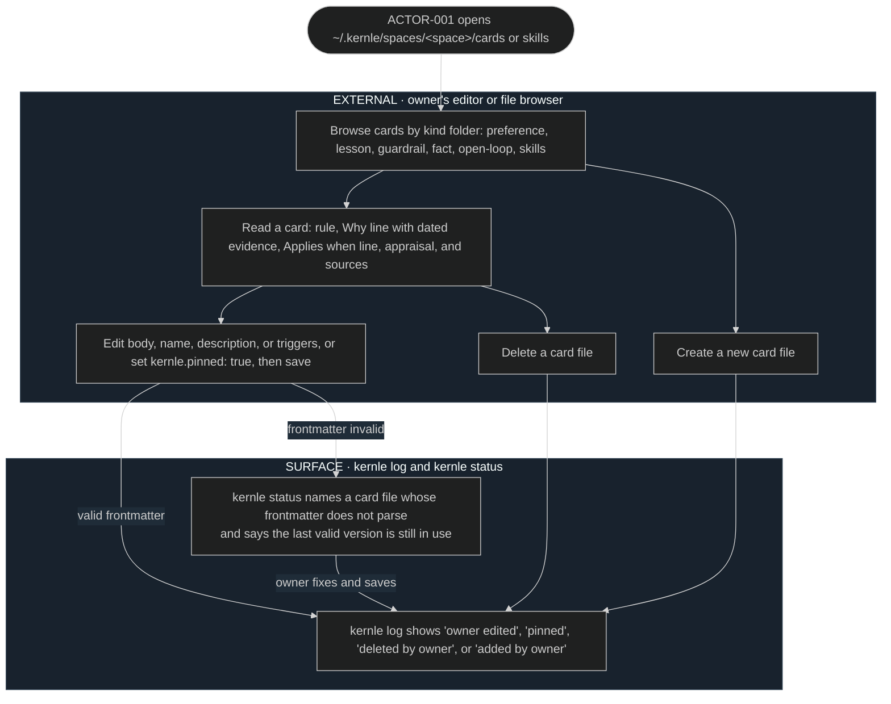

# Memory user flows

## FLOW-004 Read, edit, and pin memory as files

The owner works with memory in any editor or file browser. The watcher
registers every change through
[SEQ-041](../sequences/sequences.md#seq-041-register-owner-edits).

## Current rationale

- Memory is plain files so the owner never needs a special tool to see or
  change what their agents remember. Trust in a memory system comes from being
  able to open it.
- Every edit shows up in the log. The owner can then confirm that Kernle saw
  the change, and later sleeps treat that card as the owner's own words.
