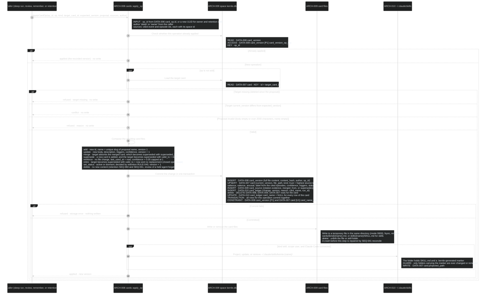
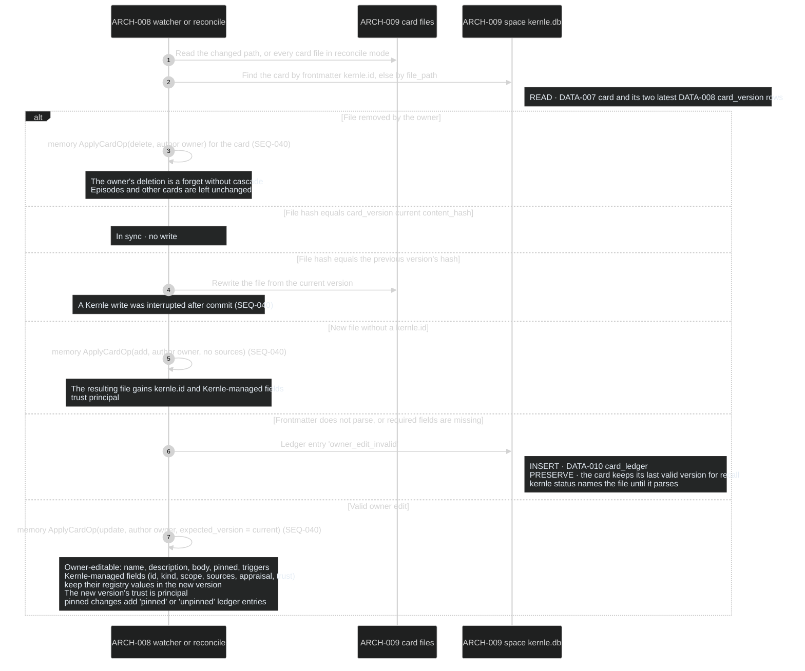
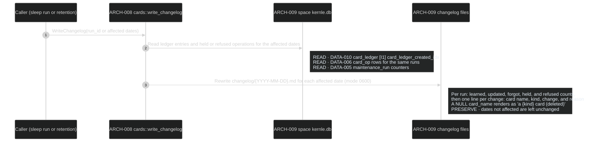

# Memory sequences

Memory owns cards and skills: the markdown files
([DATA-011](../data/data-model.md)), their registry, versions, provenance, and
change ledger ([DATA-007 to DATA-010](../data/data-model.md)), skill projection
into runtime skill directories (`ARCH-010`), and the changelog projection. The
file format is in [card-format.yaml](../contracts/card-format.yaml). Rust module
`cards` owns these processes.

## Public boundary

| Operation | Callers | Result and guarantees |
| --- | --- | --- |
| [ApplyCardOp](#seq-040-apply-a-card-operation) | consolidation SEQ-031 and SEQ-032, capture SEQ-013, retention SEQ-060 and SEQ-061 | Returns `applied` (with the new version), `conflict` (expected version differs, nothing written), or `refused` (with a reason, nothing written). Idempotent per operation id. The registry, version, provenance, and ledger commit together, and the file always converges to the committed version |
| [RegisterOwnerEdits](#seq-041-register-owner-edits) | file watcher, daemon start (spaces SEQ-004), `kernle review` Edit | Owner changes to card files become owner-authored versions. Owner-deleted files become deleted cards. Kernle-managed fields keep Kernle's values |
| [WriteChangelog](#seq-042-write-the-changelog) | consolidation SEQ-031, retention SEQ-061 | Regenerates the changelog files for affected dates from the ledger. Deleted cards appear without their names |
| Card read projection | recall, retention, consolidation | `DATA-007 card` rows plus the current file content. Usage columns are written by recall and `strength` by retention ([field ownership](../data/data-model.md#field-ownership-on-card)) |

## SEQ-040 Apply a card operation

Rust function `cards::apply_op()` owns every Kernle-initiated card change.

**DCL:** 3 (product default)

### Current rationale

- The database commits before the file is written. The database version is
  authoritative for Kernle's own writes, and SEQ-041 can then tell a crash
  apart from an owner edit by comparing the file with the last two versions.
- Expected versions make changes optimistic (`COORD-002`). Sleep, review,
  remember, retention, and owner edits can all change a card, and a check at
  write time protects each card without serializing unrelated work.
- Only project-independent skills (scope user) are projected into Claude
  Code. Writing project skills into a repository's `.claude/` folder would
  change the owner's repository. Project skills reach the agent through recall
  instead.
- Projection only touches folders carrying Kernle's marker. A name collision
  then cannot overwrite a skill the owner wrote by hand.

## SEQ-041 Register owner edits

Triggered by the card file watcher (`notify`, events debounced for 2 seconds),
by reconcile mode at daemon start (spaces SEQ-004), and by `kernle review`
Edit. Rust function `cards::register_edits()` owns it.

**DCL:** 3 (product default)

### Current rationale

- Files are the owner's interface. Editing or deleting a card in any editor
  must work without a Kernle command, and the watcher makes that the normal
  path.
- Deleting a file forgets only that card. The owner did not see a cascade
  preview, so Kernle must not remove anything else on their behalf.
- Invalid frontmatter keeps the last valid version in use. A half-saved file
  or a typo must not make a memory vanish from recall.
- Kernle-managed fields are restored after an owner edit. Provenance and
  appraisal must stay truthful, and the owner changes meaning through the
  body, name, triggers, and pin.

## SEQ-042 Write the changelog

Called at the end of each sleep run (consolidation SEQ-031) and after
deletions (retention SEQ-061). Rust function `cards::write_changelog()` owns it.

**DCL:** 3 (product default)

### Current rationale

- The changelog is regenerated from the ledger, not appended. When a card is
  deleted its name disappears from history too. Otherwise deletion would leave
  the memory's title behind in a log file.
