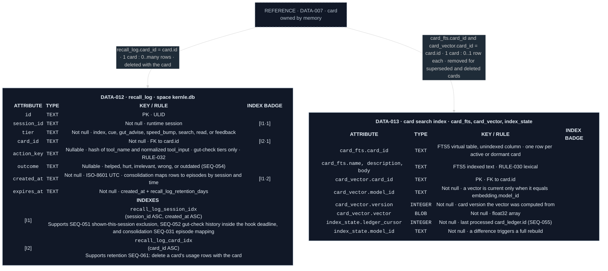

# Recall data model

Both entities live in each space's `kernle.db` (`ARCH-009`). `DATA-013` is
derived from cards and can be rebuilt at any time. `DATA-012` is the usage
record that reconsolidation and gut-check history depend on. Retention deletes
`recall_log` rows after `recall_log_retention_days`, and with their card
([retention SEQ-060, SEQ-061](../../retention/sequences/sequences.md#public-boundary)).

Legend: blue `I` = ordinary index. Numeric suffixes are ordered key positions.

## Current rationale

- `recall_log` keeps the card and the session but never the prompt or tool
  input text. Gut-check history needs only a hash of the action. Storing the
  prompts recall responded to would duplicate the most sensitive content
  outside capture's retention.
- The search index stores the model it was built with. Changing the embedding
  model must never mix incompatible vectors, and a rebuild from files is cheap
  for a personal store.
