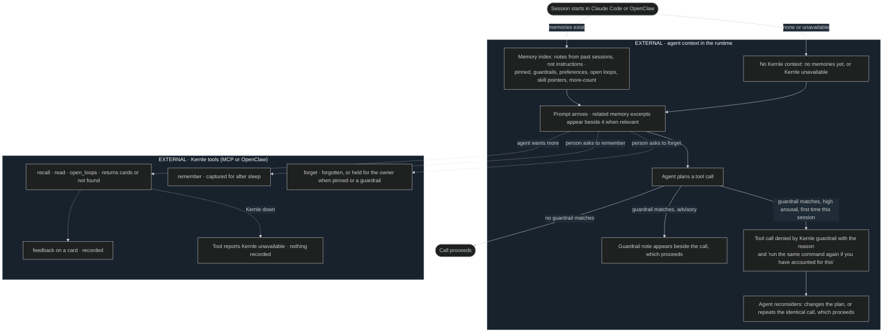

# Recall user flows

## FLOW-005 Memory during an agent session

The agent (`ACTOR-002`) experiences Kernle as context that appears at session
start, alongside prompts, and before risky actions, plus a few tools it may
call. The owner (`ACTOR-001`) sees the same context in the runtime's
transcript. Codex sessions have no hooks, so they use only the tool path.
Internal selection is owned by
[SEQ-050 to SEQ-054](../sequences/sequences.md#public-boundary).

## Current rationale

- Memory arrives as labeled notes, never as instructions. An agent that
  treats memory as commands can be steered by whatever got into memory. Notes
  with kind, trust, and date let it weigh them like a colleague's advice.
- The speed bump is a visible denial with its reason and an explicit way
  forward. The agent and the owner can both see why the action paused, and a
  reconsidered action is never blocked twice.
- With nothing to say, Kernle adds nothing. Empty preambles and "no memories
  found" messages would cost context in every session.
