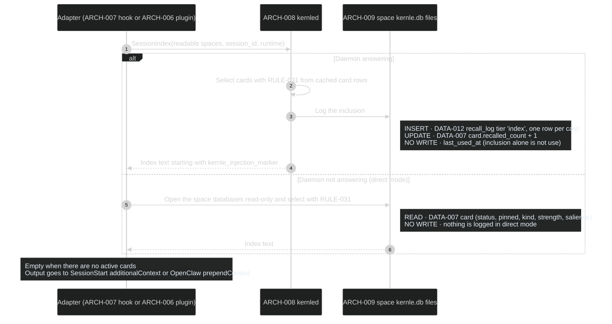
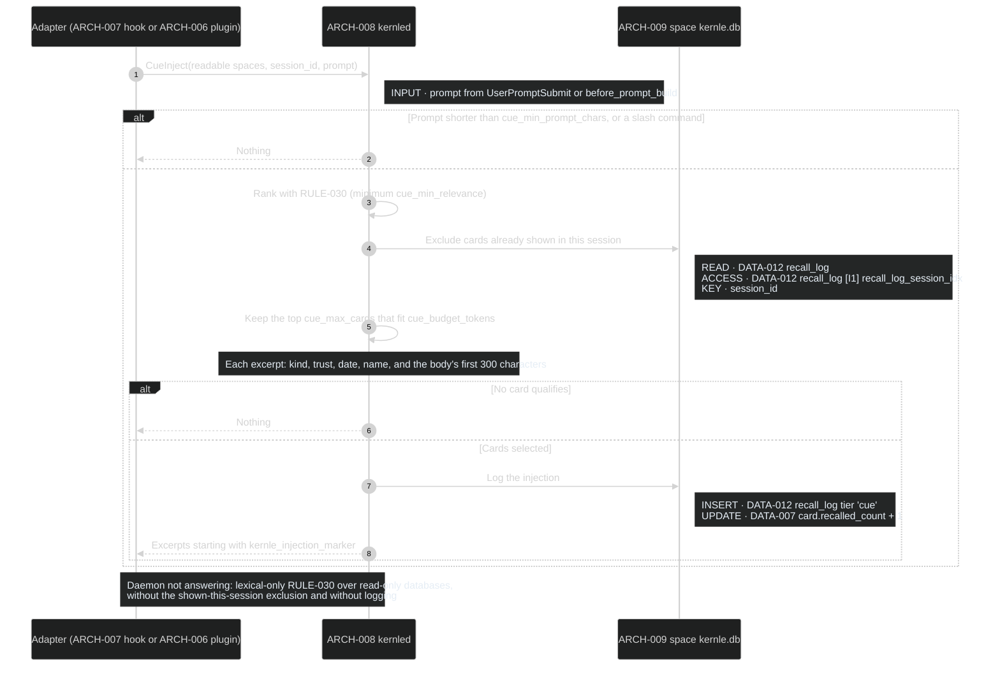
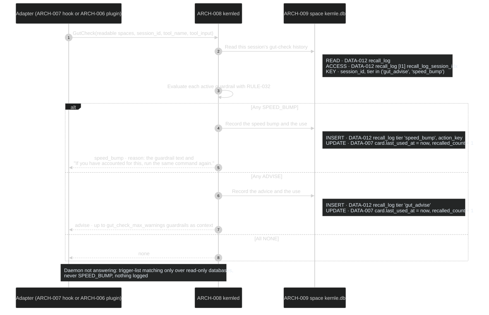
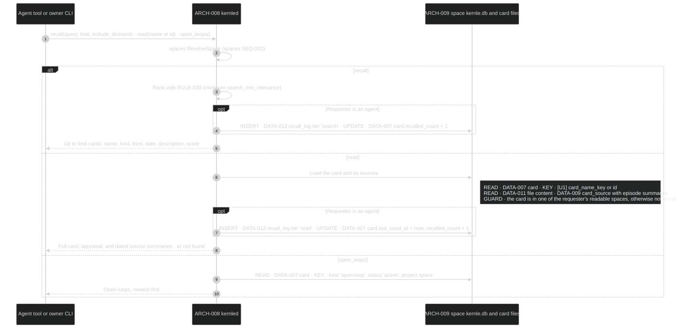
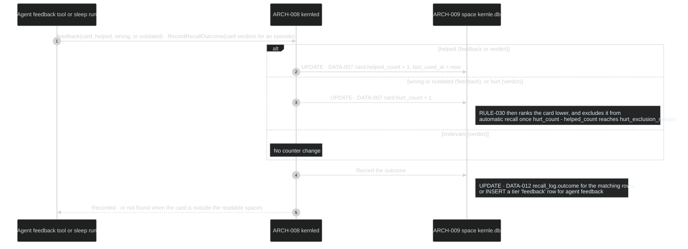
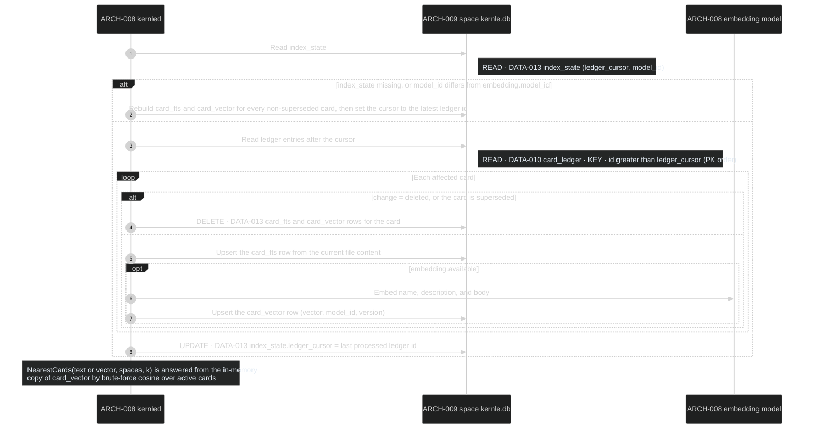

# Recall sequences

Recall brings memory back into agent context and records how it was used. It
owns [DATA-012 and DATA-013](../data/data-model.md), the
[rules](../behavior/rules.md), and the agent tool contract
([mcp-tools.yaml](../contracts/mcp-tools.yaml)). Rust module `recall` owns
these processes. The hook processes run inside capture's
[SEQ-010 deadline](../../capture/sequences/sequences.md#seq-010-handle-a-runtime-hook-event).

## Public boundary

| Operation | Callers | Result and guarantees |
| --- | --- | --- |
| [SessionIndex](#seq-050-session-index) | capture SEQ-010 | Index text within `tier0_budget_tokens`, or empty. Never fails the hook |
| [CueInject](#seq-051-cue-injection) | capture SEQ-010 | Zero to `cue_max_cards` excerpts within `cue_budget_tokens`. Cards already shown this session are not repeated |
| [GutCheck](#seq-052-gut-check) | capture SEQ-010 | `none`, `advise` with text, or `speed_bump` with a reason. At most one speed bump per card and action per session |
| [Recall, Read, Open loops](#seq-053-deliberate-recall) | MCP and OpenClaw tools, `kernle recall` | Ranked cards, one full card with its sources, or open loops. Never another project's space for agent requests |
| [Feedback and RecordRecallOutcome](#seq-054-feedback-and-recall-outcomes) | agent `feedback` tool, consolidation SEQ-031 | Updates usage counters and `last_used_at` |
| [MaintainIndex and NearestCards](#seq-055-maintain-the-search-index) | consolidation SEQ-031, retention SEQ-060 and SEQ-061, spaces SEQ-004, appraisal SEQ-020 | The index reflects every ledger change up to its cursor. Deleted cards leave the index before MaintainIndex returns |

## SEQ-050 Session index

**DCL override:** 4 — runs inside the agent's session-start hook.

### Current rationale

- Inclusion in the index does not count as use. Otherwise every card in the
  index would refresh its own idle time each session and never expire,
  whether or not it ever helped.
- Direct mode reads without writing, so recall still works while the daemon
  is stopped, without a second writer appearing.

## SEQ-051 Cue injection

**DCL override:** 4 — runs inside the agent's prompt-submit hook.

### Current rationale

- Recall is cue-driven: the person's actual request is the best cue, so
  injection waits for the prompt rather than guessing at session start.
- Cards already shown in the session are excluded. Repeating a memory the
  agent has in context only spends tokens.

## SEQ-052 Gut check

**DCL override:** 4 — runs inside the agent's pre-tool hook on every tool call.

### Current rationale

- A trigger match counts as use. A guardrail exists to fire at the risky
  moment, so firing keeps it alive, while one whose situation never recurs
  can expire on schedule.

## SEQ-053 Deliberate recall

Agent tools `recall`, `read`, and `open_loops` (MCP or OpenClaw), and owner
command `kernle recall <query>`.

**DCL:** 3 (product default)

### Current rationale

- An agent's read counts as use, while an owner browsing with `kernle recall`
  does not. Owner curiosity should not keep memories alive that the agents
  never need.
- A card outside the readable spaces returns "not found" rather than
  "forbidden", so its existence is not disclosed.

## SEQ-054 Feedback and recall outcomes

Agent tool `feedback(card, verdict, note?)`, and RecordRecallOutcome from
consolidation SEQ-031 with Dreamer verdicts.

**DCL:** 3 (product default)

### Current rationale

- Helpfulness, not exposure, keeps a memory alive and ranks it higher. This
  is reconsolidation: each recall's outcome updates the memory that was
  recalled.
- Wrong or outdated feedback never edits or deletes the card. The feedback
  may itself come from a manipulated agent, so it only lowers ranking.
  Deletion stays with retention and the owner.

## SEQ-055 Maintain the search index

Triggered by the daemon every `index_poll_seconds`, at daemon start (spaces
SEQ-004), at the end of each sleep run, and synchronously after deletions
(retention SEQ-060 and SEQ-061).

**DCL:** 3 (product default)

### Current rationale

- The index follows the ledger instead of being called by every writer. Owner
  edits, sleep, review, and retention all produce ledger entries, so none of
  them can forget to update the index.
- Deletions run synchronously before the deleting process returns, because
  the index holds card text and must not keep deleted content after the
  owner is told it is gone.
- Brute-force cosine is enough for a personal store of thousands of cards. An
  approximate index would add a dependency and nondeterminism without a
  latency need.
