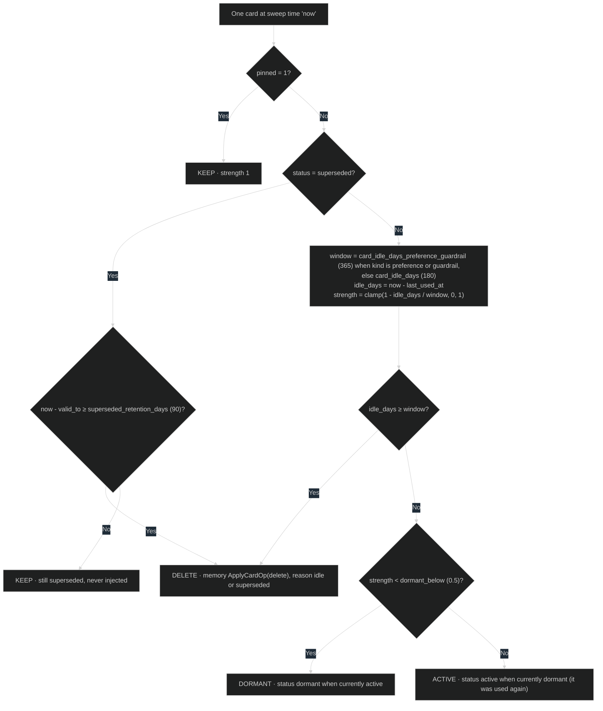

# Retention rules

## RULE-040 Card retention decision

[SEQ-060](../sequences/sequences.md#seq-060-retention-sweep) applies this rule
to every card in the space on each sweep. Inputs come from `DATA-007 card`
(`kind`, `pinned`, `status`, `last_used_at`, `valid_to`), the sweep time, and
[settings.yaml](../contracts/settings.yaml).

### Current rationale

- Idle time counts from the last use, not from creation. A memory that keeps
  helping should live indefinitely, and one that never helps should not
  survive just because it was once important.
- Preferences and guardrails get a longer window. A guardrail against a rare
  but costly mistake is idle by design between occurrences, and a preference
  can go untested for months while still being true.
- Dormancy at half the window takes a fading memory out of automatic recall
  before deleting it. Its cost to context ends early, while a deliberate
  search can still find it and a use brings it back.
- Pinned cards never expire. The owner's explicit choice outranks every
  heuristic.
