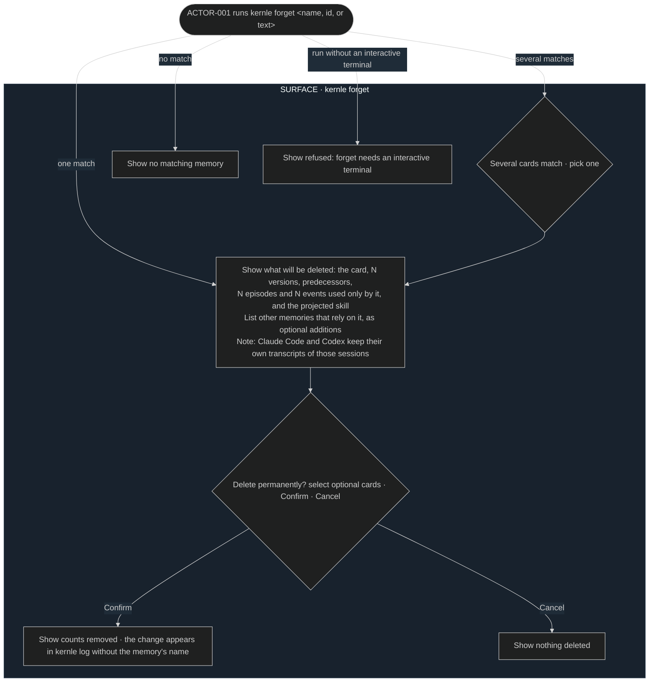
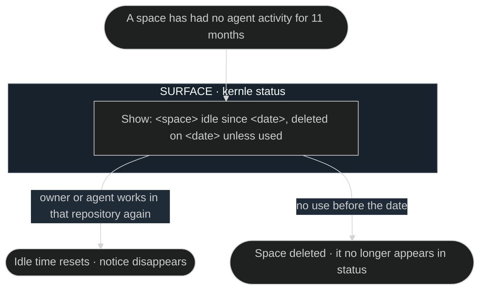

# Retention user flows

## FLOW-006 Forget a memory

The owner path runs
[SEQ-061](../sequences/sequences.md#seq-061-forget-on-request). The agent path
is shown in [recall FLOW-005](../../recall/experience/user-flows.md#flow-005-memory-during-an-agent-session).

## FLOW-007 Idle space deletion notice

Deletion runs in [SEQ-062](../sequences/sequences.md#seq-062-idle-space-deletion).
The notice appears in [spaces FLOW-002](../../spaces/experience/user-flows.md#flow-002-check-memory-status).

## Current rationale

- The forget preview lists the evidence as well as the card. "Forget that"
  usually means the underlying conversation too, and the owner should choose
  knowingly.
- The preview reminds the owner that runtimes keep their own transcripts.
  Kernle can only promise deletion of what it holds, and the owner may need to
  delete those transcripts as well.
- Idle deletion has a notice but no "keep" button. Using the space is the way
  to keep it, which matches the rule that memory survives through use.
