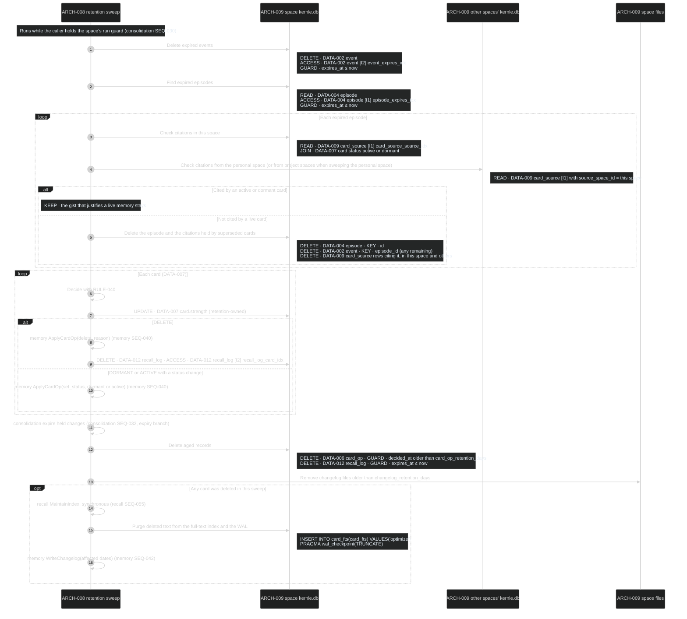
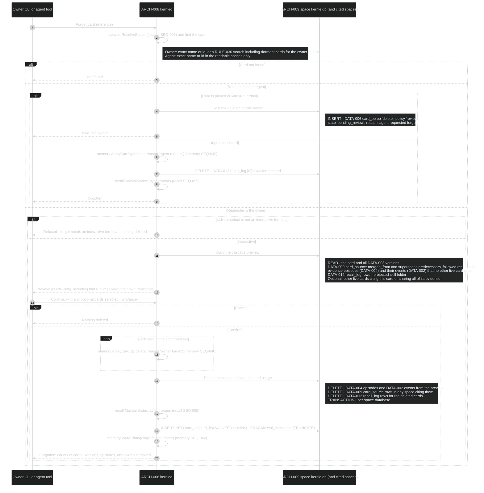
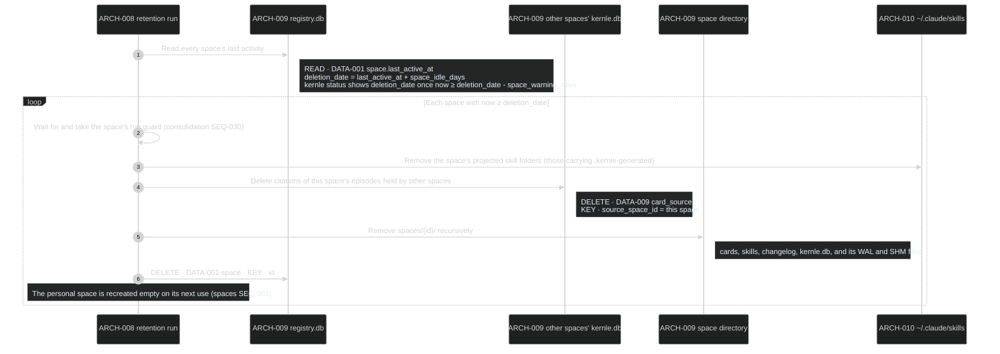

# Retention sequences

Retention owns forgetting: scheduled expiry, requests to forget, idle space
deletion, and making deletion irrecoverable from Kernle's files. It owns no
tables. It deletes rows owned by other modules through their operations, or
through the explicit deletions named below. Rust module `retention` owns these
processes. Parameters are in [settings.yaml](../contracts/settings.yaml).

Every space database connection opens with `PRAGMA secure_delete = ON`, so
deleted rows are overwritten in place, not left in free pages.

## Public boundary

| Operation | Callers | Result and guarantees |
| --- | --- | --- |
| [RetentionSweep](#seq-060-retention-sweep) | consolidation SEQ-031 (each sleep) and SEQ-030 (daily retention run) | Applies every window in settings and RULE-040. When it returns, deleted content is absent from the space's database, WAL, search index, files, projected skills, and changelog |
| [Forget on request](#seq-061-forget-on-request) | `kernle forget` (interactive owner), agent `forget` tool | Owner: previewed cascade, then complete deletion. Agent: deletes one unprotected card, and holds pinned cards and guardrails for the owner |
| [Idle space deletion](#seq-062-idle-space-deletion) | Daily retention run over the registry | Deletes a whole space after `space_idle_days` without capture or recall activity, and shows the date in status from `space_warning_days` before |

## SEQ-060 Retention sweep

**DCL:** 3 (product default)

### Current rationale

- Expired events are deleted on schedule even when their episode is kept.
  Raw transcript excerpts are the most sensitive data, and the episode's
  summary is what justifies a live memory.
- A dormant card still protects its episodes. Dormancy is the warning stage
  before deletion, and its evidence must survive until the card itself goes.
- The full-text index is optimized and the WAL truncated after deletions.
  SQLite full-text segments and write-ahead logs otherwise keep deleted text
  until a later rewrite, and "deleted" must mean gone from Kernle's files.

## SEQ-061 Forget on request

The owner runs `kernle forget <card name, id, or search text>` in an
interactive terminal, or the agent calls the `forget` tool.

**DCL:** 3 (product default)

### Current rationale

- The owner sees the cascade before anything is deleted, because forgetting
  is irreversible and the evidence behind a memory may be what the owner
  actually wants gone.
- Agents cannot delete pinned cards or guardrails. Instructions injected into
  an agent could otherwise make it delete the very memories that guard
  against them. The owner decides those deletions through review.
- An agent's forget deletes only the card, without cascade. The owner never
  saw what else would go, and agent deletions should be the minimum that
  honors the request.
- Kernle never deletes the runtimes' own transcripts, and the preview says
  so. Those files belong to the runtime, so complete forgetting also needs the
  runtime's own controls.

## SEQ-062 Idle space deletion

Runs once a day inside the scheduler's retention run, over the registry.

**DCL:** 3 (product default)

### Current rationale

- Idle deletion removes the whole directory rather than sweeping rows. A
  year without any use means the owner no longer works there, and whole-file
  removal leaves nothing behind in database pages.
- The deletion date appears in status a month ahead, because removal is
  irreversible and the only thing that prevents it is using the space.
