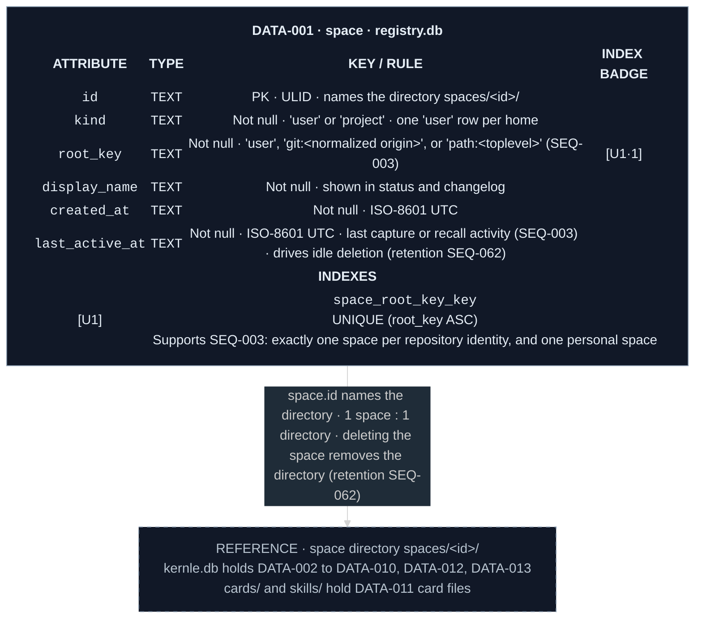

# Spaces data model

`registry.db` in the Kernle home (`ARCH-009`) holds one table. Each space's own
data lives in its directory `spaces/<id>/`, which holds `kernle.db`, cards,
skills, and changelog. The other modules own those entities.

Legend: green `U` = unique index. `·1` = first key column.

## Current rationale

- The registry is separate from space databases because resolving a request's
  space must happen before any space database is chosen. Idle-space deletion
  must also be able to delete a whole space without that space's database
  deleting its own registry entry.
- `root_key` is unique so concurrent first requests from two agents in a new
  repository resolve to the same space rather than splitting its memory.
- `last_active_at` lives in the registry because idle deletion considers every
  space, including spaces whose databases are never opened during an idle year.
