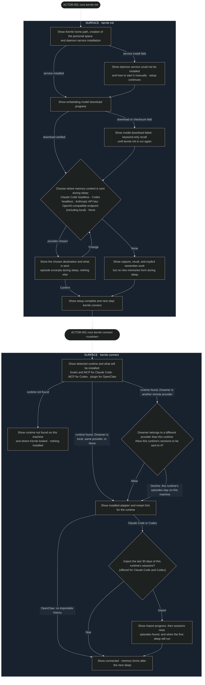
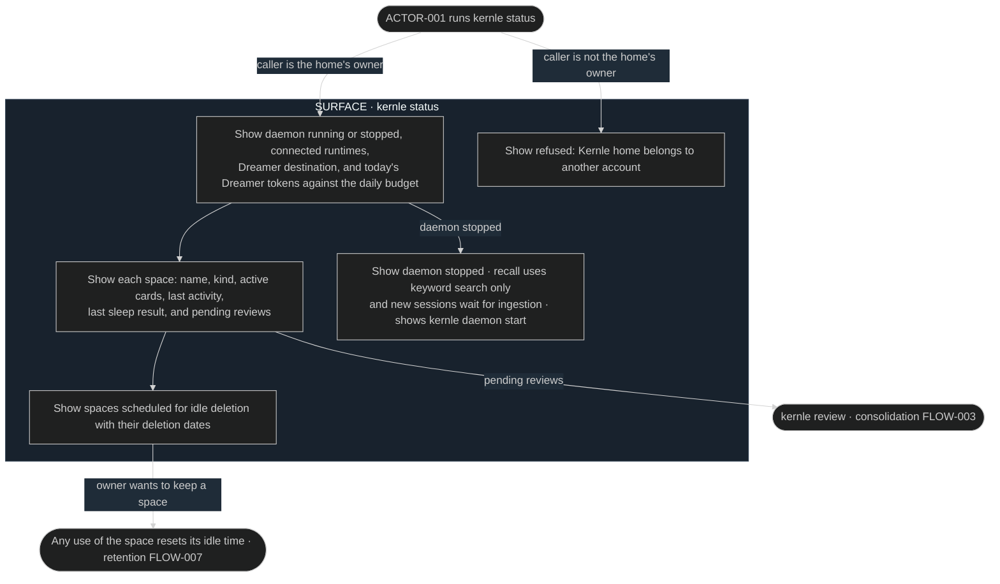

# Spaces user flows

The spaces module owns installation, runtime connection, and status. All
surfaces are terminal output from the `kernle` CLI (`ARCH-007`). No graphical
mockups exist. The message content and choices shown in each surface are the
design target.

## FLOW-001 Set up Kernle and connect a runtime

`kernle init` runs [SEQ-001](../sequences/sequences.md#seq-001-initialize-kernle-home).
`kernle connect` runs [SEQ-002](../sequences/sequences.md#seq-002-connect-a-runtime),
which can start a history import through
[capture SEQ-012](../../capture/sequences/sequences.md#seq-012-import-history).

## FLOW-002 Check memory status

`kernle status` reads the registry and space databases and asks the daemon for
its health. [SEQ-003](../sequences/sequences.md#seq-003-resolve-space-and-authorize-a-request)
authorizes the request.

Review opens [consolidation FLOW-003](../../consolidation/experience/user-flows.md#flow-003-review-memory-changes).
Idle deletion is owned by [retention FLOW-007](../../retention/experience/user-flows.md#flow-007-idle-space-deletion-notice).

## Current rationale

- Setup asks where memory content will be sent before anything is captured,
  because that destination is the only place private session content can leave
  the machine. The owner must choose it knowingly.
- "None" is a complete, usable choice because some owners want no model to
  ever see their sessions. Capture, recall, and explicit remember still work,
  and the screen says plainly that sleep forms no new memories.
- Connecting asks separately before sending one runtime's sessions to another
  provider. Owners already share a runtime's sessions with that runtime's own
  provider, but not necessarily with a different one.
- Import is offered at connect time because a new install otherwise remembers
  nothing until weeks of use have passed. Runtimes keep recent session records
  that can seed memory immediately.
- Failures in service installation or model download do not stop setup,
  because each has a degraded but working mode. The surface names that mode and
  the way back.
- Status shows upcoming idle deletions because deletion is real and
  irreversible. The owner must be able to see it coming.
