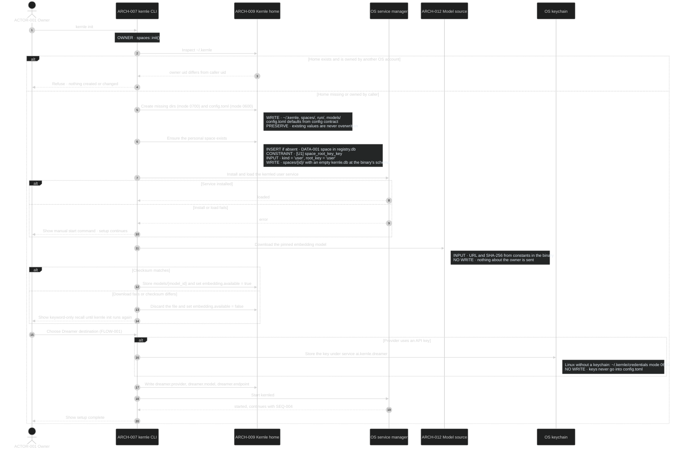
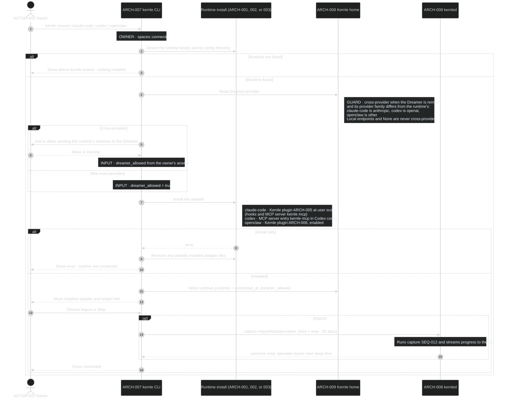
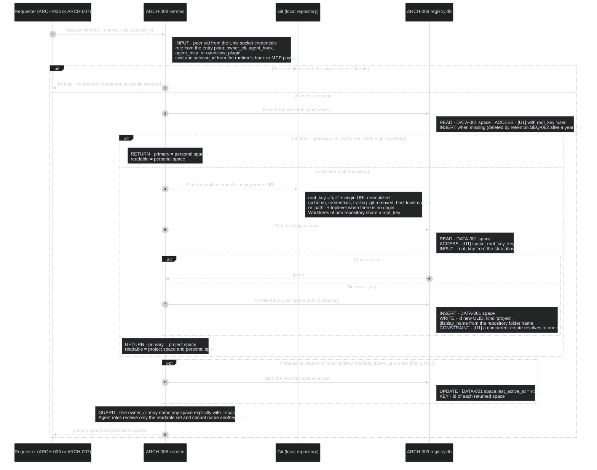
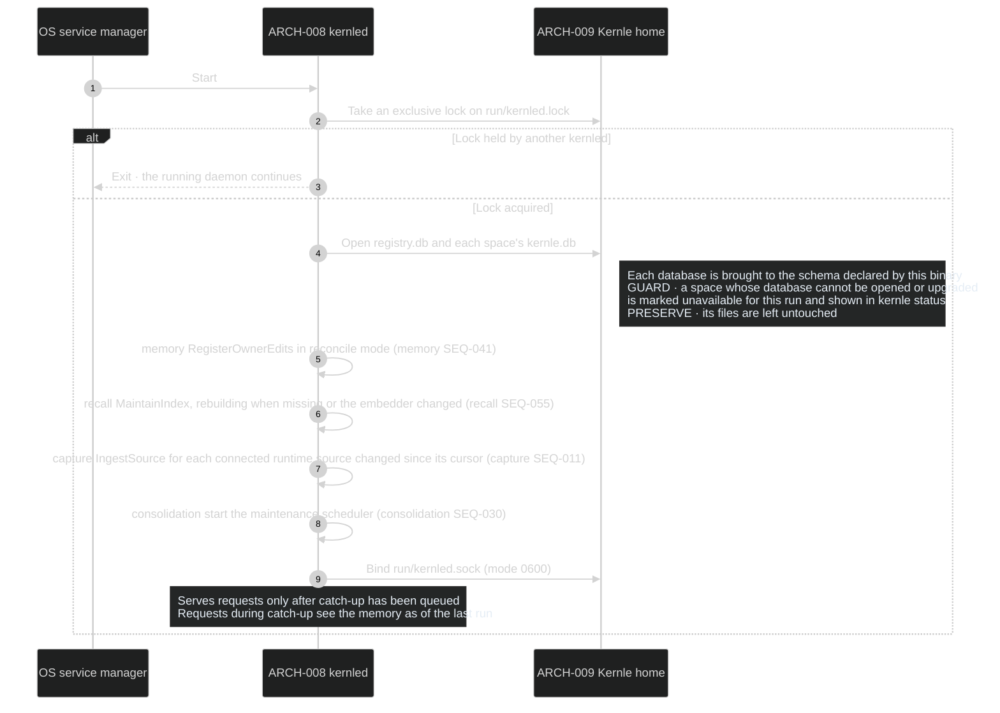

# Spaces sequences

The spaces module owns the Kernle home (`ARCH-009`), the space registry
([DATA-001](../data/data-model.md)), owner-only access, runtime connection, and
the daemon lifecycle (`ARCH-008`). Rust module `spaces` in the `kernle` binary
owns these processes.

## Public boundary

| Operation | Callers | Result and guarantees |
| --- | --- | --- |
| [ResolveSpace](#seq-003-resolve-space-and-authorize-a-request) | Every hook, MCP, plugin, and CLI request | Refusal unless the caller is the home's owner. Otherwise the request's primary space and readable spaces. Agent requests can never read spaces outside the current project and the personal space |
| Runtime connection record | [capture SEQ-010](../../capture/sequences/sequences.md#seq-010-handle-a-runtime-hook-event), [consolidation SEQ-031](../../consolidation/sequences/sequences.md#seq-031-sleep-run) | `config.toml` `runtimes.<runtime>` keys from [config contract](../contracts/config.yaml). `dreamer_allowed = false` means no episode from that runtime is sent to the Dreamer |
| Daemon availability | All modules | Exactly one daemon per Kernle home. Space databases are written only by the daemon while it runs |

## SEQ-001 Initialize Kernle home

Runs from [FLOW-001](../experience/user-flows.md#flow-001-set-up-kernle-and-connect-a-runtime).
`kernle init` is idempotent: it creates only what is missing.

**DCL:** 3 (product default)

### Current rationale

- Init is idempotent and never overwrites existing values. Owners rerun it to
  recover from a failed download or service install, and rerunning must not
  reset choices.
- The model checksum is pinned in the binary. Otherwise a compromised download
  could substitute a model that runs inside the daemon on every recall.
- API keys live in the OS keychain because `config.toml` is meant to be readable
  and editable. Keys in it would leak through backups, screenshots, and agents
  that read files.

## SEQ-002 Connect a runtime

Runs from [FLOW-001](../experience/user-flows.md#flow-001-set-up-kernle-and-connect-a-runtime).

**DCL:** 3 (product default)

### Current rationale

- Kernle installs a declared adapter (plugin or MCP entry), not hand-edited
  hook settings, because runtimes manage and update their own plugin and MCP
  configuration. Owners can then also remove Kernle with the runtime's tools.
- A failed install removes partial adapter files. A half-installed hook
  configuration can call Kernle in a broken way from inside the agent's
  critical path.
- The cross-provider choice is recorded per runtime because the privacy
  question is "who may see this runtime's sessions", and runtimes differ.

## SEQ-003 Resolve space and authorize a request

Every request that reads or writes memory first passes through this process:
hook handling, MCP tools, the OpenClaw plugin, and owner commands. Rust
function `spaces::resolve()` owns it.

**DCL override:** 4 — this step runs inside the agent's hook deadline, so it must
answer quickly and fail open on every call.

### Current rationale

- The access boundary is the OS account that owns `~/.kernle`. Every Kernle
  file is readable only by that account, and the daemon rejects other socket
  peers. Agents run under the owner's account, so an agent with shell access
  can reach anything the owner can. Kernle's owner and agent roles therefore
  set default behavior, not a security wall. The guards that matter against a
  misbehaving agent live in the processes that write or delete memory.
- An agent sees only the current project's space and the personal space.
  Otherwise memories from one client's repository could appear in another
  client's work.
- The project identity comes from the origin remote. Separate clones and
  worktrees of the same repository should share their experience, and a
  folder rename should not lose it.
- OpenClaw sessions use the personal space because a personal agent's
  experience concerns the person, not a repository.
- `last_active_at` is updated at most hourly, because idle deletion needs only
  day precision and a write on every hook call would contend with the daemon's
  other work.

## SEQ-004 Daemon start and catch-up

Runs whenever the service manager starts `kernled`: at login or boot, after
`kernle init`, or after `kernle daemon start`. Rust function `daemon::run()`
owns it.

**DCL:** 3 (product default)

### Current rationale

- One daemon per home, enforced with a file lock, because two daemons would be
  two writers to every space database. Duplicated runs would create duplicate
  memories.
- Catch-up ingestion at start lets a missed hook or a stopped daemon delay
  memory without losing it. The runtimes keep their session records, so
  nothing needs to be replayed from Kernle's side.
- A space that cannot be upgraded stays untouched and visible as unavailable.
  Repairing it automatically could destroy memory, so the owner must see it
  instead.
