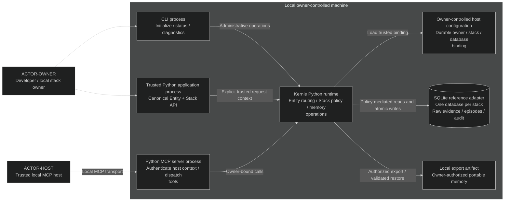

# Stack context

Kernle is an embedded memory runtime. The developer operates one owner-bound
SQLite database per stack. The Python package supports Python 3.10–3.12. No
external account, provider, model, network service, or background daemon is
required for the [local alpha](../product.yaml).

## Ownership and trust boundaries

- [`Entity`](../../../../kernle/entity.py) owns stack attachment, selection, and routing.
  [`Stack`](../../../../kernle/stack/sqlite_stack.py) owns the public memory boundary.
  All hosts and Python entrypoints use that same path.
- [`SQLiteStorage`](../../../../kernle/storage/sqlite.py) owns physical persistence.
  [`schema.py`](../../../../kernle/storage/schema.py) owns initialization and schema
  transitions. The adapter is an internal persistence boundary, not a second
  public application API.
- A trusted local host binds the stack's owner principal before handling memory
  calls. Request context carries authenticated requester, owning entity, selected
  stack, operation, and relevant context. An arbitrary tool argument, imported
  field, or string such as `source="kernle:anything"` cannot grant identity or an
  internal capability. Missing or unauthenticated context fails closed.
- Policy applies before any public content or metadata leaves the runtime and
  before any mutation. Getters, search, diagnostics, serializers, and direct
  Stack entrypoints obey the same policy. SQLite filters reinforce this boundary.
- Local process and filesystem control are the trust root. This contract does
  not isolate memory from malicious code already running with the owner's
  unrestricted filesystem or in-process access. It does separate an agent's
  tool arguments and memory content from the trusted host's identity.
- The authoritative binding persists in owner-controlled local host configuration
  outside memory exports: `stack_id`, `owner_entity`, and the resolved local
  database path. Initialization establishes it, and both CLI and MCP/SDK hosts
  reload it across restarts. Memory calls cannot mutate it. An export manifest
  or a request cannot supply a replacement owner for an existing binding.
- Stack selection uses validated identifiers and that explicit storage binding.
  Path traversal, ambiguous normalized identifiers, or an existing database
  bound to a different stack or owner are refused. Equal record IDs in different
  stack databases remain independent.
- The export file contains private memory. Its location is owner-selected;
  export, inspection, and restore use the same ownership policy as retrieval.
  There is no automatic upload or second synchronized store.

## Local operation and recovery

A successful mutation includes its required provenance and audit changes in the
same transaction. Transactions are scoped to the selected stack and exclude
external work. Independent stacks need no global memory lock. A write conflict
or unavailable database produces a visible failure; it does not discard raw
input or claim completion.

An unsupported database opens in an actionable unavailable state without data
reset. A supported schema change commits its data and version together, or
preserves both at the previous valid state. No compatibility promise for an
unspecified legacy release follows from the local alpha contract.

Detailed order and failure behavior belong to
[the runtime sequences](../sequences/sequences.md); persisted memory meaning
belongs to [the data model](../data/data-model.md).

## Current rationale

A single Entity/Stack boundary is necessary because separate host and SDK
implementations can disagree about ownership and provenance. SQLite is the
reference adapter for this local release because capture and retrieval must
remain usable offline. Keeping storage behind the runtime preserves the
protocol boundary without requiring additional adapters in this release.

A database per stack keeps collisions and transaction failures within one
owner-bound memory store. MCP keeps the selected host within the Python
runtime; the small CLI gives the developer a direct setup and diagnostic path.
Atomic changes preserve evidence when an operation cannot finish.
