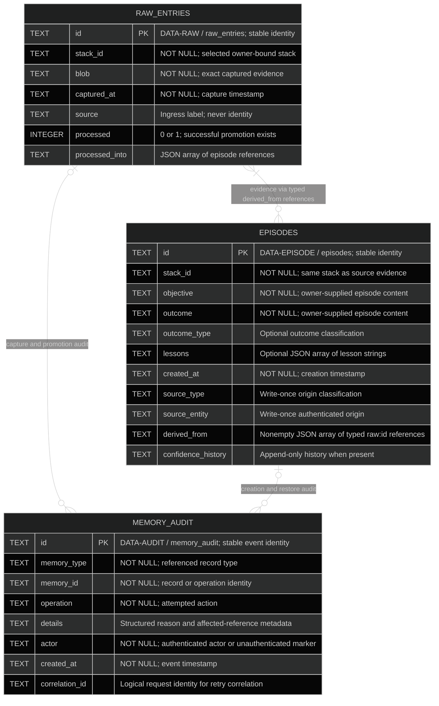

# Memory, ownership, and provenance

These are the product-significant persisted fields of the
[local alpha](../product.yaml). Physical SQLite names follow
[`schema.py`](../../../../kernle/storage/schema.py). This view owns memory meaning and
constraints; [the sequences](../sequences/sequences.md) own operation order.
Incidental compatibility, sync, and cognitive fields are not part of this
release contract.

The owner and database identity are anchored by the durable local host
configuration described in [stack context](../architecture/stack-context.md#ownership-and-trust-boundaries),
not by the current request or imported manifest.

Each record audit event identifies one typed parent. Operation-level events
can have neither a raw nor episode parent. Every retained raw record requires
its original capture event even though the polymorphic diagram permits other
audit categories.

Relationships above are logical typed references, not a claim that JSON arrays
are SQL foreign keys. An episode may cite several raw entries; each cited entry
must exist in the same authorized stack. Record identities are unique within
their owning table and database. Equal IDs in different stack databases do not
identify the same memory. No additional physical index is required by this
product contract.

## DATA-RAW — raw_entries

Raw evidence records what the caller supplied, not a verified fact about the
world. The runtime controls its capture time and ingress label. The associated
capture audit's authenticated `actor` supplies the origin identity; a text
`source` label is never proof of that identity. Export and restore retain that
origin evidence alongside the raw record.

Ordinary operations do not edit the captured `blob`, identity, timestamp, or
origin. Deliberate promotion may append to `processed_into` and set `processed`
only with the target episode and audit event in the same commit. These fields
report completed derivation; they do not delete the source or prevent another
explicitly requested episode from citing it.

## DATA-EPISODE — episodes

An episode is an explicit interpretation of saved raw evidence. The caller
supplies its objective, outcome, optional outcome classification and lessons,
and selected source references. The runtime assigns authenticated origin and
records the derivation. User text cannot claim an internal source or change the
identity that performed promotion.

`source_type` and `source_entity` are write-once through ordinary operations.
`derived_from` and `confidence_history` cannot be shortened or rewritten.
References use typed identities such as `raw:abc` and resolve within the same
stack. They cannot form a cycle or cite nonexistent evidence. A provenance
chain records how an interpretation was created; it does not certify that its
content is true.

In-place episode editing, individual deletion, and privileged origin repair are
outside the local alpha's public operations. Such operations cannot be smuggled
through create or restore.

## DATA-AUDIT — memory_audit

Required write audit events commit with the associated memory changes. They
retain the authenticated actor, action, affected identity, time, outcome/reason,
and correlation identity. Ordinary operations append events; they do not
rewrite prior origin or action history. Raw capture events are part of the
portable provenance record.

Denials expose only safe reason codes to the requester. Audit inspection is
owner-only. Audit detail excludes credentials and unnecessary copied memory
content. An audit storage failure is visible and cannot convert a denied
operation into an allowed one; if an allowed write cannot persist its required
audit, that write does not commit.

## Privacy and export constraints

All retained records, source references, and audit metadata are owner-only.
Public sharing grants, consent delegation, and cross-entity reads have no alpha
meaning. Nonempty sharing grants in an imported artifact cannot widen access.

The single local export includes format identification, owner and stack
binding, raw entries, episodes, and required provenance/audit information.
Restore validates the entire artifact and all references before changing an
empty destination. It preserves original capture and creation attribution and
appends a restore event identifying the current actor. Restore does not turn
imported records into newly witnessed experiences or accept a foreign owner.
The format is a portability contract, not a claim of protection from tampering
by an actor already controlling the local owner account.

## Current rationale

Raw evidence and episode interpretation remain distinct because an
interpretation must be inspectable against what was actually captured. Origin
and append-only lineage prevent routine operations from laundering that
interpretation into a different source. Owner-bound storage and policy on both
content and metadata prevent provenance links or search summaries from becoming
an access bypass. Keeping the source, target, and audit changes atomic prevents
failed promotion from leaving an unexplained or orphaned memory.
