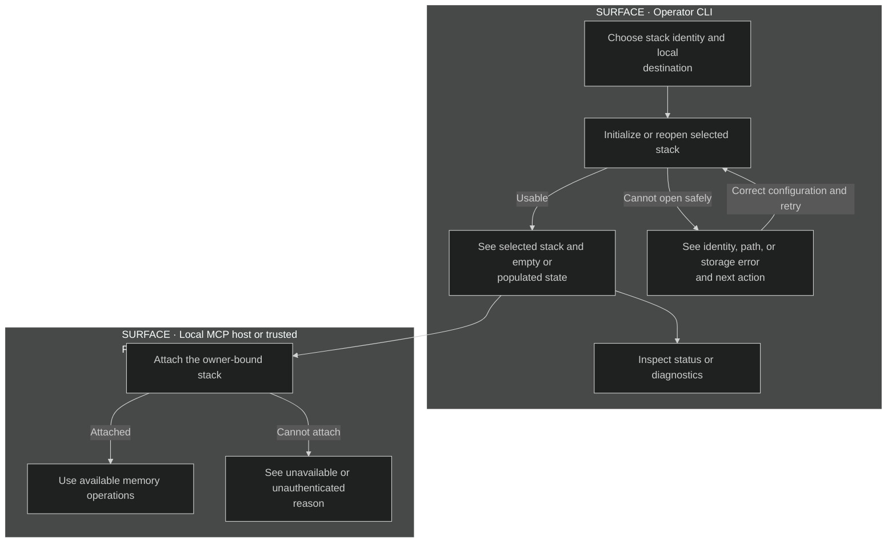
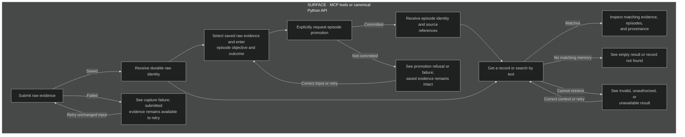
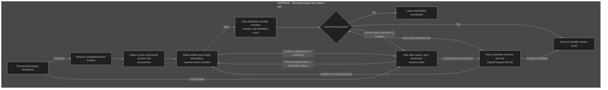

# User flows

The product surfaces are Python calls, MCP tools, and a small operator CLI.
There is no visual application or binding visual mockup. Each bounded surface
below defines its observable states. [Runtime sequences](../sequences/sequences.md)
own authorization, persistence, and recovery mechanics.

## FLOW-SETUP — establish a usable stack

Supports [CAP-SETUP](../product.yaml).

## FLOW-MEMORY — capture, interpret, and retrieve

Supports [CAP-CAPTURE and CAP-RETRIEVE](../product.yaml).

A denial never includes another owner's memory. A repeated committed request
returns its original result; it is distinguishable from a new write and from a
conflicting request. Structured errors identify whether the caller must correct
input, fix ownership or configuration, or retry storage access. No processing
or model-configuration step is required.

## FLOW-PORTABILITY — inspect an export and restore it

Supports [CAP-PORTABILITY](../product.yaml).

## Current rationale

The CLI concentrates on setup and diagnosis because a second application
command surface would duplicate memory behavior. MCP and Python expose the same
memory outcomes. Capture and explicit promotion are separate choices because
saving evidence must not silently turn it into an interpretation. Restore has a
preview and explicit commit because the owner needs to understand the local
state change before authorizing it. Empty, denied, and failed outcomes stay
distinct so the caller can choose a useful next action.
