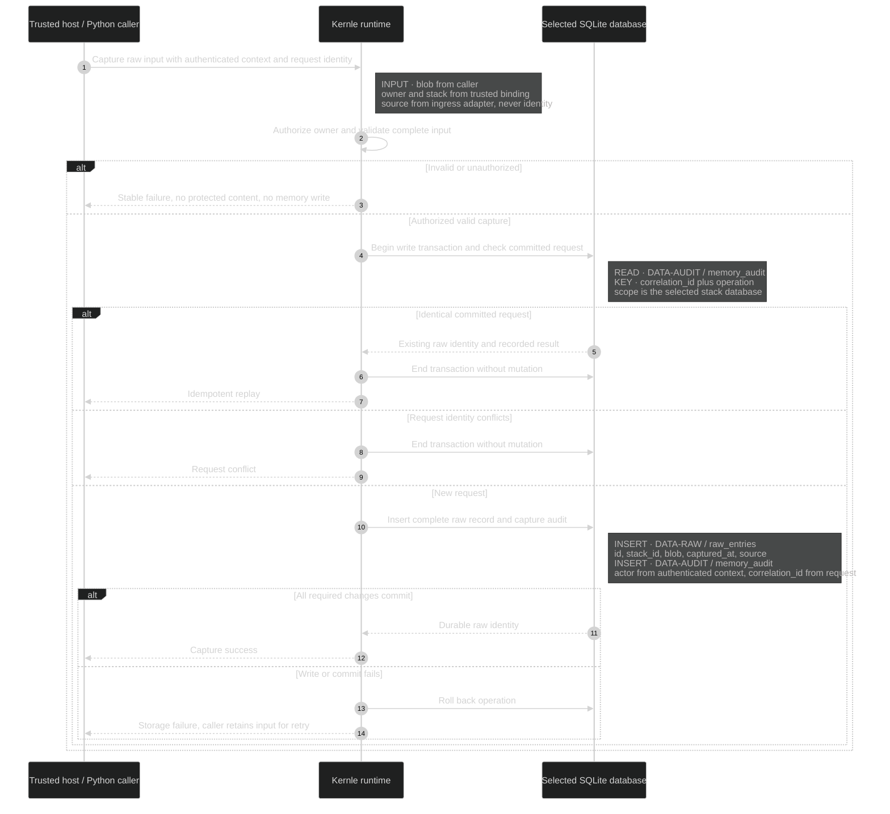
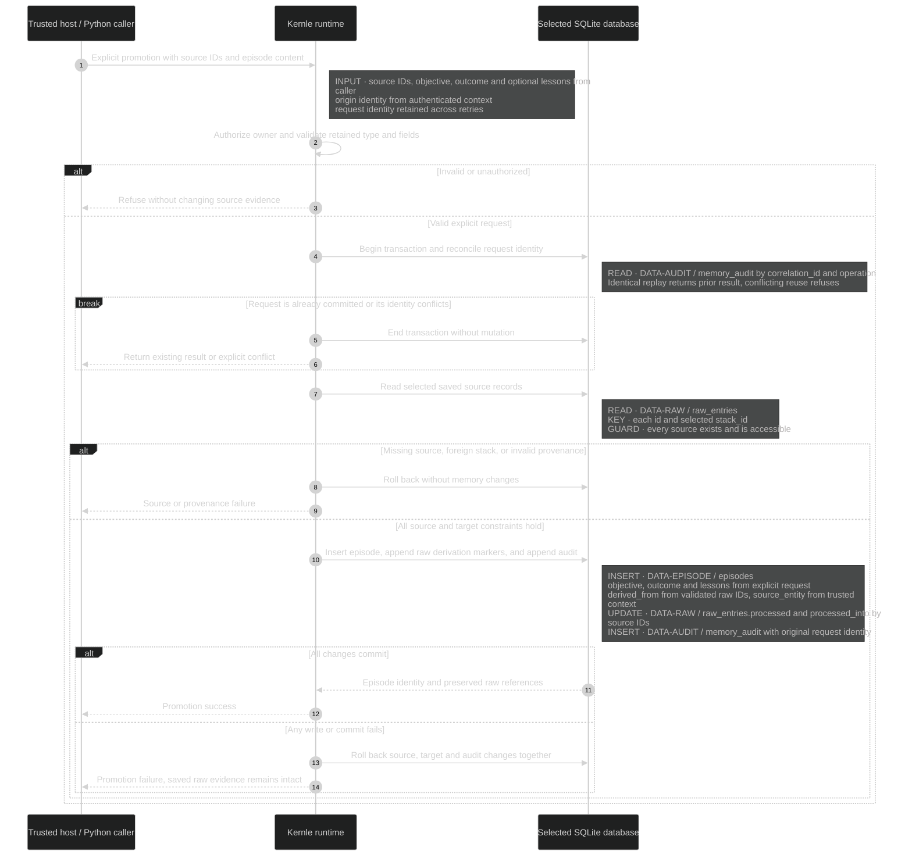
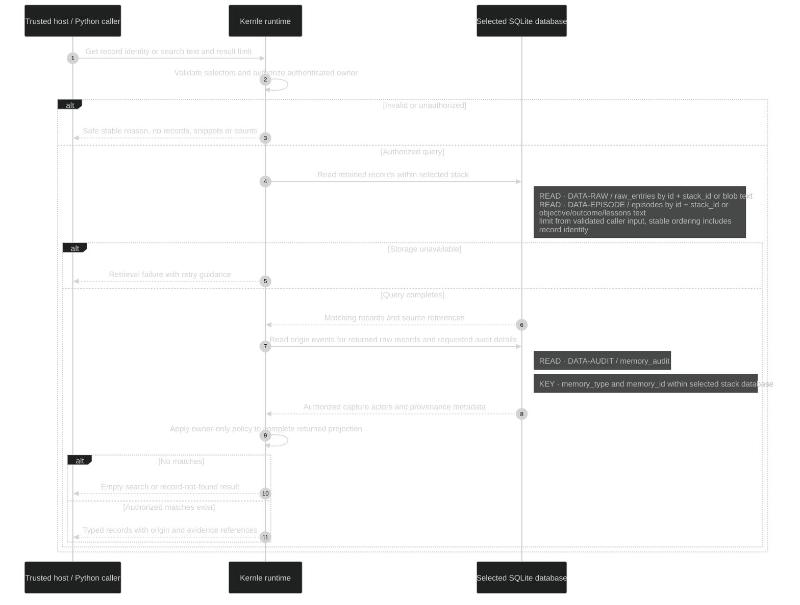
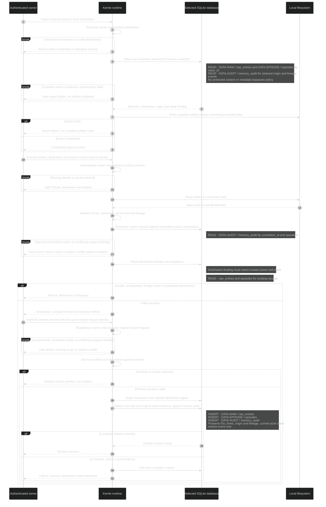

# Runtime sequences

[Stack context](../architecture/stack-context.md) owns placement and the trust
boundary. [The data model](../data/data-model.md) owns origin, ownership,
retention, and field constraints. [User flows](../experience/user-flows.md)
own visible outcomes. Each sequence uses the same Entity/Stack policy path.

## Common operation contract

The trusted host supplies authenticated requester, owner, stack binding, and
operation context. The public request supplies only the operation's content,
selectors, and logical request identity. Caller text is never authentication.
The runtime refuses omitted or forged identity before returning any protected
content or metadata. The owner-only decision applies to all retained surfaces,
including Stack calls, diagnostic output, serialization, and audit inspection.

Stable machine outcomes distinguish invalid input, unauthenticated requester,
access denial, missing record, empty results, identity/request conflict,
unavailable storage, invalid artifact, unsupported format/schema, and successful
commit or replay. Human output gives an applicable correction or retry action.
These are semantic outcomes; transport formatting belongs to the host adapter.

For mutations, the logical request identity comes from the host/API request and
is correlated through `DATA-AUDIT / memory_audit.correlation_id`. Audit `details`
retains the operation fingerprint and resulting identities without duplicating
raw content. Replay checks
match the operation, selected stack, and original content/effects. An identical
committed request returns its existing result; conflicting reuse fails. The
check and mutation share the selected stack's short write transaction so racing
requests cannot each create the same logical result. Arbitrary repeated content
with a new request identity is not silently discarded as duplicate experience.

Every denied memory operation produces a minimal owner-visible security audit
with the attempted operation, reason, correlation identity, and authenticated
actor or unauthenticated marker. It contains no copied request content. When a
trusted stack binding is known, the runtime appends that event to `DATA-AUDIT /
memory_audit` independently of the refused memory mutation. If no bound store
is available or audit persistence fails, the trusted host receives a safe
diagnostic on its local operator output; access remains denied. Successful
reads need no blanket access log. Each refusal branch below applies this rule.

No automatic unbounded retry is required. When an outcome is uncertain, retry
with the original request identity so the runtime can reconcile a prior commit.
A caller corrects invalid input or ownership before retrying. A denied operation
never becomes allowed because audit logging or storage is unavailable.

## SEQ-CAPTURE — durable raw evidence

**DCL:** 3 (product default).

Owners: [`Entity.raw`](../../../../kernle/entity.py),
[`Stack.save_raw`](../../../../kernle/stack/sqlite_stack.py), and
[`raw_entries.save_raw`](../../../../kernle/storage/raw_entries.py).

Validation refuses unsupported input rather than silently truncating evidence.
The durable alpha record lives in SQLite; an auxiliary file or index cannot be
an independently acknowledged capture. A derived index failure cannot produce
a successful but unretrievable logical record. Input content is never executed
as a policy instruction.

## SEQ-PROMOTE — explicit raw-to-episode interpretation

**DCL:** 3 (product default).

[`Entity`](../../../../kernle/entity.py) owns the explicit promotion operation.
[`Stack`](../../../../kernle/stack/sqlite_stack.py) owns authorization and provenance
validation; [`episodes_crud`](../../../../kernle/storage/episodes_crud.py) owns episode
persistence within the operation's transaction. Promotion has no model call or
automatic cognitive pipeline.

The caller's explicit invocation is the promotion decision. No second human
approval queue or background promotion is implied. A direct episode save that
omits the same authorization and saved-evidence checks is not another public
write path. Unsuccessful promotion never marks its source as successfully
processed.

## SEQ-RETRIEVE — authorized get and text search

**DCL:** 3 (product default).

[`Entity.search`](../../../../kernle/entity.py) and
[`Stack.search`](../../../../kernle/stack/sqlite_stack.py) own routed search; the Stack
owns direct getters through the same policy boundary.

Text retrieval is deterministic for the same saved state and query. It does not
require embeddings, network fallback, or a semantic-quality claim. Source links
and audit details cannot expose data that the caller could not retrieve
directly. Search cannot change the selected stack based on memory content.

## SEQ-PORTABILITY — one export and restore workflow

**DCL:** 3 (product default).

[`Stack.export`](../../../../kernle/stack/sqlite_stack.py) owns export orchestration;
[`Entity`](../../../../kernle/entity.py) owns restore orchestration through Stack
policy. [`serializers`](../../../../kernle/core/serializers.py) and
[`importers`](../../../../kernle/importers/) supply serialization and parsing within
that boundary. Normal restore has no origin-repair capability.

The commit remains owner-authorized even after preview. Repeating the same
completed restore request returns its recorded result; it does not merge the
artifact into an already populated destination. Missing lineage, duplicate or
conflicting identities, unsupported retained types, and incompatible owner
claims are invalid artifacts. A complete preview is not permission to repair
origin, transfer ownership, erase records, or overwrite existing memory.

## Current rationale

Authentication precedes both reads and writes because filtering only a primary
query leaves alternate surfaces and metadata exposed. One transaction binds
promotion to its source and audit evidence because partial writes could
otherwise claim an interpretation exists when its evidence or origin is absent.
Request reconciliation is necessary because a host can lose a successful reply
and retry. Explicit promotion makes the local workflow useful without depending
on an inference service. Snapshot export and validated atomic restore preserve
a coherent evidence graph across local installations.
